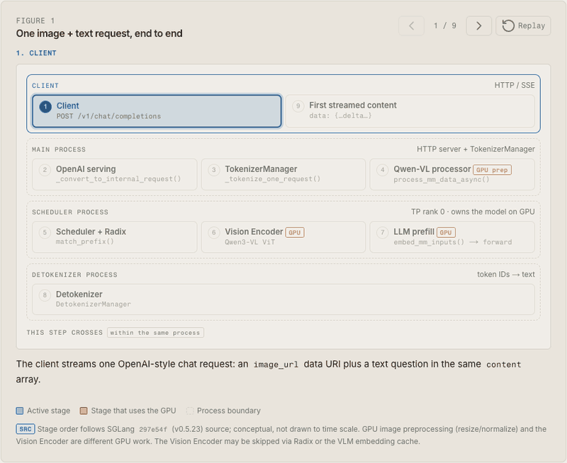
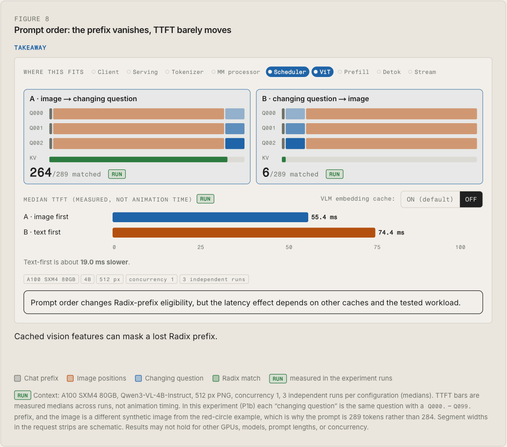
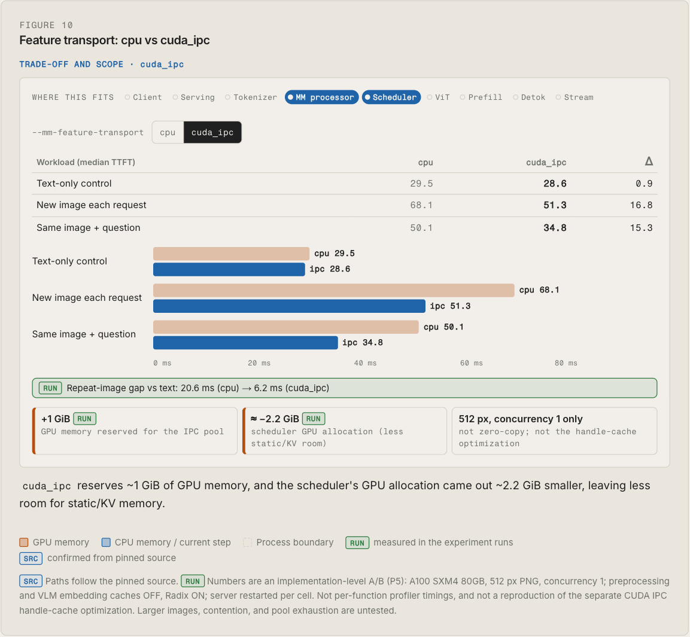

# From Image Bytes to the First Token: Tracing a Qwen3-VL Request Through SGLang

**Article:** https://alvislu.com/blog/qwen3-vl-request-trace

> **Environment:** 1× NVIDIA A100-SXM4-80GB · driver 595.91.07 (CUDA 13.2) · CUDA runtime 13.0 (PyTorch build) · Python 3.12.16 · PyTorch 2.14.1+cu130 · SGLang v0.5.23 ([`297e54f`](https://github.com/sgl-project/sglang/tree/297e54fd105e974cdf401e5b4d20253a22c16f90)) · `Qwen/Qwen3-VL-4B-Instruct` @ `ebb281e`. Versions were recorded once at the start; driver and library versions were not re-checked after later machine restarts.



After tracing a text-only request through Mini-SGLang, I wanted to explore how the full SGLang serving stack handles multimodal inputs. Multimodal inference introduces additional steps: image decoding and preprocessing, constructing visual token positions, transferring image data between processes, and running the Vision Encoder when needed.

These stages can be traced through SGLang's source code, but I also wanted to understand how they fit together at runtime and which parts contribute to the time before the first generated token.

So I followed one Qwen3-VL-4B-Instruct request, a 512 × 512 PNG plus a question, from the OpenAI-compatible endpoint to the first streamed token. I traced each stage through the pinned SGLang source, then ran small controlled experiments on one A100 to measure what the code alone could not show.

The result is an interactive article with ten step-through figures. This page is a short guide to it. The source tracing, all of the experiments, and the figures themselves are in the article.

## What You'll Learn

- **The request path:** HTTP API → OpenAI serving layer → `TokenizerManager` → Qwen-VL multimodal processor → scheduler → model runner → detokenizer, and which process each stage runs in.
- **Five representations that are easy to mix up:**
  - the image bytes;
  - the single `<|image_pad|>` placeholder from the chat template;
  - the visual positions it expands into (256 for this image, derived from the processor configuration);
  - `pixel_values`;
  - the visual embeddings produced by the Vision Encoder.
- **Vision Encoder vs. preprocessing:** why GPU image preprocessing in the main process is not the Vision Encoder, how visual embeddings enter the LLM's prefill, and when the Vision Encoder can be skipped.
- **Caching and feature transport:** Radix prefix reuse, the VLM embedding cache, and multimodal feature transport each save different work.

## How to Explore

- **Figure 1** is the end-to-end lifecycle shown above. Each stage links to the section that explains it.
- **Figures 2–6** follow the image/text split and the placeholder expansion.
- **Figure 7** compares a new image with a repeated one.
- **Figures 8–10** present the experiments below, with the measured numbers for each setting.

Every figure also has a text version.

## What I Measured

Each result below is the median of three independent runs, each on a fresh server. The explanations below are inferred from the pinned source and these measurements; I did not time those stages directly.

### Prompt order and two layers of caching

I tested whether placing the same image before or after 100 slightly different questions would affect caching and latency.

**What happened?**

- **Radix Cache:** Image-first reused 264/289 tokens, while question-first reused only 6/289, because Radix matches tokens from the start of the prompt.
- **Embedding cache on:** TTFT stayed roughly the same (56.0 vs. 54.4 ms).
- **Embedding cache off:** Question-first was about 19 ms slower (55.4 vs. 74.4 ms).

**Why?**

The two caches save different work. Radix reuses KV states from the prompt prefix, while the embedding cache reuses visual features from the same image, regardless of prompt order.

This suggests that even when Radix cannot reuse the image's KV states, SGLang may still skip running the Vision Encoder. I confirmed the caching behavior in the source code but did not measure Vision Encoder time directly.



### `cpu` vs `cuda_ipc` feature transport

I wanted to see whether moving image data between processes affects latency, even when most tokens are already cached. I compared `cpu` and `cuda_ipc` transport with preprocessing and embedding caches disabled.

**What happened?**

- **Repeated image:** Even with 283/284 tokens cached by Radix, TTFT dropped from 50.1 to 34.8 ms (**15.3 ms faster**).
- **New image:** TTFT improved from 68.1 to 51.3 ms (**16.8 ms faster**).
- **Text-only:** Almost no difference (29.5 vs. 28.6 ms).

**Why?**

With `cpu` transport, image data moves from GPU to CPU memory before reaching the scheduler. With `cuda_ipc`, the data stays on the GPU, avoiding that extra transfer.

This likely explains much of the improvement, although I didn't measure the transfer time directly.

**Trade-off:** `cuda_ipc` reserves a 1 GiB GPU pool. In my runs, the available KV cache capacity was about 4% smaller.



## Method and Limitations

**Workload.** `POST /v1/chat/completions` with streaming, `temperature=0`, `max_tokens=32`, and concurrency 1. Images are deterministic synthetic 512 × 512 PNGs.

**Method.** Each configuration and scenario ran three times, each on a fresh server: 20 warm-up requests, then 100 measured requests. TTFT is the client-side time to the first non-empty streamed chunk; I report the median of the three per-run medians over measured requests 2–100.

**Request counts.** The two experiments above used 3,000 measured requests (3,600 including warm-up), with no request errors.

```bash
python3 -m sglang.launch_server --model-path Qwen/Qwen3-VL-4B-Instruct \
  --revision ebb281ec70b05090aa6165b016eac8ec08e71b17 --enable-cache-report
# embedding cache off:  SGLANG_VLM_CACHE_SIZE_MB=0
# transport A/B:        --mm-preprocess-cache-size-mb 0 --mm-feature-transport {cpu,cuda_ipc}
```

**Limitations:**
- **Scope:** one A100, 512 px synthetic images, concurrency 1. For Qwen3-VL on Hopper GPUs with ≥60 GB, SGLang turns the embedding cache off by default.
- **Statistics:** three runs per cell give medians and ranges, not confidence intervals.
- **Not measured directly:** no profiler was run, and SGLang exposes no preprocessing-cache hit/miss counter. Rendered token IDs were not logged, so the split into 256 visual positions comes from source and configuration.
- **Answer quality:** zero request errors is not zero answer errors. Exact-text OCR accuracy was 0–3%, so answer checks used shape and colour only.

## License

This note is licensed under CC BY-NC-SA 4.0, the same as the course text.
