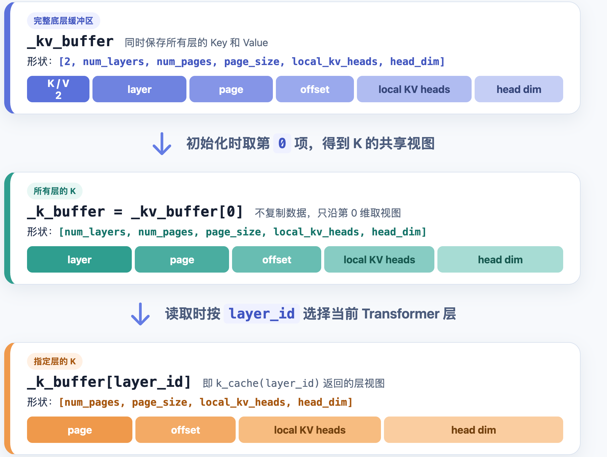

# 第 4 章 KV Cache 优化（代码走读）

上一章说明了 KV Cache 能避免 Decode 重算历史 token。本章继续回答一个更具体的问题：**这一轮新算出的 K/V 放到哪里，下一轮又怎样把它找回来？**

在 mini-sglang 中，系统需要同时处理三件事：保存真正的 K/V 张量；记录每个 token 应该写到哪里；决定哪些已经写好的位置可以给后续请求复用。

## 1 本章学习目标

完成本章后，你应该能够知道以下流程：

1. 新算出的 K/V 在 GPU 上的存放位置。
2. 一个请求怎样找到自己某个 token 的 K/V？
3. 一段已经算好的 K/V 什么时候可以给另一个请求复用？

## 2 KV Cache 读写涉及的源码模块

本章参考的代码主要位于 mini-sglang 的 `python/minisgl/` 目录。先按职责认识这些文件，后面读流程时才不会在不同模块之间迷路。

**1. 接口与入口**

| 文件 | 作用 |
|---|---|
| `kvcache/base.py` | 定义物理 KV 池的读写抽象接口 |
| `kvcache/__init__.py` | 创建 KV 池，并注册缓存策略 |

**2. 存储与初始化**

| 文件 | 作用 |
|---|---|
| `kvcache/mha_pool.py` | 在 GPU 上存放各层 K/V 张量，提供按层读取和写入接口 |
| `engine/engine.py` | 启动时初始化 KV 池、全局 `page_table` 等运行时对象 |

**3. 状态与调度**

| 文件 | 作用 |
|---|---|
| `core.py` | 记录请求进度和本轮需要写入 KV 的逻辑范围 |
| `scheduler/cache.py` | 分配与回收页，管理前缀缓存 |
| `scheduler/prefill.py` | Prefill 时匹配并锁定可复用的前缀 |
| `scheduler/scheduler.py` | 组织 batch，确定本轮 K/V 写入位置，清理结束的请求 |

**4. 计算**

| 文件 | 作用 |
|---|---|
| `attention/fa.py` | 在 Attention 前向过程中读写 K/V Cache 并完成注意力计算 |

整条链路可以先记成三步：

1. Scheduler 为这一轮要计算的 token 准备物理位置。
2. Attention 把新 K/V 写入这些位置，再读取需要的历史 K/V。
3. 请求结束或暂时离开 batch 时，系统保留可复用的位置，归还其余位置。

## 3 K/V 存储、位置映射与前缀复用

要读懂 KV Cache，先不要急着看分页和调度。我们需要先回答四个问题：**K/V 放在哪里？请求怎样找到它？已经写好的位置怎样复用？谁来分配和回收位置？**

| 组件 | 它解决的问题 | 核心数据 |
|---|---|---|
| `MHAKVCache` | K/V 浮点张量放在哪里 | `_kv_buffer`、每层 K/V view |
| `page_table` 与 `Batch.out_loc` | 这轮 token 应该写到哪个物理位置 | `int32` 物理位置索引 |
| `BasePrefixCache` | 已经算好的前缀能否给另一个请求使用 | `BaseCacheHandle`、`cached_len`、匹配的 indices |
| `CacheManager` | 哪些页可分配、哪些页可回收 | `free_slots`、页分配和回收 |

`MHAKVCache` 只保存数值。它不知道某个位置属于哪个请求，也不关心 token ID 是什么。Scheduler 通过 `out_loc` 告诉它把这几行 K/V 写到哪里。

前缀缓存也不保存 K/V 浮点数。它记录的是某段 token 已经对应哪些物理位置。这样，同一份 K/V 可以被多个请求通过各自的 `page_table` 行找到。

### 3.1 物理 KV Cache 的按层读取

Attention 只需要对物理 KV 池做三件事：取当前层的 K、取当前层的 V、把本轮新算出的 K/V 写进去。`BaseKVCachePool` 把这三个动作定义成统一接口：

```python
# python/minisgl/kvcache/base.py（节选）
class BaseKVCachePool(ABC):
    @abstractmethod
    def k_cache(self, index: int) -> torch.Tensor: ...

    @abstractmethod
    def v_cache(self, index: int) -> torch.Tensor: ...

    @abstractmethod
    def store_kv(
        self, k: torch.Tensor, v: torch.Tensor, out_loc: torch.Tensor, layer_id: int
    ) -> None: ...

    @property
    @abstractmethod
    def device(self) -> torch.device: ...

    @property
    @abstractmethod
    def dtype(self) -> torch.dtype: ...

    @property
    @abstractmethod
    def num_layers(self) -> int: ...
```

前三个方法对应实际读写：

- `k_cache(layer_id)`：取得指定层的 K 缓存。
- `v_cache(layer_id)`：取得指定层的 V 缓存。
- `store_kv(k, v, out_loc, layer_id)`：把本轮新算出的 K/V 写到指定位置。

后三个属性说明这块池运行在哪里、使用什么数据类型、包含多少层。后文重点关注前三个读写操作。

这个接口不处理请求逻辑。它只知道第几层和写到哪个 slot。某个请求能用哪些 slot，由 `page_table` 决定；这些 slot 能否给别的请求复用，由前缀缓存决定。

### 3.2 前缀缓存策略如何复用已有 K/V 位置

系统还要决定，已经写好的 K/V 能不能给后续请求直接使用。`kvcache/__init__.py` 一边创建物理 KV 池，一边注册这种复用策略：

```python
# python/minisgl/kvcache/__init__.py（节选）
def create_kvcache_pool(model_config, num_pages, page_size, dtype, device):
    from .mha_pool import MHAKVCache

    return MHAKVCache(
        num_kv_heads=model_config.num_kv_heads,
        num_pages=num_pages,
        page_size=page_size,
        num_layers=model_config.num_layers,
        head_dim=model_config.head_dim,
        device=device,
        dtype=dtype,
    )


@SUPPORTED_CACHE_MANAGER.register("naive")
def create_naive_cache(device: torch.device):
    return NaivePrefixCache(device=device)


@SUPPORTED_CACHE_MANAGER.register("radix")
def create_radix_cache(device: torch.device):
    return RadixPrefixCache(device=device)
```

`naive` 和 `radix` 不是两种 K/V 张量布局。无论选哪种策略，Attention 都读写同一个 `MHAKVCache`，接口也始终是 `k_cache`、`v_cache` 和 `store_kv`。

它们的区别只在于：已经写好的物理位置是否能匹配给后续请求。Radix 如何匹配、锁定和淘汰前缀，留到[第 8 章](./第8章_RadixAttention与前缀缓存_代码.md)再展开。

## 4 KV Cache 的物理存储与位置映射

### 4.1 MHAKVCache 保存各层 K/V

在任何请求开始前，系统要先准备一块 GPU 存储，容纳每一层随后算出的 K/V。`MHAKVCache` 一次性分配这块空间：

```python
# python/minisgl/kvcache/mha_pool.py（节选）
class MHAKVCache(BaseKVCachePool):
    def __init__(
        self,
        num_kv_heads: int,
        num_layers: int,
        head_dim: int,
        num_pages: int,
        page_size: int,
        dtype: torch.dtype,
        device: torch.device,
    ) -> None:
        tp_info = get_tp_info()
        local_kv_heads = div_even(num_kv_heads, tp_info.size, allow_replicate=True)
        self._kv_buffer = torch.empty(
            (2, num_layers, num_pages, page_size, local_kv_heads, head_dim),
            device=device,
            dtype=dtype,
        )
        self._num_layers = num_layers
        self._k_buffer = self._kv_buffer[0]
        self._v_buffer = self._kv_buffer[1]
        self._storage_shape = (num_pages * page_size, local_kv_heads, head_dim)
```

读这个形状时，可以从外到内看。先区分 K 和 V；再区分 Transformer 层；最后才定位到某页、某个 token、某个 KV 头的数值。

| 维度 | 含义 |
|---|---|
| `2` | 第 0 维区分 Key 和 Value |
| `num_layers` | 每个 Transformer 层各有一份 K/V |
| `num_pages` | 物理页数量 |
| `page_size` | 每页可容纳的 token 数 |
| `local_kv_heads` | 当前 tensor-parallel rank 持有的 KV 头数 |
| `head_dim` | 单个注意力头的维度 |

分布式运行时，一个 GPU 不一定保存全部 KV 头。代码先用 `get_tp_info()` 知道当前有多少个 tensor-parallel rank，再用 `div_even(..., allow_replicate=True)` 算出当前 rank 应保存的 `local_kv_heads`。因此，这块缓存的头数始终和当前 rank 的 Attention 计算一致。

当 Attention 要读取某一层的 K/V 时，它调用 `k_cache(layer_id)` 和 `v_cache(layer_id)`：

```python
# python/minisgl/kvcache/mha_pool.py（节选）
def k_cache(self, index: int) -> torch.Tensor:
    return self._k_buffer[index]


def v_cache(self, index: int) -> torch.Tensor:
    return self._v_buffer[index]
```

以读取 K 为例，系统先从总缓存中取出所有层的 K，再按 `layer_id` 取出当前层。下图展示了这两步切片，以及每一步保留下来的维度：

<div align="center">
  
  <p><em>图 4-8：从完整 KV Buffer 到指定层 K 张量的读取路径</em></p>
</div>

读取 V 的过程完全相同，只是从 `_kv_buffer[1]` 得到 `_v_buffer`。这些都是 view，不会复制数据。最终取得的张量形状是 `[num_pages, page_size, local_kv_heads, head_dim]`，四个维度依次表示页号、页内 token 位置、本地 KV 头和头内维度。

这个层视图包含当前层的所有物理页，但一个请求并不会读取全部位置。它具体使用哪些 token，由 `page_table` 和 Attention 的有效长度决定。即使两个层使用相同的物理 slot 编号，它们仍在不同的 `layer_id` 维度中，因此不会共享同一组 K/V 数值。

### 4.2 空闲页映射为可写入的 token slot

给新 token 分配缓存时，系统先要知道哪一整页还空着。`CacheManager` 用 `free_slots` 记录每个空闲页的起始 token slot：

```python
# python/minisgl/scheduler/cache.py（节选）
self.free_slots = torch.arange(num_pages, dtype=torch.int32, device=device) * page_size
```

例如 `page_size=4` 时，一个页起始 slot 对应连续 4 个 token 位置。假设当前有 3 个空闲页，`free_slots` 就是：

```text
[0, 4, 8]
```

| page start | 展开后的 token slot |
|---:|---|
| 0 | `[0, 1, 2, 3]` |
| 4 | `[4, 5, 6, 7]` |
| 8 | `[8, 9, 10, 11]` |

页要整体分配，但 Attention 最终要为每个 token 读写准确位置。因此，系统需要把页起始位置展开成 token slot。`_page_to_token` 就做这一步：

```python
# python/minisgl/scheduler/cache.py（节选）
def _page_to_token(self, pages: torch.Tensor) -> torch.Tensor:
    if self.page_size == 1:
        return pages
    offsets = torch.arange(self.page_size, device=self.device, dtype=torch.int32)
    return (pages.unsqueeze(1) + offsets).flatten()
```

本章只需要记住这一点：`free_slots` 按页记录空闲空间，`out_loc` 按 token 指向实际写入位置。页分配、碎片和 PagedAttention 的原理在[第 7 章](./第7章_PagedKVCache与显存管理.md)展开。

### 4.3 page_table 记录逻辑位置与物理位置的对应关系

物理 KV 池只负责保存数据，并不知道数据属于哪个请求。系统还需要回答：**某个请求的第几个 token 应该读写哪个物理 slot。** `Engine` 启动时会同时创建 KV 池和这张全局 `page_table`：

```python
# python/minisgl/engine/engine.py（节选）
self.num_pages = self._determine_num_pages(init_free_memory, config)
num_tokens = self.num_pages * config.page_size
self.ctx.kv_cache = self.kv_cache = create_kvcache_pool(
    model_config=config.model_config,
    num_pages=self.num_pages + 1,  # +1 for dummy page
    page_size=config.page_size,
    device=self.device,
    dtype=self.dtype,
)

self.max_seq_len = min(config.max_seq_len, num_tokens)
aligned_max_seq_len = _align_up_32(self.max_seq_len)
self.ctx.page_table = self.page_table = torch.zeros(
    (config.max_running_req + 1, aligned_max_seq_len),
    dtype=torch.int32,
    device=self.device,
)
```

这段初始化代码先按可用显存计算普通页数量，再创建 K/V 存储。接着，它为每个运行请求预留一行 `page_table`。这张表保存的是逻辑位置到物理 slot的关系。

有两个细节需要注意：

1. 物理 KV 池使用 `num_pages + 1`。多出的 1 页给 CUDA Graph 的 dummy request 使用；调度器管理的普通可用页仍是 `num_pages`。
2. `page_table` 的一行对应一个运行请求。表项保存的是**原始 token slot**，不是 page id。Attention 后端会在真正调用 kernel 前，把它转换成自己需要的格式。

所以，`page_table[request_row, position]` 可以直接读成：**这个请求在 `position` 位置的 token，其 K/V 放在哪个物理 token slot。**

## 5 请求完成 KV Cache 的写入、读取与回收

现在把视角放回一个具体请求。每次 forward 前，系统都要先分清哪些 token 的 K/V 已经可用，哪些 token 还没有算。

```python
# python/minisgl/core.py（节选）
@dataclass(eq=False)
class Req:
    input_ids: torch.Tensor
    table_idx: int
    cached_len: int
    output_len: int
    cache_handle: BaseCacheHandle

    def __post_init__(self) -> None:
        self.device_len = len(self.input_ids)
        self.max_device_len = len(self.input_ids) + self.output_len

    @property
    def extend_len(self) -> int:
        return self.device_len - self.cached_len

    def complete_one(self) -> None:
        self.cached_len = self.device_len
        self.device_len += 1
```

读这三个长度时，可以把请求看成一条被分成两段的序列：前半段已有 K/V，后半段需要在这一轮计算。

- `cached_len`：前半段的长度。这些 token 已经有 K/V，Attention 可以直接读取。
- `device_len`：当前这轮要处理到的总长度。
- `extend_len = device_len - cached_len`：后半段的长度，也就是这一轮真正要算 K/V 的 token 数。
- `complete_one()`：本轮算完后，把刚处理完的部分划入已有 K/V，并给下一次生成的 token 留出一个位置。

### 5.1 Prefill 匹配并使用已有前缀

新请求来了以后，系统当然希望少算一些 token。但 prompt 的最后一个 token 不能直接跳过，因为模型还要用这个位置的 logits 采样第一个输出 token。

因此，`CacheManager.match_req` 只匹配最后一个 token 之前的前缀：

```python
# python/minisgl/scheduler/cache.py（节选）
def match_req(self, req: PendingReq) -> MatchResult:
    input_len = req.input_len
    assert input_len > 0
    return self.prefix_cache.match_prefix(req.input_ids[: input_len - 1])
```

匹配完成后，`PrefillAdder` 要先确认缓存空间够不够，再使用命中的物理位置。下面的 `cached_len` 是命中的前缀长度，`extend_len` 是这轮仍需计算的 token 数：

```python
# python/minisgl/scheduler/prefill.py（节选）
handle = self.cache_manager.match_req(req).cuda_handle
cached_len = handle.cached_len
extend_len = req.input_len - cached_len
estimated_len = extend_len + req.output_len

if estimated_len + self.reserved_size > self.cache_manager.available_size:
    return None
self.cache_manager.lock(handle)
if estimated_len + self.reserved_size > self.cache_manager.available_size:
    return self.cache_manager.unlock(handle)

if cached_len > 0:
    device_ids = self.table_manager.token_pool[table_idx][:cached_len]
    page_entry = self.table_manager.page_table[table_idx][:cached_len]
    device_ids.copy_(req.input_ids[:cached_len].pin_memory(), non_blocking=True)
    page_entry.copy_(handle.get_matched_indices())
```

这里复制了两类不同的数据：命中 token 的 ID 写入 `token_pool`；这些 token 已有 K/V 的物理 slot 写入 `page_table`。后面模型需要前者，Attention 需要后者。

命中的位置在使用前必须锁定。否则，另一个请求可能淘汰这段前缀并重新分配这些 slot，当前请求的 `page_table` 就会指向错误数据。

未命中的 token 还没有 K/V，所以此时只需要先把 token ID 放进 `token_pool`。它们的物理页等 batch 确定后再统一分配：

```python
# python/minisgl/scheduler/prefill.py（节选）
_slice = slice(cached_len, cached_len + chunk_size)
device_ids = self.table_manager.token_pool[table_idx, _slice]
device_ids.copy_(pending_req.input_ids[_slice].pin_memory(), non_blocking=True)
```

### 5.2 Scheduler 分配 K/V 位置

一批请求开始计算前，要先确定新算出的 K/V 存到哪里。Scheduler 会分配需要的新缓存页，再把本轮每个 token 对应的存放位置记在 `out_loc` 中；后面算出 K/V 后，Attention 就按这个列表对缓存进行写入。

`Scheduler._prepare_batch` 把这件事拆成几步：先补齐页表，再生成逻辑位置和二维索引，最后从页表取出真正的写入位置：

```python
# python/minisgl/scheduler/scheduler.py（节选）
def _prepare_batch(self, batch: Batch) -> ForwardInput:
    self.engine.graph_runner.pad_batch(batch)
    self.cache_manager.allocate_paged(batch.reqs)
    batch.positions = _make_positions(batch, self.device)
    input_mapping = _make_input_tuple(batch, self.device)
    write_mapping = _make_write_tuple(batch, self.device)
    batch.out_loc = self.engine.page_table[input_mapping]
    self.engine.attn_backend.prepare_metadata(batch)
    ...
```

我们先看分配。一个请求不是每多一个 token 就单独申请空间，而是按页申请。`allocate_paged` 只为 `[cached_len, device_len)` 覆盖到的页补齐位置：

```python
# python/minisgl/scheduler/cache.py（节选）
def allocate_paged(self, reqs: List[Req]) -> None:
    for req in reqs:
        first_page = div_ceil(req.cached_len, self.page_size)
        last_page = div_ceil(req.device_len, self.page_size)
        if last_page > first_page:
            allocation_info.append((req.table_idx, first_page, last_page))
    if needed_pages > 0:
        allocated = self._page_to_token(self._allocate(needed_pages))
        _write_page_table(self.page_table, allocated, allocation_info, self.page_size)
```

页表补齐后，Scheduler 才能逐 token 取地址。`_make_positions` 生成每个请求这轮要算的逻辑位置；`_make_input_tuple` 把每个位置和该请求的 `table_idx` 配成二维索引。用这个索引查询 `page_table`，就得到每个新增 token 的物理 slot：

```text
batch.positions               = 这轮 token 的逻辑位置
input_mapping                 = (请求行号, 逻辑位置)
page_table[input_mapping]     = batch.out_loc
```

所以，`batch.out_loc` 不是整张页表，也不是一个请求的一整行。它只是当前 batch 中、当前这一轮新增 token 的写入地址列表。它的长度等于所有请求 `extend_len` 的总和，顺序也和模型实际处理 token 的顺序一致。

### 5.3 Attention 如何写入新 K/V 并读取历史 K/V

模型已经得到本轮 token 的 q、k、v 后，下一步要做两件事：把新的 k、v 放入缓存；让当前 Query 读取历史和刚写入的 K/V。FlashAttention 后端把这两步放在同一个 `forward` 中：

```python
# python/minisgl/attention/fa.py（节选）
def forward(
    self, q: torch.Tensor, k: torch.Tensor, v: torch.Tensor, layer_id: int, batch: Batch
) -> torch.Tensor:
    metadata = batch.attn_metadata
    self.kvcache.store_kv(k, v, batch.out_loc, layer_id)
    return _fa_sgl_impl(
        q=q,
        k_cache=self.kvcache.k_cache(layer_id),
        v_cache=self.kvcache.v_cache(layer_id),
        page_table=metadata.page_table,
        cache_seqlens=metadata.cache_seqlens,
        ...
    )
```

顺序不能反过来。先写入，当前 token 的 K/V 才会进入当前层的缓存；随后 Attention 才能在因果掩码允许的范围内，同时读取历史 K/V 和本轮新写入的 K/V。

`store_kv` 需要的是逐 token 的写入地址。当前层的缓存原本按 `[num_pages, page_size, ...]` 排列，代码先把前两个维度看成一个连续 token 维度，再按 `out_loc` 写入：

```python
# python/minisgl/kvcache/mha_pool.py（节选）
def store_kv(
    self, k: torch.Tensor, v: torch.Tensor, out_loc: torch.Tensor, layer_id: int
) -> None:
    from minisgl.kernel import store_cache

    store_cache(
        k_cache=self._k_buffer[layer_id].view(self._storage_shape),
        v_cache=self._v_buffer[layer_id].view(self._storage_shape),
        indices=out_loc,
        k=k,
        v=v,
    )
```

这里的扁平视图形状为：

```text
[num_pages * page_size, local_kv_heads, head_dim]
```

例如 `out_loc=[4, 5]`，本轮两个新增 token 的 K/V 就分别写到第 4、5 个物理 token slot。`layer_id` 已经选定当前层，因此这些 slot 只影响这一层；其他层会在各自的 Attention 调用中，把同一逻辑 token 的 K/V 写到自己的层视图中。

Attention kernel 不直接使用全局页表里的 token slot。它按页读取缓存，所以 `FlashAttentionBackend.prepare_metadata` 会先从全局表中取每页的起始 slot，再转换成 page id：

```python
# python/minisgl/attention/fa.py（节选）
page_table = get_global_ctx().page_table
new_page_table = torch.stack(
    [page_table[req.table_idx, : max_seqlen_k : self.page_size] for req in reqs]
)
if self.page_size > 1:
    new_page_table.div_(self.page_size, rounding_mode="floor")
```

这一步只是在适配 Attention 后端的输入格式。系统内部仍以 token slot 表示位置；后端需要页号时才进行转换。

### 5.4 请求结束后复用、释放 K/V 位置

一轮 Prefill 结束后，系统要决定刚写好的位置如何处理。能作为前缀复用的部分应保留；当前请求不再需要、也不能复用的部分应归还空闲页。

请求继续 Decode 时，Scheduler 调用 `cache_req(req, finished=False)`；请求结束或取消时，`_free_req_resources` 调用 `cache_req(req, finished=True)`：

```python
# python/minisgl/scheduler/scheduler.py（节选）
def _free_req_resources(self, req: Req) -> None:
    self.table_manager.free(req.table_idx)
    self.cache_manager.cache_req(req, finished=True)
```

`cache_req` 把 `[0, cached_len)` 这段已经有效的位置交给前缀缓存。前缀缓存返回哪些位置已存在、哪些位置新登记成功；`CacheManager` 再解锁旧前缀并回收不需要的位置：

```python
# python/minisgl/scheduler/cache.py（节选）
def cache_req(self, req: Req, *, finished: bool) -> None:
    insert_ids = req.input_ids[: req.cached_len]
    page_indices = self.page_table[req.table_idx, : req.cached_len]
    old_handle = req.cache_handle
    cached_len, new_handle = self.prefix_cache.insert_prefix(insert_ids, page_indices)
    self.unlock(old_handle)
    self._free(page_indices[old_handle.cached_len : cached_len])
    if finished:
        self._free(page_indices[new_handle.cached_len :])
    else:
        req.cache_handle = new_handle
        self.lock(new_handle)
```

可以把这些位置分成三类：

1. **原本已命中的前缀**：之前由 `old_handle` 保护。当前请求使用完后，先解锁。
2. **本请求新计算且成功登记的完整前缀**：保留在物理 KV 池中，后续相同前缀可以继续使用。
3. **不能登记的尾部，或已经被其他请求登记的重复位置**：归还到 `free_slots`，以后可以分配给新请求。

这里的归还不等于清零 K/V 张量。它只表示这些 slot 不再属于当前请求；下次分配时，新 K/V 可以覆盖写入这里。

## 6 总结与测试题

### 6.1 课程总结

整条 KV Cache 读写链路可以按下面的顺序回顾：

1. **先准备存储**：`MHAKVCache` 用 `[K/V, layer, page, offset, kv_head, head_dim]` 的 GPU 张量保存所有层的 K/V。
2. **再确定地址**：`page_table` 记录请求的逻辑位置 → 物理 token slot；Scheduler 从本轮 `[cached_len, device_len)` 的位置生成 `batch.out_loc`。
3. **然后写入并读取**：Attention 用 `store_kv(k, v, out_loc, layer_id)` 写入新 K/V，再从当前层的 K/V 池读取需要的上下文。
4. **最后保留或归还**：前缀缓存保留后续请求可复用的完整前缀；请求不再需要的尾部位置回到空闲页列表。

### 6.2 测试题

1. `MHAKVCache._kv_buffer` 的第 0、1、2、3 个维度分别表达什么？为什么读取时还需要 `layer_id`？
2. 若 `page_size=4`，`free_slots` 中一个值为 `8`，它代表哪一页？`_page_to_token` 会把它展开成哪些 token slot？
3. 为什么 Scheduler 要先调用 `allocate_paged`，再用 `page_table[input_mapping]` 生成 `batch.out_loc`？如果这两个步骤错位，K/V 会被写到哪里？

## 参考资料

- [mini-sglang](https://github.com/sgl-project/mini-sglang)
- [SGLang](https://github.com/sgl-project/sglang)
