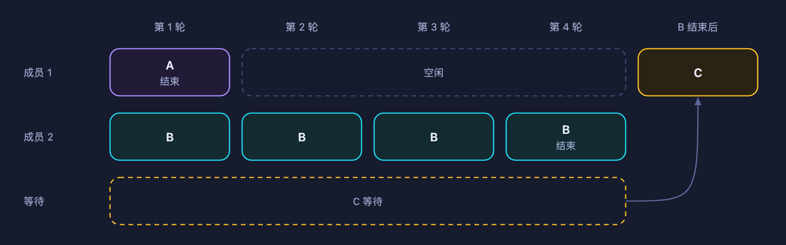
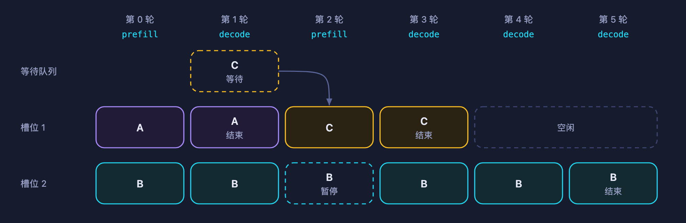
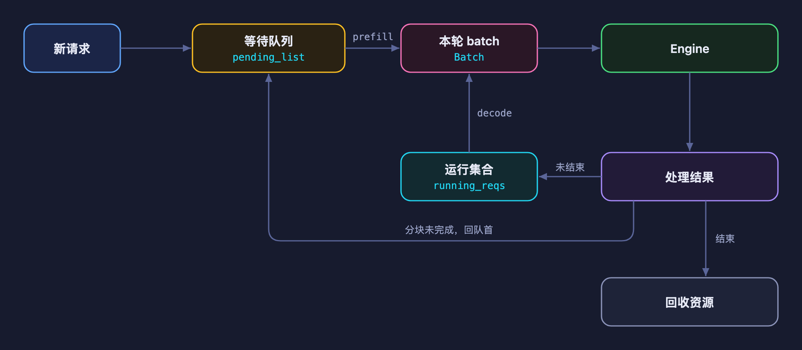
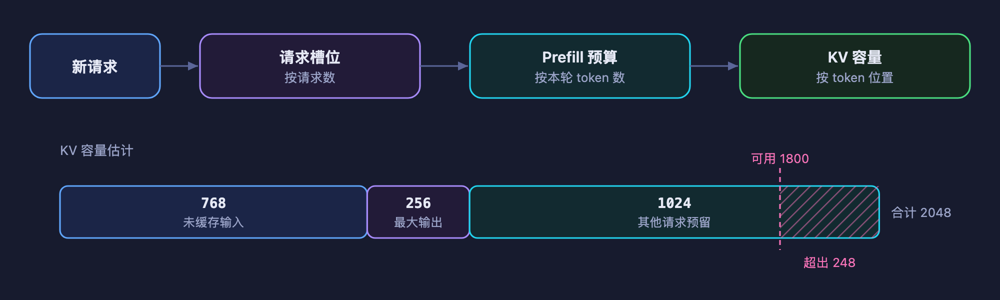
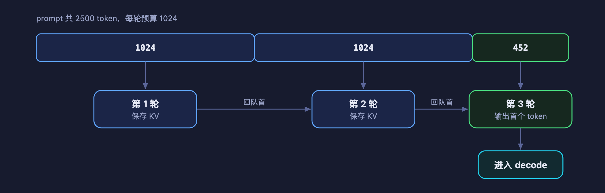

# 第 6 章 连续批处理与调度

上一章让推理程序成为了 HTTP 服务：A 的回答还没生成完的同时，服务也能接收 B、C 的请求。但是接收之后，请求如何才能一起计算提高效率呢？如何动态的安排哪些请求一起运行？新请求加入，以及已经结束的请求怎样让出资源？这就涉及本章需要讨论的内容。

本章从固定批处理的问题出发，介绍连续批处理（Continuous Batching）和调度器（Scheduler）。具体实现放在配套的[代码走读](https://github.com/datawhalechina/zero-to-sglang/pull/88)中；本章涉及的 mini-sglang 行为与代码篇一致，固定对应 [9a91cfa](https://github.com/sgl-project/mini-sglang/tree/9a91cfafe754aa85daee49998176275667eb58f2)。

## 1 本章学习目标

读完本章后，你应该能够：

- 解释固定批处理为什么容易被长请求拖住，以及连续批处理改变了什么；
- 区分等待队列、正在生成的请求集合和本轮 batch；
- 区分请求槽位、prefill token 预算与 KV 容量，说明新请求为什么可能继续等待；
- 解释 prefill 优先、分块 prefill 和资源回收对请求延迟的影响。

## 2 固定 batch 的局限性

### 2.1 什么是 batching

前面讨论单条请求时，每一步都是把它的输入交给模型，得到 logits，再采样出下一个 token。当多个请求使用同一个模型时，可以把它们组织成一个 **batch（批次）**，一起交给模型执行。

这样做的一个好处，是让同一次模型执行处理更多 token，增加权重读取的复用，并把部分固定开销分摊给更多请求。尤其在小 batch 的 decode 中，每条请求每步只处理一个新位置，合批通常能提高硬件利用率。

batch 中的请求仍然各自独立：它们有不同的输入、KV Cache、采样参数和结束条件。共同执行模型，不意味着把几个人的对话拼成一段上下文。注意力计算仍需按请求边界读取各自的历史。

### 2.2 请求不会同时到达，也不会同时结束

一种简单的做法是先收集一组请求，固定这组成员，等整组都结束后再运行下一组。这就是**固定批处理**。收集请求时可以等待一个短时间窗口，但如果启动后不能补入新请求，仍然会遇到同样的问题。

假设 A、B 已完成 prefill，接下来还分别需要 1 次和 4 次 decode。C 此时到达，并且资源足以在 A 结束后接入它：

| Decode 轮次 | A          | B          | C    |
| ----------- | ---------- | ---------- | ---- |
| 1           | 生成后结束 | 继续生成   | 等待 |
| 2           | 已结束     | 继续生成   | 等待 |
| 3           | 已结束     | 继续生成   | 等待 |
| 4           | 已结束     | 生成后结束 | 等待 |

    

<em>图 1. 固定批处理：A 结束后，C 仍要等整组结束</em>

A 在第一轮后已经不需要计算，但固定成员的规则让 C 必须等到 B 也结束。实现可以屏蔽 A 的后续计算，或把 A 从执行张量中移除；只要不允许 C 接入，剩余轮次就只能由 B 继续运行。GPU 未必完全空闲，但它失去了让更多请求一起参与计算的机会。

生成任务尤其容易遇到这种情况，因为 prompt 长度各不相同，实际输出长度也事先未知。`max_tokens` 只是输出上限，请求可能提前生成结束标记。很难在开始前把所有请求排成“恰好一起结束”的组。因此我们说，固定batch的局限性主要在于 **任务长度的不一致，无法用固定的batch大小打包多项任务一起结束**

## 3 连续批处理：每轮重新决定谁参与

### 3.1 从整条请求改为一次迭代

连续批处理把调整 batch 的时机放在**模型执行的轮次之间**。一轮结束后，调度器保留还需要继续生成的请求，移除已经结束的请求，并在资源允许时接入新的请求。新请求不必等待原来那一整组全部结束。

这里的“连续”不表示能在一个正在执行的 GPU 算子中途塞入请求，也不表示每轮一定有新请求加入。它描述的是：batch 的成员可以随着请求到达和完成不断变化。

这也不改变单条请求的自回归依赖。普通 decode 仍需先产生当前 token，才能用它计算下一个 token；变化的是，下一次执行时可以与另一组请求一起计算。

### 3.2 跟随 A、B、C 看一次完整调度

沿用代码篇的例子：系统只有两个请求槽位，KV 容量充足，没有前缀缓存命中，每个 prompt 都能在一轮 prefill 中处理完。A、B、C 分别生成 2、5、2 个 token，均不会提前遇到结束标记；C 在第 0 轮结束后到达。调度按本版本 mini-sglang 的规则进行：每轮只执行 prefill 或 decode 中的一种，能组出 prefill batch 时优先执行 prefill。

这里输出数量包含 prefill 完成时采样的第一个 token。表中的轮次是调度顺序，不代表等长的时间片，也不是性能测量。

| 轮次 | 本轮执行      | 累计输出 token 数（A / B / C） | 为什么这样安排                        |
| ---- | ------------- | ------------------------------ | ------------------------------------- |
| 0    | Prefill：A、B | 1 / 1 / 0                      | A、B 占用两个槽位，完成 prompt 处理   |
| 1    | Decode：A、B  | 2 / 2 / 0                      | C 已到达，但没有空槽位；本轮后 A 结束 |
| 2    | Prefill：C    | 2 / 2 / 1                      | C 使用 A 归还的槽位；B 本轮不执行     |
| 3    | Decode：B、C  | 2 / 3 / 2                      | C 本轮结束，B 继续保留                |
| 4    | Decode：B     | 2 / 4 / 2                      | 只有 B 还需要生成                     |
| 5    | Decode：B     | 2 / 5 / 2                      | B 结束                                |

    

<em>图 2. 连续批处理：C 接入 A 让出的槽位</em>

C 在 B 结束前就开始了计算，这正是本例中连续批处理带来的变化。同时，B 在第 2 轮暂停了一次 decode，说明“让新请求更早开始”也可能影响已经开始生成的请求。后面讨论调度策略时，会回到这个取舍。

**检查一下：**C 为什么不能在第 1 轮接入？第 2 轮 B 没执行，是否代表它已经退出系统？

## 4 调度器

上一节中，A 结束后，C 开始 prefill，随后和 B 一起 decode。这些安排由调度器完成：它记录每条请求的进度，并决定下一轮让哪些请求一起计算。

### 4.1 调度器需要记住哪些状态

C 刚到达时，需要先排队；B 已经开始回答，还需要继续生成。调度器要分别记录这些请求，再从中选出本轮要计算的 batch。

| 状态            | 记录什么                                               | 在 A/B/C 示例中的表现                            |
| --------------- | ------------------------------------------------------ | ------------------------------------------------ |
| 等待队列        | 等待处理 prompt 的请求                                 | C 刚到达时先进入这里                             |
| Decode 运行集合 | 已经处理完 prompt、还需要继续生成的请求                | 第 2 轮 B 还没结束，仍留在这里                   |
| 本轮 batch      | 这一轮交给模型计算的请求，以及执行 prefill 还是 decode | 第 2 轮是 C 的 prefill，第 3 轮是 B、C 的 decode |

例如，第 2 轮只计算 C 的 prefill，所以本轮 batch 里只有 C。B 这一轮没参与计算，但它的回答还没生成完，调度器仍要把它记在 decode 运行集合里，等下一轮继续。

在 mini-sglang 中，等待队列保存在 `PrefillManager.pending_list`，decode 运行集合保存在 `DecodeManager.running_reqs`。选好本轮要执行的请求后，再用一个 `Batch` 交给模型。

### 4.2 一轮调度如何衔接

调度器会反复执行“接收消息、选择 batch、执行模型、处理结果”这四步。沿用前面例子的第 1 轮，可以看到它们怎样连起来：

1. **接收消息**：C 到达，调度器把它放进等待队列。
2. **选择 batch**：A、B 还占着两个请求槽位，C 暂时进不来，因此本轮继续执行 A、B 的 decode。
3. **执行模型**：Engine 计算这个 batch，为 A、B 各生成一个 token。
4. **处理结果**：A 得到第 2 个 token，达到输出上限。调度器将它移出运行集合并归还资源；B 还需要生成，继续保留。

到了下一轮，调度器再次检查等待队列，发现已有空槽位，便可以安排 C 的 prefill。C 完成 prefill 后，下一次 decode 就能让 B、C 一起计算。batch 的成员正是在这样一轮轮的检查和更新中发生变化。

    

<em>图 3. 调度器的一轮循环与请求状态流转</em>

## 5 新请求加入 batch 前，要检查什么

前面的例子假设资源充足，所以 A 一结束，C 就能加入。如果等待队列里还有十条、二十条请求，调度器能把它们全部加进来吗？

实际情况中是不能的，因为资源是有限的。每条请求都需要保存自己的状态，占用 KV Cache，还要花时间计算 prompt。调度器需要据此决定接入多少请求，以及这一轮处理多少输入。

### 5.1 请求数量有上限

mini-sglang 用请求表保存每条活动请求的 token 和 KV 位置映射。一条请求占用一行，空闲的一行就是一个**请求槽位**。表的行数有限，因此同时容纳的请求数也有上限。

A、B 占满两个槽位时，C 只能留在等待队列。A 结束并归还槽位后，C 才有地方保存自己的状态。这里限制的是请求数量：A 的 prompt 是 100 个 token 还是 10000 个 token，都占一个槽位。

### 5.2 KV Cache 要留余量，才能不烧心

显而易见的是：相同数量的请求，显存需求却可能差很多。一个 10000-token prompt 需要保存的 KV，远多于一个 100-token prompt。因此，即使有空槽位，也要检查 C 所需的 KV 能否放下。

还要考虑 C 开始回答之后的增长。prefill 为输入建立 KV Cache；随后的 decode 继续计算新 token 的 KV。如果接入 C 时把剩余容量全部用来存 prompt，后面就可能没有空间继续生成。B 还没结束，它后续生成所需的空间也要算进去。

mini-sglang 为新请求估计的需求是：**尚未缓存的输入长度，加上最大输出长度**。再加上其他请求的预留估计，检查可用 KV 容量是否足够。例如：

| 需要考虑的部分         | Token 数 |
| ---------------------- | -------- |
| C 尚未缓存的输入       | 768      |
| C 最多生成的输出       | 256      |
| B 等其他请求的预留估计 | 1024     |
| 合计                   | 2048     |

如果缓存管理器报告的可用容量只能再容纳 1800 个 token 位置，C 就要继续等。这里按 token 位置计算容量，是因为每个位置都需要存储各层对应的 K/V；具体占多少字节，取决于模型和缓存精度。

    

<em>图 4. 接入前的三项检查与 KV 容量估计</em>

这个估计把最大输出长度也算进去，即使请求最终可能提前结束。它会限制当前能接入的请求数，为后续生成留出容量。实际 KV 页仍然按计算需要分配；分页和可回收缓存的核算留到第 7、8 章。

### 5.3 长 prefill 的问题&解决方法

通过槽位和 KV 检查后，还需要决定 C 的 prompt 这一轮算多少。假设 C 提交了一篇很长的文章，一次算完会让这次 prefill 执行很久。

为控制单次执行的规模，调度器设置一个 **prefill token 预算**，限制一个 prefill batch 最多处理多少个尚未缓存的输入 token。这个预算由 batch 内的请求共同使用：预算是 1024，前一条请求用了 800，留给后一条请求的就只有 224。

如果 C 有 2500 个尚未缓存的输入 token，可以用 **分块 prefill（Chunked Prefill）** 分几轮处理。假设每轮预算都是 1024，而且没有其他请求分走预算，三轮分别处理 1024、1024、452 个 token。

    

<em>图 5. 分块 prefill：同一个 prompt 分三轮完成</em>

这样，调度器在每一块结束后都有机会重新选择下一批工作。不过，下一轮是继续算 C的下一个chunk，还是让 B decode生成一个 token，还要看调度策略。

## 6 先算新请求，还是继续生成

现在假设 C 已经通过资源检查，B 也还没结束。GPU 下一轮应该处理 C 的 prefill，还是继续 B 的 decode？两种选择都能推进请求，但等待的人不同。

### 6.1 Prefill 优先与 decode 优先

回到第 3.2 节的第 2 轮。A 刚刚结束，C 可以加入，B 已经生成了两个 token。

| 下一轮的选择      | C 的体验                                  | B 的体验                          |
| ----------------- | ----------------------------------------- | --------------------------------- |
| 先做 C 的 prefill | 开始处理 prompt，更早得到第一个回答 token | 等这次 prefill 完成，才能继续生成 |
| 先做 B 的 decode  | 继续排队等待 prefill                      | 更早得到下一个 token              |

C 等待第一个 token 的时间，计入首 token 延迟（TTFT）；B 两个输出 token 之间的等待，体现在 token 间延迟（ITL）上。调度器把 GPU 时间交给 C，就会推迟 B 的下一次 decode；先交给 B，C 又要多等一轮。

本版本 mini-sglang 选择 prefill 优先：能组出 prefill batch 就先执行，否则执行 decode。所以第 2 轮先算 C，B 在第 3 轮继续。如果不断有可以接入的新请求，这条规则也可能让 B 连续等待多轮。换成一直优先 decode，则可能让新请求迟迟等不到第一次 prefill。

### 6.2 分块之后的优先调度

C 的长 prompt 分成了三块的目的是减少长prefill带来的其他请求的阻塞。要让 B 从中受益，需要在块与块之间安排 B 的 decode。下面对比两种顺序，C1、C2、C3 表示 C 的三个 prefill 块：

| 执行顺序                                 | 对 B、C 的影响                                |
| ---------------------------------------- | --------------------------------------------- |
| C1 → C2 → C3 → B 的 decode               | C 尽早完成 prefill，B 等完三个块才继续        |
| C1 → B 的 decode → C2 → B 的 decode → C3 | B 可以在中途继续输出，C 的首 token 则更晚产生 |

第二种是用来说明取舍的调度方案。本版本 mini-sglang 会把 C 尚未完成的 prefill 放回队首，并继续优先 prefill，因此在这个例子中采用第一种顺序。只把预算调小、把 prompt 切得更碎，并不会自动让 B 获得执行机会。

### 6.3 Batch 大小、吞吐与等待时间

除了选择阶段，batch 的大小也会影响结果。一次让更多请求参与计算，通常可以提高权重读取的复用，增加单位时间内生成的 token 总数，也就是输出 token 吞吐量。但更大的 batch 也可能使一次执行变久，让每条请求等待下一个 token 的时间变长。

简而言之：块大，一次 prefill 通常占用 GPU 更久；块小，处理同一个 prompt 需要更多轮次，也增加了调度和执行开销。

因此，评价一次调度改动时，需要同时看三件事：每秒总共生成多少 token、新请求等多久看到第一个 token、已经开始的回答会停顿多久。例如，改动后每秒输出更多 token，但 B 的回答经常停顿，这说明吞吐提高了，B 的 ITL 却变差了。对聊天服务，只报告前一个数字就看不出这个问题。

## 7 请求结束之后如何补位

前面一直说“A 结束，C 就能使用它的槽位”。这需要调度器先发现 A 已经结束，再把 A 占用的资源交还。只把最后一个 token 发给用户，C 还无法加入。

### 7.1 怎样知道 A 已经结束

调度器在处理每轮输出时检查结束条件。在第 3.2 节的例子中，A 的输出上限是 2，得到第 2 个 token 后就停止。另一种情况是提前采样到 EOS（序列结束标记）：例如上限为 100，生成到第 20 个 token 时出现 EOS，也可以结束。本版本在设置了 `ignore_eos` 时会忽略这个标记。

用户主动取消时，也要停止后续生成。调度器收到取消消息后，将请求从等待队列或运行集合移除。如果请求还没开始计算，也没分配资源，移出等待队列即可；如果已经开始 prefill 或 decode，还需要归还它占用的资源。

### 7.2 从运行集合中移除，再归还资源

继续看 A 正常结束的情况。第 1 轮计算完成后，调度器需要处理以下变化：

| 状态            | A 结束前 | 处理结束结果后 |
| --------------- | -------- | -------------- |
| Decode 运行集合 | A、B     | B              |
| 空闲请求槽位    | 0        | 1              |
| 等待队列        | C        | C              |

移除 A，是为了下一轮不再替它生成 token；归还槽位，是为了能够登记 C。随后，缓存管理器处理 A 的 KV：可以回收的空间交还缓存池，有复用价值的前缀可以继续保留，供后来的请求使用。因此，A 退出运行集合后，它计算过的部分 KV 仍可能留在缓存中。

到下一轮，调度器重新检查等待队列中的 C。按照前面资源充足的假设，C 取得空闲槽位，执行 prefill，之后与 B 一起 decode。如果 C 所需的 KV 容量仍然不足，就继续等待，不能仅凭 A 结束来判断它一定能加入。

这就是连续批处理中“结束一条、补进一条”的具体过程。下一章会进一步讨论这里的 KV 空间如何分配和回收。

## 8 总结与测试题

### 8.1 课程总结

固定批处理容易让短请求结束后留下的容量无法及时服务新请求。连续批处理把调整成员的时机放到轮次之间，让未结束的请求继续推进，新请求在资源允许时接入。

调度器为此维护等待队列、decode 运行集合和本轮 batch，并分别检查请求槽位、prefill 预算与 KV 容量。新请求完成 prefill 后才能进入普通 decode；结束与取消则触发状态更新和资源回收。

本版本 mini-sglang 采用 prefill 优先，支持分块 prefill，但不保证块间插入 decode。理解这些策略对首 token 延迟、token 间延迟和吞吐的影响，再进入代码篇追踪具体实现。

### 8.2 测试题

1. A、B 在固定 batch 中运行，A 提前结束而 C 正在等待。为什么即使移除了 A 的执行开销，仍然可能浪费合批机会？
2. 连续批处理为什么选择在模型执行轮次之间调整成员？它是否消除了单条请求的自回归依赖？
3. 在第 3.2 节的条件下，如果 A 只生成 1 个 token，C 最早可以在哪一轮开始 prefill？如果 C 需要两轮 prefill，B 的执行会怎样变化？
4. 某轮 GPU 只执行 C 的 prefill，但 B 仍在 decode 运行集合里。这两件事是否矛盾？为什么？
5. 新请求还需处理 600 个输入 token，最多输出 200 个 token，其他请求的预留估计为 500，可用 KV 容量为 1200。即使还有槽位，它能否通过本章描述的容量估计检查？
6. 为什么分块 prefill 的中间块不能提交回答 token？为什么分块本身不能保证旧请求及时获得 decode 机会？
7. 一项调度改动提高了输出 token 吞吐量，但用户反馈回答更容易停顿。你会同时检查哪些指标和阶段选择行为？
8. 一条请求提前生成 EOS 后，需要更新哪些状态？为什么仍可能在缓存池中找到它计算过的 KV？

## 参考资料

- [mini-sglang：调度主循环与请求回收](https://github.com/sgl-project/mini-sglang/blob/9a91cfafe754aa85daee49998176275667eb58f2/python/minisgl/scheduler/scheduler.py)
- [mini-sglang：Prefill 接入与分块](https://github.com/sgl-project/mini-sglang/blob/9a91cfafe754aa85daee49998176275667eb58f2/python/minisgl/scheduler/prefill.py)
- [mini-sglang：Decode 运行集合与容量预留](https://github.com/sgl-project/mini-sglang/blob/9a91cfafe754aa85daee49998176275667eb58f2/python/minisgl/scheduler/decode.py)
- [mini-sglang：请求状态与 Batch](https://github.com/sgl-project/mini-sglang/blob/9a91cfafe754aa85daee49998176275667eb58f2/python/minisgl/core.py)
- [mini-sglang：请求表与槽位](https://github.com/sgl-project/mini-sglang/blob/9a91cfafe754aa85daee49998176275667eb58f2/python/minisgl/scheduler/table.py)
- [mini-sglang：KV 分配与缓存生命周期](https://github.com/sgl-project/mini-sglang/blob/9a91cfafe754aa85daee49998176275667eb58f2/python/minisgl/scheduler/cache.py)
