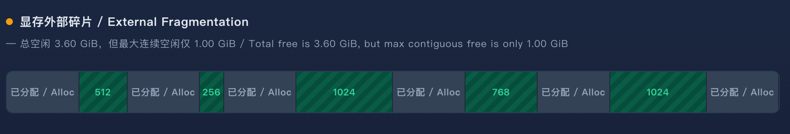

# 第 7 章 分页 KV Cache 与显存管理

欢迎来到 zero-to-sglang 课程，这里是课程的part 2 第七章，我们介绍了大模型推理的具体过程以及 KV Cache 的基本原理，下面我们要介绍的是 **Paged KV Cache 与内存管理**。KV Cache 作为大模型推理的显存杀手，其管理效率直接决定了推理系统的吞吐量与并发能力。为了突破显存瓶颈，现代推理引擎引入了类似操作系统虚拟内存的分页机制。我们有必要深入学习这套底层的显存管理技术。下面就让我们开始本节课程的学习。

## 1 本章学习目标

本章围绕 **Paged KV Cache 的核心原理** 与 **大模型推理引擎的显存管理机制** 展开，共分为三个部分：

1. **连续分配的显存困境**：从传统的连续 KV Cache 分配讲起，分析内部碎片、外部碎片以及动态扩展难题，引出分页机制要解决的核心矛盾：**显存按需高效利用（非连续）** 与 **Attention 计算需要完整 K/V 序列（逻辑连续）** 之间的冲突。

2. **分页抽象与 PagedAttention 算法**：讲解分页的核心抽象，包括物理块（Block）、槽位（Slot）与块表（Block Table），阐述逻辑块到物理块的映射机制。并深入剖析 PagedAttention 算法如何在非连续显存上按块（Block-wise）读取 K/V，实现与普通 Attention 数学等价的计算。

3. **内存管理器与调度协同**：说明内存管理器如何管理 Block 的完整生命周期（分配、填充、共享、写时复制 CoW、回收），并揭示内存管理器如何与 Scheduler 交互，在显存不足时触发抢占（换出 Swap 或重计算 Recompute）机制，最终实现高效的显存复用。

## 2 为什么需要分页，连续 KV Cache 的显存困境

在深入 PagedAttention 的算法细节之前，有必要先理解它要解决的问题：**传统的连续 KV Cache 分配方式，在真实的推理负载下为何会严重浪费显存**。本节从预分配机制出发，分析其产生的碎片问题，并总结分页要解决的核心矛盾。

### 2.1 连续分配 KV Cache 的机制与局限

在自回归解码过程中，第 $ t $ 步的 Attention 计算需要用到前 $ t-1 $ 步所有 Token 的 Key 和 Value 向量。为了避免重复计算，推理系统将这些 K/V 向量缓存到显存中，这就是我们前面介绍过的 **KV Cache**。KV Cache 的大小与序列长度、层数、注意力头数等因素成正比。对于高并发长序列场景，KV Cache 的显存占用随并发度与序列长度**线性增长**，成为限制推理吞吐的瓶颈。

**传统方案：按最大长度预分配连续显存块**

    

<em>图 1. 连续 KV Cache 的预分配布局</em>

由于 GPU 的高效计算需要张量在显存中保持连续布局，传统推理引擎采用 **连续分配** 策略：当请求到达时，为它预分配一块**连续显存空间**，大小等于该请求的 **最大可能序列长度**（如 2048 个 Token）乘以每个 Token 的 KV 缓存大小。例如，系统为每个请求预分配形状为 `[batch, layers, max_seq_len, num_heads, head_dim]` 的连续 KV 缓存。

这种设计**在逻辑上是合理的**：它保证了 Attention 计算时 K/V 矩阵在显存中的连续性，从而可以高效地进行矩阵乘法。但问题在于，**它假设可以提前知道每个请求的最终序列长度**，但是而这一假设在真实的推理负载中并不成立。

### 2.2 显存碎片与浪费问题

预分配机制产生了三类显存浪费，它们共同导致了严重的显存利用率下降。现有系统仅将 **一部分** 的显存用于存储实际 Token 状态，其余的显存完全浪费。

**内部碎片**

    

<em>图 2. 连续 KV Cache 的内部碎片</em>

内部碎片是三类浪费中最严重的。由于系统无法预知请求的最终长度，只能按最大可能长度预分配。如果系统为 2048 个 Token 分配了空间，而请求实际只生成了 200 个 Token，那么剩余的 1848 个位置在请求的整个生命周期内都无法被其他请求使用。更关键的是，**即使提前知道了实际长度，预分配仍然低效**——因为整个空间在请求期间一直被保留，其他较短的请求无法利用其中当前未使用的部分。

根据实际测量数据，在多轮对话或代码生成等生产负载中，请求的实际生成长度通常远小于最大值。例如，若每个请求预分配 2048 Token 的空间，而如果实际只生成约 200 Token，那么就约 **90% 的预分配显存处于闲置状态**。

**外部碎片**

    

<em>图 3. 连续 KV Cache 的外部碎片</em>

不同请求的输入长度和生成长度各不相同，导致 KV Cache 的分配大小千差万别。当大量长短不一的请求交替到达和离开时，显存中会留下大量**大小不等的空闲空洞**——这就是外部碎片。这些碎片的总空闲量可能很大，但由于**连续性约束**，无法被新请求利用。

一个具体的例子是：系统总共有 3.60 GiB 的空闲显存，但它们被分割为五个孤立的不连续片段（512 MiB、256 MiB、1024 MiB、768 MiB、1024 MiB）。当第十一个请求需要 1.50 GiB 的连续空间时，尽管总空闲量超过需求的两倍，但最大连续片段仅 1024 MiB，分配失败。这种有空间但用不了的情况在传统连续分配方案中非常普遍，长序列请求很容易因找不到连续大块显存而直接触发 OOM。

**动态扩展难题**

自回归生成的一个本质特征是：**序列长度在每一步都在动态增长，且最终长度不可预知**。这给连续分配方案带来了额外的困难。如果系统在请求开始时预留足够的空间，就会造成大量闲置浪费；如果先分配较小的空间，随着序列增长就需要**周期性地重新分配和拷贝**整块 KV Cache 到更大的连续区域。这种频繁的重新分配和拷贝不仅带来性能开销，还可能因为找不到更大的连续空间而失败。

更根本的问题是，**连续分配方案无法支持需要多个输出分支的解码算法**。在并行采样和 Beam Search 等场景中，一个请求会生成多个候选输出序列，这些序列共享大部分前缀 KV Cache。然而，在连续分配方案中，每个序列的 KV Cache 存储在各自独立的连续空间中，**无法实现跨序列的显存共享**。

### 2.3 分页要解决的核心矛盾

综合上述分析，分页机制要解决的核心矛盾可以概括为：

**显存的高效利用（要求按需分配、非连续存储）** 与 **Attention 计算需要完整的 K/V 序列（要求逻辑上连续可访问）** 之间的矛盾。

具体来说：

- **从显存管理的角度看**，最优的策略是**按需分配**，请求需要多少 Token 的空间就分配多少，序列增长时再动态追加。这必然导致物理存储的非连续性，因为空闲显存分布在显存空间的不同位置。

- **从 Attention 计算的角度看**，计算需要访问序列中所有历史 Token 的 K/V 向量，这要求 K/V 数据在**逻辑上是连续的**，第 $ i $ 个 Token 的 K/V 必须能被顺序访问，以便进行完整的注意力计算。

传统方案通过**强制物理连续**来保证逻辑连续，代价是严重的碎片化和低利用率。分页机制的思路则是**将逻辑连续与物理连续解耦**：

1. 将 KV Cache 划分为固定大小的 **Block（物理块）**，每个 Block 存放固定数量 Token 的 K/V；
2. 通过 **Block Table（块表）** 维护逻辑块到物理块的映射，使序列在逻辑上连续、在物理上可以离散存储；
3. Attention 计算时，通过 Block Table **按块读取** K/V，在逻辑上还原出连续的序列视图。

    

<em>图 4. 分页 KV Cache 的逻辑块到物理块映射</em>

这一设计借鉴了操作系统虚拟内存的经典思想：正如操作系统通过页表将程序的连续逻辑地址映射到非连续的物理内存页，推理系统通过块表将请求的连续逻辑 KV 序列映射到非连续的物理显存块。

通过这种解耦，分页机制同时解决了三个问题：
- **内部碎片被限制在最后一个块内**：浪费最多不超过一个 Block 的大小；
- **外部碎片被彻底消除**：所有 Block 大小相同、可互换，任何空闲 Block 都能被任何请求使用；
- **动态扩展变得自然**：序列增长时只需分配新的 Block，无需拷贝已有数据。

## 3 分页抽象：Block、Block Table 与逻辑到物理映射

在上一节中，我们分析了连续分配方案面临的显存困境，并指出分页机制的核心思路是**将逻辑连续与物理连续解耦**。本节将深入介绍这一解耦所依赖的三个核心抽象——Block、Slot 与 Block Table，以及它们如何协同完成从逻辑序列到物理显存的映射。

### 3.1 核心概念与层级关系

现代推理引擎通常将每个序列的 KV Cache 划分为固定大小的 **KV Block（逻辑块）**，每个 Block 存储固定数量 Token 的 Key 和 Value 向量。常见默认 Block 大小为 **16 个 Token**，也支持配置为 32 或 64。以 16 为例，一个 2048 Token 的序列需要 128 个逻辑块，但这些块在物理显存中**无需相邻**。

**Block（物理块）** 是显存分配与管理的最小单元。推理引擎初始化时会根据可用 GPU 显存确定物理块总量，并将显存划分为固定数量的物理块。所有物理块大小相同、完全等价，任何一个空闲块都可以被任何请求使用。

**Slot（槽位）** 是物理块内部的微观存储单位，对应单个 Token 在某个 Block 内的存储位置。

**Block Table（块表）** 是连接逻辑视图与物理视图的桥梁。它本质上是每个请求维护的一个映射数组：记录该请求的第 $ i $ 个逻辑块对应哪个物理块。Block Table 在 CPU 和 GPU 上各维护一份。CPU 端用于调度器的分配决策，GPU 端供 Attention 内核在计算时实时查表。

三个概念的层级关系可以总结为：

Token ->（逻辑块号, 块内偏移）-> Block Table ->（物理块号, Slot）-> 实际显存地址

其中，逻辑块号由 Token 的绝对位置除以 Block 大小计算得出；Block Table 负责将逻辑块号翻译为物理块号；Slot 则确定该 Token 在物理块内的精确偏移。三者协同，使得序列在逻辑上保持连续视图，而物理存储可以完全离散。

### 3.2 逻辑到物理的映射机制

分页抽象的关键在于：**逻辑块与物理块并非一一对应，而是通过 Block Table 动态建立映射**。这种映射借鉴了操作系统虚拟内存的设计——正如操作系统的页表将程序连续的虚拟地址映射到非连续的物理内存页，推理引擎的 Block Table 将请求连续的逻辑 KV 序列映射到非连续的物理显存块。

具体而言，映射过程遵循以下步骤：

**第一步：逻辑块划分。** 请求的 Token 序列按顺序被划分为逻辑块。例如，一个包含 50 个 Token 的序列，在 Block 大小为 16 时，被划分为 4 个逻辑块：Block 0 存放 Token 0–15，Block 1 存放 Token 16–31，Block 2 存放 Token 32–47，Block 3 存放 Token 48–49（最后一个块仅部分填充）。相邻的逻辑块在逻辑上自然是连续的，但这**不要求**它们在物理显存中连续。

**第二步：物理块分配。** 当需要存储某个逻辑块时，内存管理器从空闲物理块池中取出一个块，将其物理块号写入 Block Table 对应位置。不同的逻辑块可能被分配到完全不相邻的物理块。例如，逻辑块 0 可能映射到物理块 12，逻辑块 1 映射到物理块 7，逻辑块 2 映射到物理块 42，逻辑块 3 映射到物理块 3。

    

<em>图 5. 分页 KV Cache 的逻辑块到物理块映射</em>

**第三步：地址翻译。** 在 Attention 计算时，GPU 内核需要访问某个 Token 的 KV 数据。给定 Token 在序列中的绝对位置计算出 KV缓存 的地址

**第四步：跨块连续访问。** 当一个查询需要访问跨越多个逻辑块的 K/V 序列时，GPU 内核会按块迭代遍历。对于每个逻辑块，内核先通过 Block Table 查表获得物理块号，再读取该物理块内的所有 Slot。这种设计使得 Attention 计算可以处理任意长度的序列，而不受物理存储连续性的限制。

这一映射机制带来了三个关键优势。**第一，消除外部碎片**：所有物理块大小相同、完全等价，任何空闲块都能被任何请求使用，彻底消除了连续分配中有空间但用不了的问题。**第二，内部碎片受限**：只有序列的最后一个块可能部分填充，浪费最多不超过一个 Block 的大小，而非整个预分配空间。**第三，支持动态扩展**：序列增长时只需分配新的物理块并追加到 Block Table，无需拷贝已有的 KV 数据，实现了真正的按需分配。

## 4 PagedAttention：在非连续 KV 上做 Attention

上一节介绍了 Block、Slot 与 Block Table 三个抽象概念，它们共同实现了逻辑连续与物理离散的解耦。然而，仅有抽象还不够——真正的挑战在于：**Attention 计算需要访问序列中所有历史 Token 的 K/V 向量，而这些向量在物理显存中是离散存储的**。PagedAttention 算法正是为了解决这一问题而设计的：它在非连续 KV 上执行 Attention 计算，同时保证与连续内存上的标准 Attention 在数学上完全等价。

### 4.1 PagedAttention 的读取机制

PagedAttention 的核心思路是：**将 Attention 计算按 KV Block 粒度拆解，逐块读取 K/V 并累积结果**。这种按块迭代的方式使得计算不再依赖于 K/V 在物理显存中的连续性，而是通过 Block Table 的动态映射来定位每个逻辑块对应的物理块。

**块粒度的读取流程**

对于每个查询 Token，内核按以下步骤执行：

1. **计算逻辑块数**：给定序列的实际长度 $ L $，逻辑块数量为 $ \lceil L / B \rceil $，其中 $ B $ 为 Block 大小（常见默认值为 16，也可设为 32 或 64）。

2. **逐块迭代**：内核遍历每个逻辑块 $ j $（$ j = 0, 1, \ldots, \lceil L/B \rceil - 1 $），通过 `block_table` 查表获取该逻辑块对应的物理块号，然后读取该物理块内所有 Slot 的 K/V 数据。这一过程将离散的物理块收集（Gather）到计算单元中。

3. **块内注意力计算**：对于当前逻辑块 $j$，块内第 $t$ 个 Token 的全局位置为 $p=jB+t$。计算查询 $q_i$ 与该块内 Key 的点积，并施加因果掩码：

$$
s_{ij,t}=\frac{q_i^\top k_{j,t}}{\sqrt{d}},
\qquad
\tilde{s}_{ij,t}=
\begin{cases}
s_{ij,t}, & p\le i\\
-\infty, & p>i
\end{cases}
$$

最终注意力输出为：

$$
o_i=
\sum_{j,t}
\frac{\exp(\tilde{s}_{ij,t})}
{\sum_{j',t'}\exp(\tilde{s}_{ij',t'})}
v_{j,t}
$$

其中求和只对有效 Token 进行。实现时按块读取 K/V，用在线 Softmax 逐块累积，结果与上式等价。

4. **跨块累积**：由于 Softmax 不是线性算子，不能简单地将各块的计算结果相加。PagedAttention 借助**在线 Softmax（Online Softmax）** 技术，维护三个运行统计量——当前最大值 $ m $、指数和 $ \ell $ 以及加权输出 $ O $——并在每读取一个新块后更新这三个统计量，从而将各块结果正确合并。

**非连续访存的影响与优化**

非连续访存是 PagedAttention 内核面临的核心工程挑战。与连续 KV Cache 不同，PagedAttention 的 K/V 数据分散在物理显存的不同位置，无法保证连续的内存访问模式。

我们可以通过**内存合并（Memory Coalescing）** 和**共享内存（Shared Memory）** 两级优化来缓解这一问题：

- **合并访问**：内核精心设计了线程到数据的映射方式，使相邻线程读取相邻的显存地址。具体而言，当线程组将全局内存中的 K/V 数据加载到共享内存时，相邻线程（如 thread 0 和 thread 1）读取相邻的内存位置，从而最大化内存带宽利用率。

- **共享内存暂存**：从全局内存读取的 K/V 块首先被加载到共享内存中，然后在共享内存上执行密集的计算。由于共享内存的延迟远低于全局内存，这一设计有效掩盖了非连续全局访存的延迟。

- **Block 大小调优**：Block 大小是影响内核性能的关键参数。较小的 Block 增加 Block Table 的查找开销，较大的 Block 则增加内部碎片。常见实现会使用 16，并根据负载评估 32 或 64。

尽管 PagedAttention 引入了 Block Table 间接寻址和非连续读取的开销，但通过上述优化，这些开销被有效控制，而内存管理带来的收益远大于内核开销。

### 4.2 数学等价性证明与前提

PagedAttention 的核心主张是：**在非连续物理块上分块计算 Attention，其结果与在连续内存上一次计算的标准 Attention 在数学上完全等价**。这一等价性由在线 Softmax（Online Softmax）技术保证。

**前提是Attention 计算对 K/V 无状态依赖**

等价性成立的前提是：Attention 计算对每个 Token 的 K/V 是**独立的、无状态依赖的**。具体而言，注意力分数 $ s_{ij} = q_i^\top k_j / \sqrt{d} $ 仅依赖于查询向量 $ q_i $ 和键向量 $ k_j $，不依赖于序列中其他 Token 的状态。同样，输出 $ o_i = \sum_j \alpha_{ij} v_j $ 是各 Value 向量的加权和，权重 $ \alpha_{ij} $ 仅由对应的注意力分数决定。这一性质使得 K/V 可以按任意粒度分组处理，而不影响最终结果的正确性。

**在线 Softmax 的分块合并机制**

标准 Softmax 的计算需要先获得所有注意力分数，然后减去全局最大值以保证数值稳定性，再计算指数和与加权和。这一过程需要**两遍遍历**：第一遍计算全局最大值 $ m $，第二遍计算指数和 $ \ell $ 与输出 $ O $。问题在于，PagedAttention 按块迭代读取 K/V，无法在读取所有块之前获得全局最大值。

在线 Softmax 通过**运行式递推**解决了这一问题。对于每个新读取的块 $B$，维护三个运行统计量：

- $m$：截至当前块已见分数的最大值；
- $\ell$：截至当前块、以 $m$ 为基准的指数和；
- $O$：截至当前块、以 $m$ 为基准的**未归一化**加权输出。

读取新块后，先计算该块的局部统计量：

$$
m_B=\max s,\qquad
\ell_B=\sum e^{s-m_B},\qquad
O_B=\sum e^{s-m_B}v
$$

然后用下式合并：

$$
m'=\max(m,m_B)
$$

$$
\ell'=\ell e^{m-m'}+\ell_B e^{m_B-m'}
$$

$$
O'=O e^{m-m'}+O_B e^{m_B-m'}
$$

所有块处理完毕后，最终输出为：

$$
o=\frac{O}{\ell}
$$

该结果与在完整序列上一次性计算 Softmax 的结果**逐元素相等**。等价性成立的原因是：在线 Softmax 只是把“先减去全局最大值”拆成“边读边更新最大值，并同步校正已累积的指数和与加权和”，数学结构并未改变。

**与 PagedAttention 的结合**

PagedAttention 将在线 Softmax 与分块读取相结合。每个逻辑块被独立处理，块内执行标准的 Attention 计算（使用块内的局部 Softmax），块间通过在线 Softmax 的合并公式正确累积。由于：

1. **块内计算**是标准的 Attention（在局部范围内），数学上正确；
2. **块间合并**使用在线 Softmax 的精确递推公式，数学上等价于全局 Softmax；
3. **块与块之间的分界**不改变任何 Token 的 $ q $、$ k $、$ v $ 值，也不改变它们之间的相对位置关系；

因此，最终输出与连续内存上一次性计算的 Attention 结果**在数学上完全等价**。数值上可能因浮点运算顺序的差异产生微小偏差（如舍入误差），但这是在可接受的精度范围内，且不改变算法的正确性。

需要强调的是，**PagedAttention 仅改变了 K/V 的内存寻址方式，未改变算子内部的数学运算逻辑**。无论是块内计算还是跨块合并，所使用的数学公式与标准 Attention 完全一致。PagedAttention 的魔法不在于发明了新的数学，而在于**让标准的数学运算可以在非连续的内存布局上正确执行**。

具体而言，PagedAttention 做了以下工作：

| 标准 Attention | PagedAttention |
|---|---|
| 在连续 K/V 矩阵上计算 | 通过 Block Table 查表，按块 Gather K/V |
| 一次 Softmax 归一化 | 在线 Softmax 分块递推归一化 |
| 一次矩阵乘法 | 逐块矩阵乘法 + 运行式累积 |

数学正确性由在线 Softmax 的等价性定理保证，而工程可行性则依赖内核的合并访问和共享内存优化。两者结合，使得 PagedAttention 既能获得分页管理带来的显存效率提升，又不损失 Attention 计算的数学正确性。

## 5 总结与测试题

### 5.1 课程总结

本章围绕 Paged KV Cache 与内存管理，从问题背景到算法设计再到工程落地，完成了一条完整的逻辑链路。

**第一，显存困境与分页动机。** 传统推理引擎为每个请求按最大序列长度预分配连续显存。这一假设在真实负载中并不成立：请求的实际生成长度远小于最大值，导致大量内部碎片；不同请求交替到达和离开，留下大小不等的空闲空洞，形成外部碎片；序列长度动态增长，连续空间难以按需扩展。三类浪费共同造成显存利用率仅 20%–40%。分页机制的核心思路是将**逻辑连续与物理连续解耦**——序列在逻辑上保持连续视图，物理存储可以完全离散。

**第二，分页抽象与 PagedAttention 算法。** 分页机制依赖三个核心抽象：**Block** 是显存分配的最小单元，常见大小为 16 个 Token；**Slot** 是物理块内部的微观存储单位；**Block Table** 维护逻辑块到物理块的映射，在 CPU 端供调度器决策，在 GPU 端供 Attention 内核实时查表。PagedAttention 算法在非连续 KV 上执行 Attention：内核按 Block 粒度迭代读取 K/V，借助在线 Softmax 维护运行统计量，逐块累积并正确合并结果。PagedAttention **只改变了 K/V 的内存寻址方式，未改变注意力计算的数学逻辑**，分页结果与连续结果在数学上严格等价。

### 5.2 测试题

1. 合上文章，画出分页机制的完整数据流：从 Token 序列出发，经过逻辑块划分、Block Table 映射，到物理块中的 Slot 存储。

2. 在分页抽象中，Block、Slot 与 Block Table 各自扮演什么角色？三者之间的层级关系是什么？如果 Block Table 中某个逻辑块对应的物理块号被错误修改，会导致什么后果？

3. PagedAttention 在非连续物理块上执行 Attention，为什么其结果与连续内存上的标准 Attention 在数学上等价？请从在线 Softmax 的运行统计量更新公式出发，说明分块合并为何不会引入数学偏差。

## 参考资料

- [《Efficient Memory Management for Large Language Model Serving with PagedAttention》](https://www2.eecs.berkeley.edu/Pubs/TechRpts/2023/EECS-2023-19.pdf)
- [Milakov 和 Gimelshein：《Online Normalizer Calculation for Softmax》](https://arxiv.org/abs/1805.02867)
- [https://cloud.tencent.cn/developer/article/2616536](https://cloud.tencent.cn/developer/article/2616536)