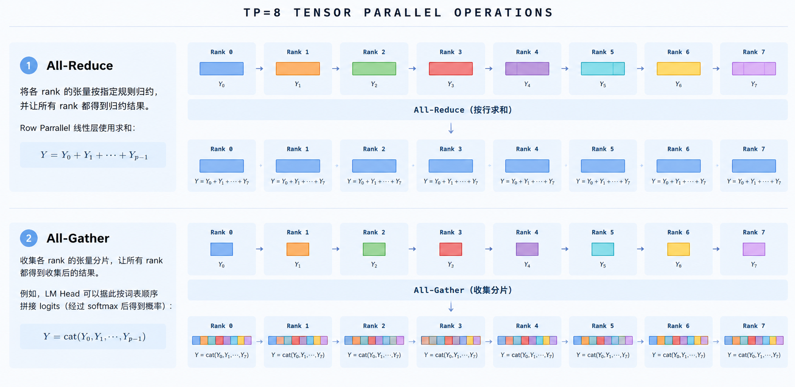
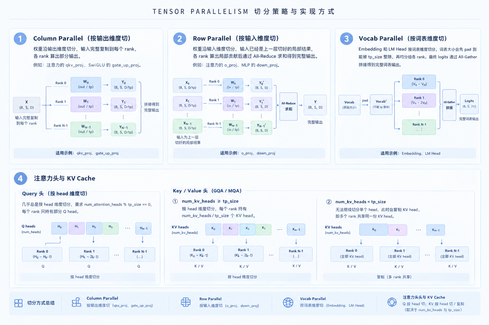

# 第 9 章 多进程与张量并行

前面几章中，我们跟随一个请求走完了端到端的处理流程，并分析了分页 KV Cache、RadixAttention 与前缀缓存。这些机制回答了“如何高效管理和复用 KV Cache”，但部署时还有一个更基础的问题：**如果一张 GPU 的显存或计算能力无法满足需求，如何让多张 GPU 协作运行同一个模型？**

本章围绕这个问题，先区分多进程与张量并行的职责，再说明各 GPU 如何通信、权重与计算如何切分，最后把这些机制串回从加载模型到处理请求的完整流程。

## 1 本章学习目标

学完本章后，应该能回答以下问题：

- Multi-process 与 Tensor Parallelism 分别解决什么问题，为什么二者需要配合？
- 各 rank 如何保持请求处理的一致性，又如何合并局部计算结果？
- 线性层、词表层和 KV Cache 分别如何切分，有哪些限制？
- 从启动推理引擎、加载模型到处理一次请求，各进程如何协作？

## 2 Multi-process 与 Tensor Parallelism

在分析实现之前，我们从显存需求出发，看看什么时候需要多卡，以及使用多卡需要付出什么代价。

### 2.1 单卡能装下权重，为什么还要考虑多卡

以 Qwen2.5-32B 为例，按约 $3.2 \times 10^{10}$ 个参数估算，若使用 BF16（每个参数 2 字节），仅权重就需要：

$$
3.2 \times 10^{10} \times 2 \approx 64\ \mathrm{GB} 
$$

一张 A100 80GB 可以容纳这部分权重，但能支持多长的上下文、多大的并发量，还取决于其余显存开销。

模型推理时还需要保存：

- **KV Cache**：在模型结构和缓存精度固定时，其占用随缓存的 token 总数增长；等长序列下，可理解为随序列长度和 batch size 的乘积增长。
- 临时激活值、算子工作区与通信缓冲区。
- 启用 CUDA Graph 时所需的捕获与运行缓冲区。

因此，**“权重装得下”不等于“目标负载下能稳定运行”**。模型可能在低并发、短上下文时正常工作，却在增加并发或上下文长度后出现 OOM。

若模型参数量进一步增至 $1.6 \times 10^{12}$ ，仅 BF16 权重就约为 $3.2\ \mathrm{TB}$ ，更无法直接放入单卡。可以把大部分权重和部分中间计算分摊到多张 GPU 上，降低每张卡的显存压力。在合适的模型、负载和互联条件下，它也可能降低单次前向的延迟，或为更大的 batch 留出空间。

不过，多卡部署并不意味着计算一定会更快。TP 会引入频繁的跨卡通信与同步，收益还需要取决于计算量、batch size 和 GPU 通信带宽等因素。

### 2.2 二者如何支持多卡并行

**Multi-process 是一种系统组织方式**：多个拥有独立地址空间的进程，通过消息传递等方式协作。为了绕过 Python GIL 并实现高效推理，系统采用多进程架构，典型组件包括：

- **API Server、Tokenizer process**：接收请求，将文本转为 token。
- **Detokenizer process**：将模型输出的 token 转回文本。
- **Scheduler process**：核心调度进程。每个 Scheduler process 对应一个 rank（绑定一张 GPU），负责请求排队、动态批处理（continuous batching）、KV Cache 分配与管理，并触发本地计算。
- **Engine/TpModelWorker/ModelRunner process**：运行在 Scheduler process 进程内部，负责实际的模型前向计算、权重加载，以及跨 rank 的通信。

***注**：一个 rank 对应一张 GPU，也是一个进程。*

**Tensor Parallelism（张量并行，简称 TP）是一种模型并行策略**——将模型中**同一层权重/词表**切分到多个 rank 上，让这些 rank **共同完成同一批输入的计算**。以线性层计算为例：

- 单卡：完整矩阵乘法 $Y = XW$ 。
- 多卡：权重矩阵按 **列 (输出维度)或按行 (输入维度)** 切分。每张 GPU 只持有一部分权重，计算局部结果后，在需要的位置通过 All-Reduce、All-Gather 汇总完整结果。

对一个请求来说，它的**每一个 token** 都由整个 TP 组协同计算得到，**所有 rank 始终处理相同的 batch 这一点可以通过 Multi-process 保证**。

***注**：在 mini-SGLang 中目前只支持 TP。而 SGLang 中除了 TP，还支持 DP（数据并行）、PP（流水线并行）等高级策略。*

概括来说就是 **Multi-process 负责进程组织、信息传输与调度协调，TP 负责把计算拆开并行执行**。那么两者实现基础是什么，这是我们接下来要分析的问题。

## 3 通信与切分

把模型分到多张 GPU 上，需要同时满足两个条件：各 rank 在同一步处理相同输入，且局部结果能还原原模型运算——前者靠调度与通信协调，后者靠切分规则和张量通信保证；若模型能放入单卡，则无需切分与跨 rank 通信（无数据面），直接加载完整权重即可。

### 3.1 通信：对齐任务、合并结果

单 rank 运行时，API Server、分词 worker、Scheduler 之间仍需要进程间通信。TP 大小大于 1 后，还增加了 rank 之间的请求协调和 GPU 张量通信。

**1.控制面：让各 rank 在同一步执行对应的任务（保证执行一致性）**

在本章对应的 mini-SGLang 实现中，主要使用两类机制：

- **ZeroMQ（ZMQ）**：在 API Server、分词与反分词 worker、rank 0 Scheduler 之间传递请求、token ID、采样参数及生成结果。多 rank 时，rank 0 还通过 ZMQ 的发布/订阅机制向其他 Scheduler 广播请求消息。
- **Gloo CPU 进程组**：通过 `torch.distributed` 创建，用于启动时的 barrier、PyNCCL 初始化时的 NCCL Unique ID 广播，以及运行时每轮非阻塞接收消息的数量同步等。

因为各 rank 处理速度可能不同，如果让所有 rank 都直接与 Tokenizer/Detokenizer 通信，容易造成消息错乱。因此只有 rank0 负责对外通信，其他 rank 从 rank0 接收信息。

**2.数据面：交换模型计算中的 GPU 张量（保证结果正确性）**

NCCL 是 NVIDIA 提供的 GPU 集合通信库，mini-SGLang 的 PyNCCL 是对 NCCL 的封装。默认多卡路径启用 PyNCCL（可用 `--disable-pynccl` 回退到 PyTorch 的 NCCL 后端）。两种常见操作是：

  
  
<em>图 1. TP=8的数据交换例子</em>

- **All-Reduce**：将各 rank 的张量按指定规则归约，并让所有 rank 都得到归约结果。Row Parallel 线性层使用求和：

  $$
  Y = Y_0 + Y_1 + \cdots + Y_{p-1}
  $$

- **All-Gather**：收集各 rank 的张量分片，让所有 rank 都得到收集后的结果。例如，LM Head 可以据此按词表顺序拼接 logits（经过 softmax 后得到概率）：

  $$
  Y = \mathrm{cat}(Y_0,Y_1,\ldots,Y_{p-1})
  $$

如果在需要通信的位置（例如 Row-Parallel 部分线性层之后、或最后词表概率输出时）缺少对应的跨 rank 集体通信，后续计算拿到的就不是原模型应有的结果，最终输出会出现严重偏差。

简单来说两种通信方式：控制面保证”大家在做同一件事“，数据面保证”大家算出的结果能正确合成“，两者缺一不可。真正开始运行 LLM 处理请求之前，还需要正确加载模型权重、词表、配置等信息，这些内容如何在多 rank 之间进行切分与加载，就是接下来要讨论的问题。

### 3.2 切分

在 LLM 推理引擎中，**切分**的核心目标是：把模型权重与计算拆分到多张 GPU 上，使大模型能放入显卡，同时通过并行计算提升吞吐。

多 GPU 切分必须严格遵循数学等价性。什么需要切分、什么应该保留完整，通常会遵循以下原则：

- **保留部分复制**：如 RMSNorm 等每个部分都需要同步，就直接在每个 rank 上完整复制。
- **按维度切分**：如权重矩阵以及对应的偏置沿输出（行）维度按 `tp_size` 均分。

切分方式：

  
  
<em>图 2. 切分加载方法</em>

- **Column Parallel（按输出维度切）**：权重沿输出维度切分，输入完整复制到每个 rank，各 rank 算出部分输出。例如注意力的`qkv_proj`、SwiGLU 的`gate_up_proj`。
- **Row Parallel（按输入维度切）**：权重沿输入维度切分，输入已经是上一层切好的局部结果，各 rank 算出局部贡献后通过 **All-Reduce** 求和得到完整输出。例如注意力的`o_proj`、MLP 的`down_proj`。
- **Vocab Parallel（按词表维度切）**：Embedding 和 LM Head 按词表维度切分。词表大小会先被 pad 到能被 `tp_size` 整除，再均分给各 rank。最终 logits 通过 All-Gather 拼接得到完整词表输出。
- **注意力头与 KV Cache**：
  - **Query 头**：几乎总是按 head 维度切分（要求 num_attention_heads % tp_size == 0），每个 rank 只持有部分 Q head。
  - **Key/Value 头**：若 **num_kv_heads ≥ tp_size**，按 head 切分，每个 rank 持有 num_kv_heads//tp_size 份 KV head ；若 **num_kv_heads < tp_size**，无法继续切分单个 head，此时会复制 KV head，让多个 rank 共享同一份。

切分只针对大权重，小层通常会保持全部保留。选择 `tp_size` 时，需要同时考虑：

1.模型参数量大小与单卡显存容量；

2.模型结构约束（如 num_heads 等）与计算方式，保证局部计算合并之后与全局结果数学等价。

## 4 从启动到运行

用户只需执行一条启动命令，指定模型路径和可选的 TP 数量等参数，系统就会自动完成后续工作。入口是 `launch_server`，主进程解析参数后进入 `run_api_server`，在其中拉起各类子进程、等待就绪，再提供服务。

**Step 1**&emsp;`start_subprocess` 拉起子进程，按配置启动：
- TP 个 Scheduler 进程（tp_info.size），父进程为每个子进程写入各自的 `DistributedInfo(rank, world_size)`，进程名比如`minisgl-TP{i}-scheduler`；
- 1 个 Detokenizer 进程；
- num_tokenizer个 Tokenizer 进程。默认 `num_tokenizer=0` 时，启动一个共享 Worker 同时处理 Tokenize 与 Detokenize，不额外拉起独立 Tokenizer。

主进程通过 `ack_queue` 等待就绪确认，共等待 rank 0 Scheduler + 全部 Tokenizer + 1 个 Detokenizer 信号。

**Step 2**&emsp;各 Scheduler 进程内的初始化。每个 Scheduler 进程在 `_run_scheduler` 中：
- 创建 Scheduler，其内部再创建 Engine；
- Engine 完成：绑定本 rank 对应 GPU、初始化分布式通信、加载并按 TP 规则切分权重、初始化 KV Cache / Attention Backend、CUDA Graph capture 等；
- Scheduler 继续初始化 Table/Cache/Prefill 等管理器，以及基于 ZMQ 的收发。各 rank 执行 `sync_all_ranks()` 对齐后，进入 `scheduler.run_forever()` 等待处理请求。

**Step 3**&emsp;子进程全部就绪后，主进程上的 API Server 开始监听指定端口，提供 OpenAI 等兼容接口，即可接收请求。处理请求的完整处理路径已在[第 2 章一个请求的旅程](https://datawhalechina.github.io/zero-to-sglang/ch/part2/%E7%AC%AC2%E7%AB%A0_%E4%B8%80%E4%B8%AA%E8%AF%B7%E6%B1%82%E7%9A%84%E6%97%85%E7%A8%8B.html)中介绍过了，此处不再展开。

## 5 总结与测试题

### 5.1 课程总结

在这一章中，我们介绍了在单卡、多卡环境中部署开源模型并启动推理服务前需要考虑的问题，例如用多少张卡部署一个模型；随后说明了通过 TP 切分并加载权重，以及多进程协作处理请求的过程。权重并行不止 TP 一种方式，SGLang 源码中还有其它并行与通信实现可对照阅读。

### 5.2 测试题

1.多进程与 TP 分别解决什么问题？

2.为什么各 rank 不能独立接收任意数量的请求，以及怎么保证哪些处理信息的一致性、正确性？

3.为什么 TP 大小翻倍，不代表显存占用减半、推理速度翻倍？请分别从复制开销、KV 头数和通信成本解释。

## 参考资料

- [第 2 章：一个请求的旅程](https://datawhalechina.github.io/zero-to-sglang/ch/part2/%E7%AC%AC2%E7%AB%A0_%E4%B8%80%E4%B8%AA%E8%AF%B7%E6%B1%82%E7%9A%84%E6%97%85%E7%A8%8B.html)
- [mini-SGLang](https://github.com/sgl-project/mini-sglang)
- [SGLang](https://github.com/sgl-project/sglang)
- [Qwen2.5-32B config](https://huggingface.co/Qwen/Qwen2.5-32B/blob/main/config.json)
