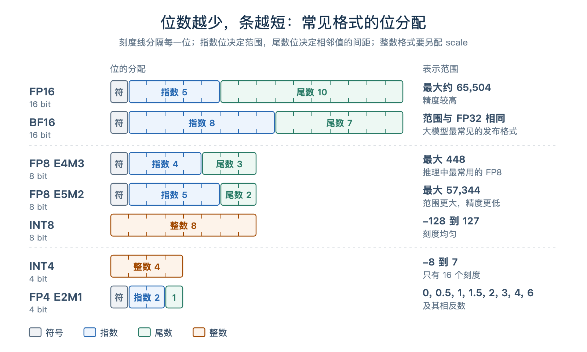
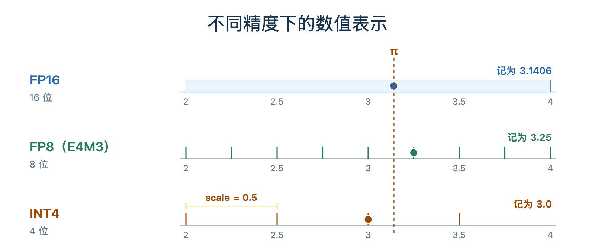
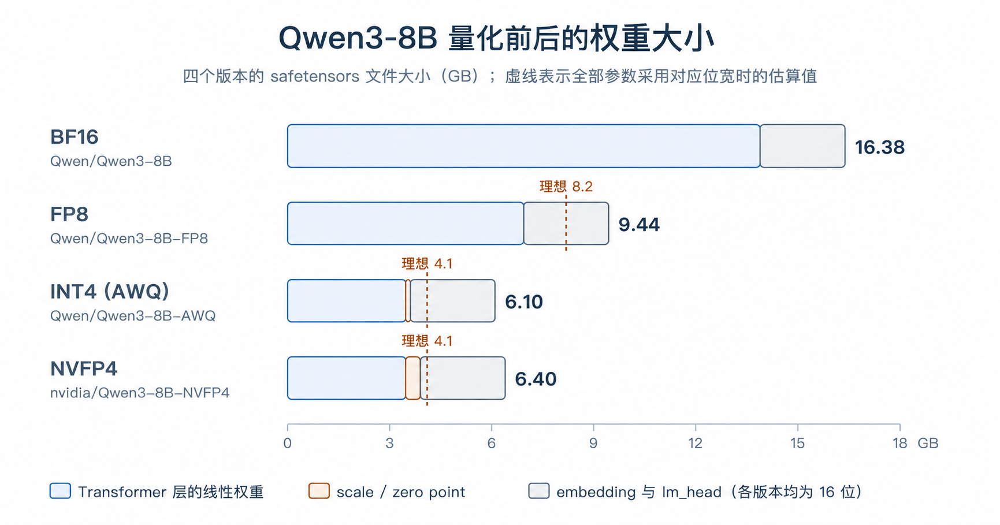
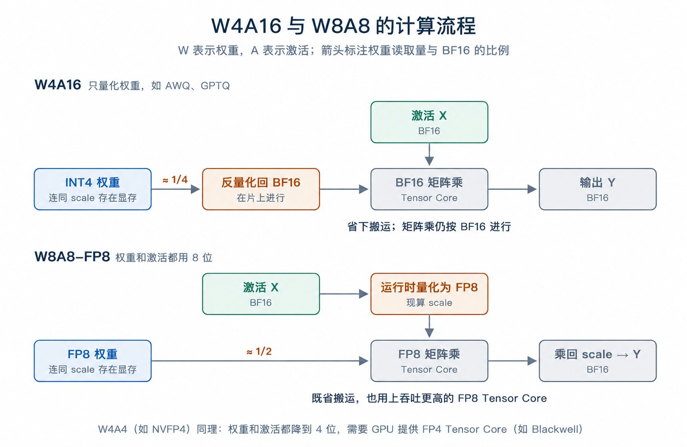
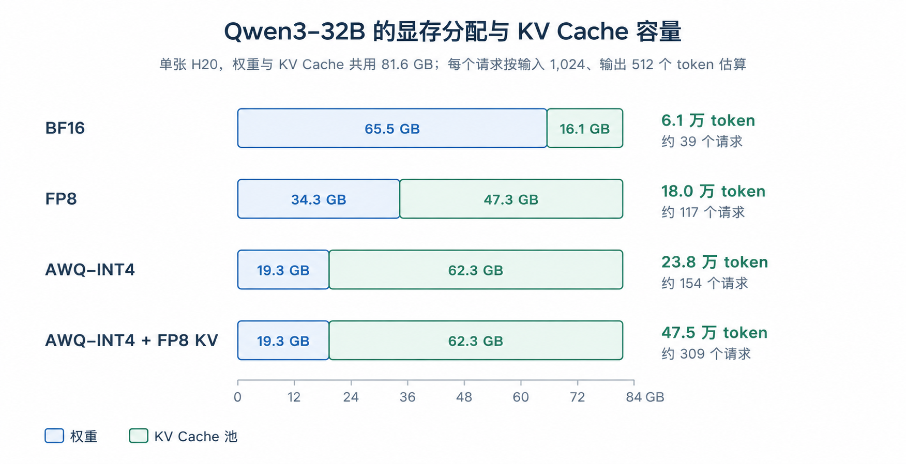
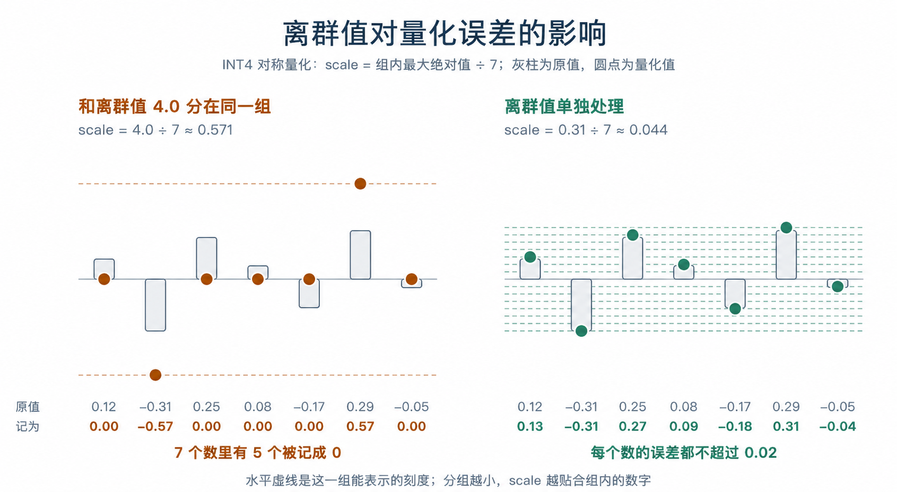

# 第 2 章 量化与低精度推理

上一章介绍了 Attention 后端如何组织搬运和计算。这一章讨论量化：把权重从 16 位压到 8 位甚至 4 位，减少 Decode 每一步的读取量，并把省下的显存留给 KV Cache。我们会详细讨论量化的数字表示方式，以及性能收益和精度变化。

## 1 本章学习目标

完成本章学习后，你将能够：

1. 说明量化如何减少存储开销，以及为什么会引入误差。
2. 从 Decode 搬运量和 KV Cache 容量两方面解释量化的性能收益。
3. 说明精度损失从哪里来，并用评测 benchmark 发现精度回归。
4. 区分 W4A16、W8A8、FP8、NVFP4 等常见方案，读懂模型下载页上的量化标签。

## 2 量化是什么

### 2.1 用更少的比特表示数字

权重是模型的参数，激活是各层计算时输入、输出的中间结果，它们和 KV Cache 一样，都需要以某种数值格式保存。以常见的 BF16 为例，每个数占 16 位，也就是 2 字节。**量化（quantization）** 把这些数转成 8 位、4 位等低精度表示，以减少存储开销，并在合适的硬件上加速计算。

这有点像把 3.14159 记成 3.14：表示变短了，也丢掉了一点精度。在计算机中，每种格式都有一组可以表示的值，存入一个数时，通常要把它舍入到最近的可表示值。以 π 为例：

| 格式        | 每个数占用      | 最多能表示的值 | π 被记成  | 误差           |
| ----------- | --------------- | -------------- | --------- | -------------- |
| FP32        | 32 位（4 字节） | 约 43 亿个     | 3.1415927 | 小于 0.0000001 |
| FP16        | 16 位（2 字节） | 65,536 个      | 3.140625  | 约 0.001       |
| FP8（E4M3） | 8 位（1 字节）  | 256 个         | 3.25      | 约 0.11        |
| FP4（E2M1） | 4 位（半字节）  | 16 个          | 3         | 约 0.14        |

量化保留模型结构，只改变数值表示。权重、激活和 KV Cache 可以分别选择精度，组合起来就是不同的量化方案，也就是混合精度。方案名常用 W、A 记号：W 指权重（weight），A 指激活（activation），后面的数字是位数。例如 W4A16 是权重 4 位、激活 16 位，W8A8 是两者都用 8 位。常见方案如下：

| 方案         | 权重 / 激活      | 常见标签                    | 含义                                                                          |
| ------------ | ---------------- | --------------------------- | ----------------------------------------------------------------------------- |
| W4A16        | INT4 / BF16      | `-AWQ`、`-GPTQ-Int4`        | 只量化权重，计算前反量化回 BF16；省显存和权重读取，精度最稳                   |
| W8A8-FP8     | FP8 / FP8        | `-FP8`、`-FP8-dynamic`      | 权重和激活都量化，直接用 FP8 Tensor Core 做矩阵乘（Ada / Hopper / Blackwell） |
| W8A8-INT8    | INT8 / INT8      | `-W8A8`                     | 同上，改用 INT8 Tensor Core，适合不支持 FP8 的 GPU                            |
| NVFP4        | FP4 / FP4        | `-NVFP4`                    | W4A4，Blackwell 原生支持；更早的 GPU 上 SGLang 退回 W4A16 计算                |
| MXFP4        | FP4 / 视实现而定 | `mxfp4`                     | 另一种 4 位浮点格式，gpt-oss 的 MoE 专家权重使用它                            |
| FP8 KV Cache | —                | `--kv-cache-dtype fp8_e4m3` | KV Cache 的精度不在 W/A 记号里，要单独指定                                    |

### 2.2 浮点、整数与缩放系数

先看几种常见格式的位是怎么分配的。图 1 中条的长度就是位数：

<div align="center">
  
  <p><em>图 1. 常见格式的位分配与表示范围。</em></p>
</div>

浮点格式用指数和尾数表示数值：指数位决定范围，尾数位影响精度。它的刻度靠近 0 时密，离 0 越远越稀。

整数格式（INT8、INT4）的刻度则是均匀的，但它本身表示不了 0.3 这样的小数。量化时需要配一个**缩放系数 scale**。在不带零点偏移的情况下，可以写成：

$$
x \approx q \times s
$$

其中 $q$ 是存下来的整数，$s$ 是 scale。例如，$s = 0.5$ 时，INT4 的 −8 到 7 就对应 −4.0 到 3.5，相邻刻度相差 0.5。scale 通常用较高精度保存，由一组数共享。

FP8、FP4 的表示范围也有限，因此同样常配 scale，将一组数缩放到可表示的范围内。

<div align="center">
  
  <p><em>图 2. FP16、FP8 和 INT4 的可表示值，以及 π 的舍入结果。</em></p>
</div>

图 2 中，位数越少，π 附近可选的值就越少，舍入时的偏差也更明显。

### 2.3 范例：一个 8B 模型量化后有多大

存储开销可以直接按参数量和位数估算。一个 8B 参数的模型，如果所有参数都用同一种格式保存：

- FP16 / BF16：8B × 2 字节，约 16 GB。
- FP8：8B × 1 字节，约 8 GB。
- INT4：8B × 0.5 字节，约 4 GB。

实际下载的量化 checkpoint 往往比这个估算更大。以 Qwen3-8B 为例，它约有 8.19B 参数，Hugging Face 上四个版本的 safetensors 文件总大小如下：

| 版本        | Hugging Face 仓库                                                       | 按位宽估算 | 实际大小 |
| ----------- | ----------------------------------------------------------------------- | ---------- | -------- |
| BF16        | [`Qwen/Qwen3-8B`](https://huggingface.co/Qwen/Qwen3-8B)                 | 16.4 GB    | 16.38 GB |
| FP8         | [`Qwen/Qwen3-8B-FP8`](https://huggingface.co/Qwen/Qwen3-8B-FP8)         | 8.2 GB     | 9.44 GB  |
| INT4（AWQ） | [`Qwen/Qwen3-8B-AWQ`](https://huggingface.co/Qwen/Qwen3-8B-AWQ)         | 4.1 GB     | 6.10 GB  |
| NVFP4       | [`nvidia/Qwen3-8B-NVFP4`](https://huggingface.co/nvidia/Qwen3-8B-NVFP4) | 4.1 GB     | 6.40 GB  |

多出来的空间主要用在两处。首先，embedding 和输出层 lm_head 保留了 16 位，合计约 12.4 亿参数，占约 2.49 GB。

其次，量化权重还要附带 scale 等信息。AWQ 版本每 128 个权重共享一组 scale 和 zero point，合计约 0.14 GB；NVFP4 每 16 个权重就有一个 FP8 scale，合计约 0.43 GB。分组越小，附加的存储开销越大。

<div align="center">
  
  <p><em>图 3. Qwen3-8B 四个版本的权重大小，按线性层、embedding 与 lm_head、量化附加信息拆分。</em></p>
</div>

## 3 量化为什么能提速

逻辑很简单，权重变小以后，单步推理需要读取的数据减少了，显存也能腾出更多空间。

### 3.1 范例：前后对比的实测数据

Qwen 官方的 [Speed Benchmark](https://qwen.readthedocs.io/en/latest/getting_started/speed_benchmark.html) 使用 SGLang 测试了 Qwen3-8B 的 BF16、FP8 和 AWQ 版本，条件如下：

| 项目 | 设置                                                                           |
| ---- | ------------------------------------------------------------------------------ |
| 硬件 | 1 张 NVIDIA H20（96 GB）                                                       |
| 软件 | SGLang 0.4.6.post1，`mem_fraction_static=0.85`；AWQ 版本使用 `awq_marlin` 实现 |
| 负载 | batch size 为 1，每次生成 2,048 个 token，输入长度从 1 到约 12.9 万个 token    |
| 指标 | 速度 =（输入 token 数 + 生成 token 数）÷ 总耗时，单位 token/s                  |

结果如下，括号内是相对 BF16 的倍数：

| 输入长度   | BF16     | FP8               | AWQ-INT4          |
| ---------- | -------- | ----------------- | ----------------- |
| 1          | 81.73    | 150.25（1.84×）   | 144.11（1.76×）   |
| 6,144      | 296.25   | 516.64（1.74×）   | 477.89（1.61×）   |
| 30,720     | 832.67   | 1,242.24（1.49×） | 1,075.91（1.29×） |
| 约 12.9 万 | 1,173.32 | 1,393.21（1.19×） | 1,198.06（1.02×） |

第一行耗时几乎都在 Decode，FP8 和 INT4 的速度均约为 BF16 的 1.8 倍。随着输入变长，加速幅度逐渐缩小。下面从单步耗时解释这组结果。

### 3.2 减少每一步的权重读取量

小 batch 的 Decode 中，每次读取权重只服务少量 token，搬运容易成为瓶颈。只考虑权重读取，可以估算单步耗时的下限：

$$
\text{每一步的耗时} \gtrsim \frac{\text{权重的字节数}}{\text{显存带宽}}
$$

比如，H20 的显存带宽约为 4 TB/s。如果用 checkpoint 大小近似每一步的权重读取量，BF16 的 16.4 GB 对应约 4.1 ms，FP8 的 9.4 GB 对应约 2.4 ms，INT4 的 6.1 GB 对应约 1.5 ms。

实测 BF16 每步约需 12.2 ms（81.73 token/s），还包含 Attention、采样、调度和 kernel 启动等开销，读取权重时也受实际带宽利用率影响。量化缩短了权重读取时间，其余工作仍占用一部分延迟。

这也有助于理解 INT4 的结果：权重压到了 BF16 的 37%，速度达到 1.76 倍，略慢于 FP8。这里的 INT4 采用 W4A16 路径，要先反量化成 BF16 再做矩阵乘，增加了反量化开销；FP8 则可以直接使用 H20 的 FP8 Tensor Core。图 4 对比了这两条计算路径：

<div align="center">
  
  <p><em>图 4. W4A16 与 W8A8-FP8 从权重读取到矩阵乘、输出的计算流程。</em></p>
</div>

表格中还有一个规律：输入变长后，量化带来的加速逐渐缩小。FP8 从 1.84 倍降到 1.19 倍，AWQ-INT4 从 1.76 倍降到 1.02 倍，几乎追平 BF16。这是因为输入越长，Prefill 和长 KV 序列上的 Attention 占用的时间越多，权重读取的占比随之下降。Prefill 更受计算吞吐限制：W4A16 只减少了权重读取，矩阵乘仍是 BF16，收益很小；FP8 连激活也进行了量化，可以用 FP8 Tensor Core 加速矩阵乘，因此还能保留一部分加速。

### 3.3 给 KV Cache 留出更多显存

多请求服务中，权重省下的显存可以分给 KV Cache 池，容纳更多请求。以 Qwen3-32B 为例，它有 64 层，每层 8 个 KV 头，每个头 128 维。按 BF16 存储时，每个 token 需要：

$$
2 \times 64 \times 8 \times 128 \times 2\ \text{字节} = 262{,}144\ \text{字节} = 256\ \text{KiB}
$$

其中第一个 2 表示 K 和 V 各一份，最后的 2 字节是 BF16 每个数的大小。一个输入 1,024、输出 512 个 token 的请求，最多占 1,536 × 256 KiB，即 384 MiB。

以 H20 的 96 GB × 0.85 ≈ 81.6 GB 为预算，减去权重大小，再除以每个 token 的 KV Cache 大小，就得到图 5 的估算。SGLang 启动时会计入其他显存开销，并在日志中用 `max_total_num_tokens` 给出实际容量。

<div align="center">
  
  <p><em>图 5. Qwen3-32B 在单张 H20 上的显存分配，以及各方案可容纳的 token 数和请求数估算。</em></p>
</div>

按每个请求占满 1,536 个 token 估算，BF16 版本能容纳约 39 个请求，AWQ-INT4 约 154 个；KV Cache 再转成 FP8，每个 token 的存储开销减半。请求充足时，更大的 KV Cache 池支持更大的 batch，让一次权重读取服务更多 token，提高吞吐。

权重占显存的比例越高，这项容量收益越明显。例如，同一张 H20 上，Qwen3-8B 从 BF16 换成 INT4，KV Cache 容量只增加约 16%；图中的 Qwen3-32B 则增加得更多。

## 4 代价：用精度换吞吐

第 3 节的提速来自更少的位数，代价是更粗的刻度。量化本质上是一次取舍：吞吐上去了，精度可能下来。这一节看精度损失从哪里来，以及怎么发现它。

### 4.1 舍入误差与离群值

除了 π 例子中的舍入误差，共享 scale 还会受到离群值（outlier）的影响。以按最大绝对值选择 scale 为例，组内一个特别大的数会增大 scale，使其余小数值的差异难以保留，甚至都被舍入成 0。

<div align="center">
  
  <p><em>图 6. 离群值与其他权重共享 scale、单独处理两种情况下的 INT4 量化结果。</em></p>
</div>

图 6 中，把离群值单独处理后，其余数值就可以使用更小的 scale，保留更多细节。常见方案缩小分组（如 NVFP4 每 16 个数一个 scale，FP8 block-wise 每 128×128 一块）、按通道或按 token 分配 scale，都是为了减少这类误差。

权重固定，可以离线选择 scale；激活随输入变化，还可能出现数值很大的通道，量化时更难处理，压到 4 位通常需要更细的分组。

误差会传入后续层，量化后的 KV Cache 也会被后续 token 反复读取。接下来通过评测，观察它们对最终输出的影响。

### 4.2 怎么发现掉点

评测量化后的模型时，固定评测集、prompt 模板和采样参数，只改变量化方式，再对比前后的得分，就可以观察量化对任务表现的影响。

Qwen 官方在 [Qwen3-8B-AWQ](https://huggingface.co/Qwen/Qwen3-8B-AWQ) 和 [Qwen3-32B-AWQ](https://huggingface.co/Qwen/Qwen3-32B-AWQ) 的模型页上公布了 BF16 与 AWQ-INT4 的评测对比。下表摘录了部分结果，括号内是量化后的分数变化：

| 模型与模式            | LiveBench           | GPQA                | MMLU-Redux          | AIME24              |
| --------------------- | ------------------- | ------------------- | ------------------- | ------------------- |
| Qwen3-8B，思考模式    | 67.1 → 65.5（−1.6） | 62.0 → 59.0（−3.0） | 87.5 → 86.4（−1.1） | 76.0 → 71.3（−4.7） |
| Qwen3-8B，非思考模式  | 53.5 → 48.9（−4.6） | 39.3 → 35.9（−3.4） | 79.5 → 79.1（−0.4） | —                   |
| Qwen3-32B，思考模式   | 74.9 → 73.1（−1.8） | 68.4 → 69.0（+0.6） | 90.9 → 90.8（−0.1） | 81.4 → 79.4（−2.0） |
| Qwen3-32B，非思考模式 | 59.8 → 59.8（0）    | 54.6 → 53.1（−1.5） | 85.7 → 85.6（−0.1） | —                   |

Qwen3-8B 在 MMLU-Redux 上最多下降 1.1 分，思考模式下的 AIME24 则下降了 4.7 分。两个评测放在一起，可以看到量化对不同任务的影响程度。在这组结果里，8B 模型的降幅也普遍大于 32B 模型。

分数偶尔还会升高：Qwen3-32B 在思考模式下的 GPQA 得分增加了 0.6 分。评测题量和生成过程的随机性都会带来分数波动。重复运行基线与量化版本，比较各自的均值和波动范围，可以帮助分辨这类小幅变化。

KV Cache 量化也需要覆盖不同难度的任务。SGLang 文档给出的 GPT-OSS-120B 评测中，不同评测集上的变化相差很大：

| 评测集       | KV Cache BF16 | KV Cache FP8 E4M3 | KV Cache FP4 E2M1 |
| ------------ | ------------- | ----------------- | ----------------- |
| GSM8K        | 0.9161        | 0.9163            | 0.9152            |
| AIME25       | 0.7533        | 0.7667            | 0.3533            |
| GPQA Diamond | 0.5081        | 0.5434            | 0.3202            |

GSM8K 上，FP4 KV Cache 与 BF16 的得分几乎一样；AIME25 上却从约 0.75 降到了约 0.35。同一份文档中的 Qwen3-235B-A22B、DeepSeek-R1-0528，AIME25 降幅约为两成。因此，评测需要覆盖准备部署的模型，以及实际使用中的任务难度和输出长度，才能看清这一方案在目标场景下的表现。

实际评测时，可以按下面的清单检查：

- **选和实际业务接近的评测**，覆盖基础任务，以及有难度、输出较长的任务。
- **固定评测条件**：数据集版本、few-shot 数量、prompt 模板、采样参数都与 BF16 基线保持一致。
- **多跑几次，先看清波动**。记录基线与量化版本的均值和波动范围，判断分数变化是否稳定出现。
- **长上下文单独验证**，尤其是量化了 KV Cache 时。
- **性能和精度一起报告**。Part I 的 Benchmark 一章提到，对比性能时要固定精度与量化方式；反过来，报告量化带来的加速时，也要同时给出精度结果。

## 5 实战：量化标签与加载模型

### 5.1 读懂模型下载页上的量化标签

从模型名找到量化标签后，打开 `config.json` 中的 `quantization_config`，或单独的量化配置文件，可以进一步确认格式和分组方式。配置里常见的 group size、dynamic / static、per-tensor / per-channel / per-token，说的都是 scale 怎么分配：多少个数共享一个，运行时现算还是离线定好，按整个张量还是按通道、按 token 共享。

| 模型                                                                    | 名字说明了什么                     | 配置文件里还能看到什么                                                                                 |
| ----------------------------------------------------------------------- | ---------------------------------- | ------------------------------------------------------------------------------------------------------ |
| [`Qwen/Qwen3-8B-AWQ`](https://huggingface.co/Qwen/Qwen3-8B-AWQ)         | AWQ 方法产出的 INT4 权重，即 W4A16 | `bits: 4`、`group_size: 128`、`zero_point: true`                                                       |
| [`Qwen/Qwen3-8B-FP8`](https://huggingface.co/Qwen/Qwen3-8B-FP8)         | FP8 权重                           | `fmt: e4m3`、`weight_block_size: [128, 128]`、`activation_scheme: dynamic`，即激活也在运行时量化为 FP8 |
| [`nvidia/Qwen3-8B-NVFP4`](https://huggingface.co/nvidia/Qwen3-8B-NVFP4) | NVFP4，即 W4A4                     | 写在 `hf_quant_config.json`：`group_size: 16`、`kv_cache_quant_algo: FP8`，KV Cache 也是 FP8           |
| [`openai/gpt-oss-120b`](https://huggingface.co/openai/gpt-oss-120b)     | 名字里没有量化后缀                 | `quant_method: mxfp4`，但 Attention、router、embedding 和 lm_head 不量化，只有 MoE 专家权重是 MXFP4    |

名字只是线索，配置文件才是依据。

### 5.2 在 SGLang 中加载量化模型

预量化模型直接指定路径，SGLang 会读取配置选择实现，不要再加 `--quantization`；AWQ 在兼容的 GPU 上还会自动切到更快的 `awq_marlin`。`--quantization fp8` 用于把 BF16 权重在线转成 FP8，适合快速试验。KV Cache 的精度用 `--kv-cache-dtype` 单独指定：

```bash
# 预量化模型
python3 -m sglang.launch_server --model-path Qwen/Qwen3-8B-AWQ
# 在线量化为 FP8
python3 -m sglang.launch_server --model-path Qwen/Qwen3-8B --quantization fp8
# 权重不变，只把 KV Cache 设为 FP8
python3 -m sglang.launch_server --model-path Qwen/Qwen3-8B --kv-cache-dtype fp8_e4m3
```

支持的方法、硬件和参数见[量化官方文档](https://docs.sglang.io/docs/advanced_features/quantization)和 [KV Cache 量化文档](https://docs.sglang.io/docs/advanced_features/quantized_kv_cache)；源码中，所有量化方法登记在 [`layers/quantization/__init__.py`](https://github.com/sgl-project/sglang/blob/75878f27c88c2ffd296425d94226d0dc9bd42518/python/sglang/srt/layers/quantization/__init__.py)。

## 6 总结与测试题

### 6.1 课程总结

总的来说，量化就是用更少的位数存数据，让模型少占显存、少搬数据，有时还能算得更快。但位数越低，不一定跑得越快。同时一个取舍就是，量化可能影响回答质量。选方案时，要看哪些部分做了量化、硬件是否支持，再用实际任务测试速度和效果。

### 6.2 测试题

1. W4A16、W8A8-FP8 和 FP8 KV Cache 分别能省什么、加速什么？
2. 为什么 8B 模型量化成 INT4 后，下载大小仍有 6.1 GB，而不是 4 GB？
3. 为什么 W4A16 对单请求 Decode 加速明显，对长输入 Prefill 帮助较小？
4. 为什么对话越长，KV Cache 量化越有用？
5. GSM8K 只下降了 0.3 个百分点，就能说量化没影响吗？还要检查什么？
6. 下面这些模型用了什么量化方案？如何从配置文件确认？
   - `Qwen/Qwen3-32B-AWQ`
   - `RedHatAI/Llama-3.3-70B-Instruct-FP8-dynamic`
   - `nvidia/DeepSeek-R1-0528-NVFP4`
   - `openai/gpt-oss-20b`

## 参考资料

- [SGLang：量化官方文档](https://docs.sglang.io/docs/advanced_features/quantization)
- [SGLang：KV Cache 量化官方文档](https://docs.sglang.io/docs/advanced_features/quantized_kv_cache)
- [SGLang：量化方法注册表](https://github.com/sgl-project/sglang/blob/75878f27c88c2ffd296425d94226d0dc9bd42518/python/sglang/srt/layers/quantization/__init__.py)
- [SGLang：AWQ 实现与 Marlin 自动切换](https://github.com/sgl-project/sglang/blob/75878f27c88c2ffd296425d94226d0dc9bd42518/python/sglang/srt/layers/quantization/awq/awq.py)
- [Hugging Face：Qwen/Qwen3-8B](https://huggingface.co/Qwen/Qwen3-8B)
- [Hugging Face：Qwen/Qwen3-8B-FP8](https://huggingface.co/Qwen/Qwen3-8B-FP8)
- [Hugging Face：Qwen/Qwen3-8B-AWQ（BF16 与 AWQ-INT4 精度对比）](https://huggingface.co/Qwen/Qwen3-8B-AWQ)
- [Hugging Face：nvidia/Qwen3-8B-NVFP4](https://huggingface.co/nvidia/Qwen3-8B-NVFP4)
- [Microscaling（MX）数据格式论文](https://arxiv.org/abs/2310.10537)
- [Qwen：Speed Benchmark（Qwen3 各量化版本的 SGLang 实测速度）](https://qwen.readthedocs.io/en/latest/getting_started/speed_benchmark.html)
- [Hugging Face：Qwen/Qwen3-32B-AWQ（BF16 与 AWQ-INT4 精度对比）](https://huggingface.co/Qwen/Qwen3-32B-AWQ)
- [LMSYS：INT4 QAT 端到端实践](https://lmsys.org/blog/2026-01-26-int4-qat/)
- [LMSYS：SGLang 原生集成 NVIDIA Model Optimizer 量化](https://lmsys.org/blog/2025-12-02-modelopt-quantization/)
- [AWQ：Activation-aware Weight Quantization 论文](https://arxiv.org/abs/2306.00978)
- [GPTQ：Accurate Post-Training Quantization 论文](https://arxiv.org/abs/2210.17323)
- [DeepSeek-V3 技术报告（FP8 block-wise 训练与推理）](https://arxiv.org/abs/2412.19437)
