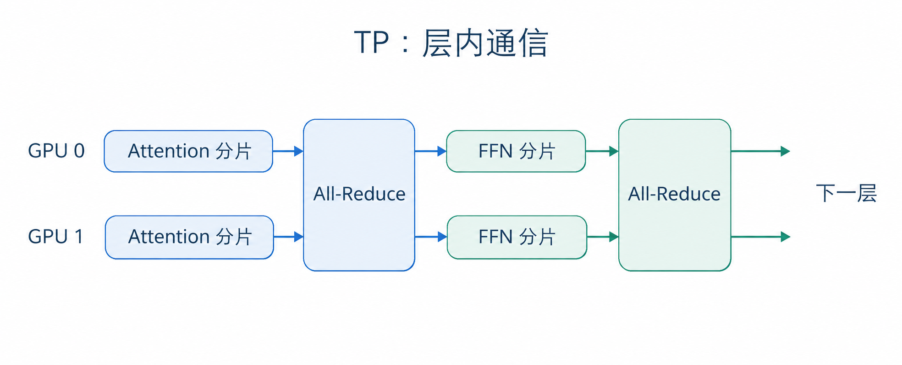
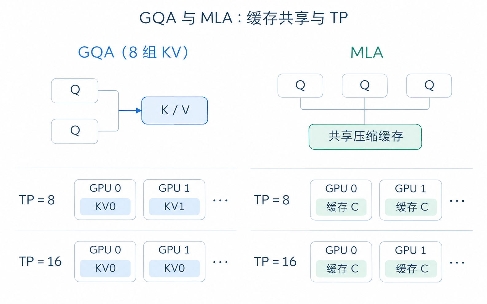
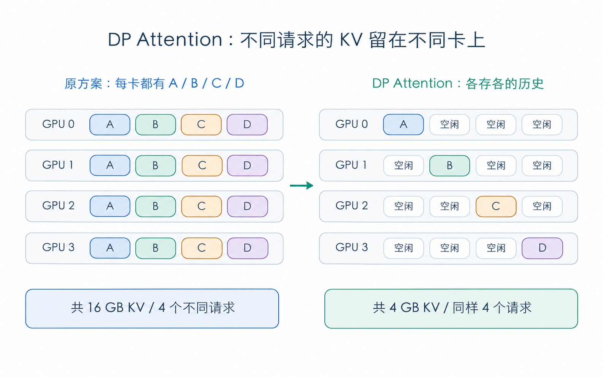
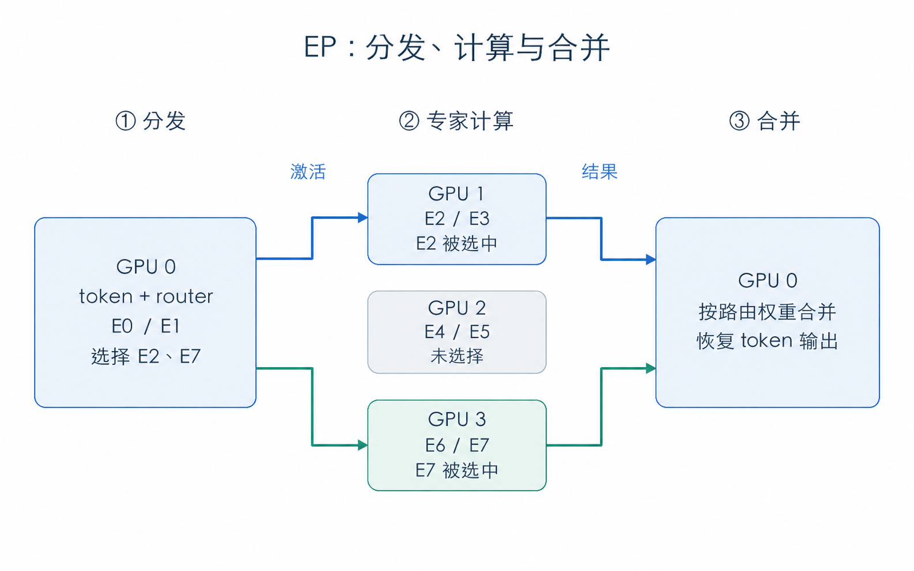
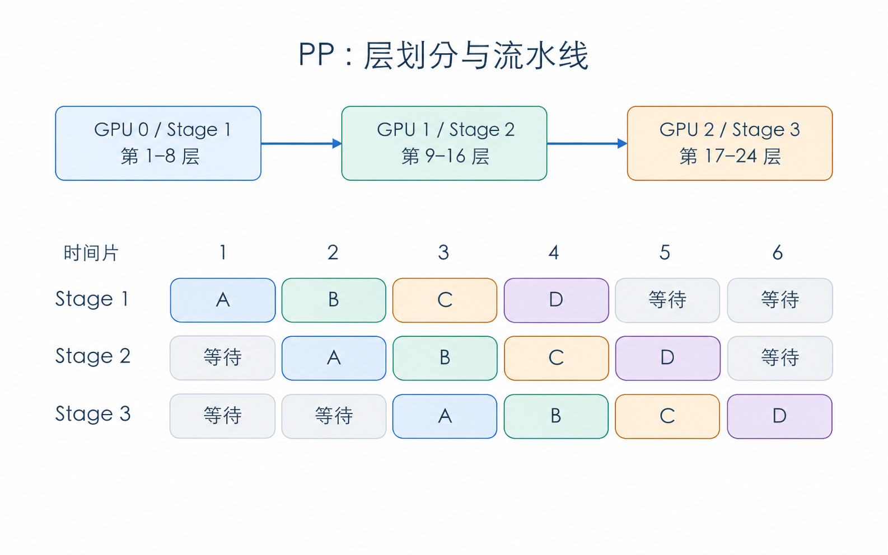

# 第 4 章 横向扩展

在 Part II 的[第 9 章](../part2/第9章_多进程与张量并行.md)中，我们介绍了 Tensor Parallelism（张量并行，TP）：把同一层的大矩阵切开，交给多张 GPU 一起计算。单卡放不下的权重可以分摊到多张卡上，计算也由这些卡共同完成。

但继续增加 GPU，推理不一定会更快。每张卡分到的计算少了，卡之间仍然要通信、等待；对于一些模型，KV Cache 也无法随着 TP 卡数增加而继续切分。到了这一步，就需要考虑：除了把同一层的矩阵切得更细，还能怎样分配工作？

本章介绍三种方式：DP Attention 让不同 GPU 处理不同请求的 Attention，EP 把 MoE 专家分到不同 GPU，PP 则把模型的不同层分开部署。我们先从 TP 的限制讲起，再看这三种方式如何工作。

## 1 本章学习目标

学完本章后，你应该能回答以下问题：

1. 为什么增加 TP 卡数后，省下的计算时间可能被通信抵消？GQA、MLA 的 KV Cache 又有哪些切分限制？
2. DP Attention 如何按请求分工，什么情况下能减少重复保存的 KV Cache？
3. MoE 中的一个 token 怎样找到对应专家，完成计算并拿回结果？
4. PP 为什么会出现流水线气泡，micro-batch 又怎样减少等待？
5. 面对显存不足、通信过多或负载不均，应该考虑哪些并行方式？

## 2 TP 的优化空间

### 2.1 通信的代价

回想 TP 的矩阵乘法：每张 GPU 只计算一部分结果，再通过 All-Reduce 等通信操作，把各自的结果合起来，供后续计算使用。

这样的通信在模型内部会反复发生。在常见的 Transformer TP 实现中，Attention 的输出投影、FFN 的输出投影等位置都可能需要通信。生成一个 token 要经过几十层，也就要进行多次跨卡交换。

  
  
<em>图 1. 一层中的两次通信：合并 Attention 和 FFN 的局部结果。</em>

假设把一个矩阵从 4 张卡扩展到 8 张卡，每张卡负责的乘法少了，但通信的启动、传输和同步仍然要花时间。尤其是在小 batch 的 Decode 中，每张卡原本就没有多少计算，继续拆分后，省下的时间可能还不够完成新增的通信。如果这些 GPU 分布在不同机器上，还要考虑机器之间的网络带宽和延迟。

因此，增加 TP 卡数能否加速，要看**省下的计算时间能否覆盖新增的通信与调度开销**。

### 2.2 KV Cache 的切分极限

在标准多头注意力中，可以沿 head 维度切分 KV Cache，让不同 GPU 保存不同 head 的 KV。GQA 和 MLA 则在模型结构上减少了需要缓存的数据，切分时也有各自的限制。

- **GQA**：多个 Query head 共用一组 KV head，因此 KV head 比 Query head 少。例如，一个模型有 8 个 KV head，使用 8 路 TP 时，每张卡可以保存一个 KV head。增加到 16 路后，按完整 KV head 切分的方案已经没有更多 head 可分，部分卡就需要保存相同的 KV，每张卡的 KV 占用也就无法再减半。
- **MLA**：历史信息主要保存为压缩后的 latent 状态，供多个 Query head 使用。它无法直接沿用“每张卡保存不同 KV head”的切法。在复制这份状态的 TP 实现中，同一个请求的缓存会在多张卡上各存一份。

能否继续节省 KV 显存，取决于模型结构和具体实现。GQA 在 KV head 足够时仍然可以切分，MLA 也可以采用其他并行方案；但仅仅增大 TP，未必能让每张卡少存一些 KV。SGLang 的 [DP Attention 文档](https://docs.sglang.io/docs/advanced_features/dp_dpa_smg_guide)介绍了 MLA 缓存重复的问题，以及按请求分配 Attention 的思路。

  
  
<em>图 2. 同一请求、同一长度下，增加 GPU 不一定减少单卡 KV。示例采用按 head 切分的 GQA 和复制缓存的 MLA；结构参考 <a href="https://arxiv.org/abs/2305.13245">GQA</a> 与 <a href="https://arxiv.org/html/2405.04434v5#S2.SS1">MLA</a>。</em>

接下来先看 DP Attention：如果让各张卡负责不同请求，KV Cache 应该怎样保存？

## 3 DP Attention：按请求切分

### 3.1 各算各的请求，各存各的 KV

计算 Attention 时，不同请求通常互不依赖。用户甲生成下一个 token，只需要读取甲的历史 KV，用户乙的请求也是一样。既然如此，就可以把这些请求分给不同 GPU，各自完成 Attention。

假设有 4 张 GPU，要处理请求 A、B、C、D。为了看清 KV 的变化，先假设每张卡都能独立完成 Attention，而原来的 TP 方案会在每张卡上保存这四个请求的完整缓存。改用 DP Attention 后，可以这样分配：

| GPU | 原先复制 KV 的 TP 方案 | 改用 DP Attention |
|---|---|---|
| GPU 0 | 保存 A、B、C、D 的 KV | 负责 A 的 Attention，保存 A 的 KV |
| GPU 1 | 保存 A、B、C、D 的 KV | 负责 B 的 Attention，保存 B 的 KV |
| GPU 2 | 保存 A、B、C、D 的 KV | 负责 C 的 Attention，保存 C 的 KV |
| GPU 3 | 保存 A、B、C、D 的 KV | 负责 D 的 Attention，保存 D 的 KV |

这样，请求 A 的 Attention 一直由 GPU 0 计算，历史 KV 也留在 GPU 0，其他三张卡不再需要保存 A 的缓存。B、C、D 同理，原来重复保存 KV 的显存就空了出来。SGLang 的 [v0.4 发布文章](https://www.lmsys.org/blog/2024-12-04-sglang-v0-4/)介绍了这一设计。

  
  
<em>图 3. 对同样四个请求，假设每个 KV 占 1 GB，消除四重复制后总 KV 占用从 16 GB 降至 4 GB。</em>

### 3.2 省下的空间能多装多少请求

继续用上面的例子。假设每个请求的 KV 都占 1GB，每张卡有 4GB 显存可用于 KV Cache。原方案中，A、B、C、D 的缓存会占满每张卡的这 4GB。四张卡一共用了 16GB，却只能保存四个不同请求的历史。

改用 DP Attention 后，每张卡只保存自己负责的请求。一张卡能放四个请求，四张卡就能放 16 个，容量变成了原来的四倍。

这个四倍来自例子中的四重复制。如果原来的 KV 已经能通过 TP 均匀切分，就没有这么多重复缓存可以省。实际能多接多少请求，还要扣除 Attention 权重副本、临时缓冲区等显存开销，并考虑请求长短和分配是否均匀。即使显存足够装下四倍的请求，处理这些请求仍然需要计算和通信，吞吐量要通过实际测试来判断。

### 3.3 Attention 独立，不代表整层没有通信

Attention 算完后，token 还要经过 FFN 或 MoE。这些部分可以继续使用 TP、EP 等方式，因此各张卡仍然需要交换数据。

例如，FFN 使用 TP 时，需要先把各卡的 token 激活整理成 TP 所需的数据布局，计算后再把结果交回负责相应请求的卡。MoE 使用 EP 时，则要把 token 激活发给对应专家所在的卡。这里传输的是当前计算用到的激活和结果，历史 KV 可以继续留在负责 Attention 的卡上。

这也是 DP Attention 与普通 DP 的区别。普通 DP 为每组 GPU 部署一个完整的模型副本，各组可以独立完成推理；DP Attention 则只对 Attention 按请求分工，后面的 FFN 或 MoE 仍可由多组 GPU 协作完成。Attention 本身也可以结合 TP，让一小组 GPU 共同处理一个请求，具体可参见 SGLang 的[大规模 EP 文章](https://www.lmsys.org/blog/2025-05-05-large-scale-ep/)。

## 4 EP：按专家切分

### 4.1 先回顾 MoE

普通 FFN 中，每个 token 都经过同一套网络。Mixture of Experts（混合专家，MoE）则包含多套专家网络，由 router 为每个 token 选出少数几个专家，再将它们的输出按路由权重合并。

每个专家都是一组训练得到的网络参数，不是人为指定的“数学专家”或“写作专家”。例如，一层有 8 个可路由专家，每个 token 选择其中 2 个，那么计算这个 token 时，只需要运行选中的两套专家网络。

虽然一次只用两个专家，但下一个 token 可能选中另外两个。在专家权重常驻 GPU 的部署中，仍然要为全部专家准备显存。Expert Parallelism（专家并行，EP）就是把这些专家分到不同 GPU 上，让每张卡保存和计算其中一部分。

### 4.2 专家平分GPU

假设把 8 个专家平均放到 4 张卡上，每张卡保存两个专家：

| GPU | 保存的专家 |
|---|---|
| GPU 0 | E0、E1 |
| GPU 1 | E2、E3 |
| GPU 2 | E4、E5 |
| GPU 3 | E6、E7 |

现在，GPU 0 上的一个 token 被 router 分配给 E2 和 E7。这两个专家都在别的卡上，因此需要完成以下步骤：

1. **分发（dispatch）**：将 token 的激活发送到 GPU 1 和 GPU 3。
2. **专家计算**：GPU 1 用 E2 计算，GPU 3 用 E7 计算。
3. **合并（combine）**：将两个专家的结果送回 GPU 0，按路由权重合并，得到这个 token 的输出。

  
  
<em>图 4. 一次 token 路由：分发激活、执行选中的专家、返回并合并结果。</em>

一批 token 往往会选中分布在多张卡上的专家，各张卡既要向外发送激活，也要接收其他卡发来的激活，于是形成多对多的数据交换。典型 EP 使用 All-to-All 类通信完成分发与回收，每个 token 只需发送给选中的专家。SGLang 为这个过程提供了专门的通信与计算后端，见 [Expert Parallelism 文档](https://docs.sglang.io/docs/advanced_features/expert_parallelism)。

### 4.3 负载与通信成本

使用 EP 后，每张卡保存的专家权重少了，但每次经过 MoE，都可能要把 token 激活发到其他卡，再等待结果返回。发往远端专家的数据越多，对 GPU 互联的要求就越高。

另一个问题是负载不均。上面的例子中，每张卡虽然都放了两个专家，但如果一批 token 大多选择 E2，GPU 1 就要处理更多计算，其他卡可能已经算完，却还在等它。判断分配是否合理，需要看各个专家实际接收的 token 数量。

因此，部署 EP 时，除了看专家权重能否装下，还要看分发和回收花了多少时间、计算是否集中在少数专家上。Attention 和 KV Cache 的分配则需要另外安排。

## 5 PP：按流水线切分

### 5.1 一张卡负责一段模型

除了切分层内的矩阵和专家，还可以把整个模型按层分开。Pipeline Parallelism（流水线并行，PP）把连续的若干层放在一起，称为一个 stage，即流水线阶段。

例如，一个 24 层的模型可以分成三段，分别负责第 1–8 层、第 9–16 层和第 17–24 层。输入先经过第一段，再依次经过第二段、第三段。每一段保存自己负责的层的权重和 KV，完成计算后，将中间激活传给下一段。

一个 stage 可以放在一张 GPU 上，也可以由多张 GPU 协作。先按一段一张卡来理解，这就像工厂流水线：一道工序完成后，把半成品交给下一道工序。跨 stage 的数据传输发生在阶段边界，因此可以将不同 stage 放在不同节点上，再在节点内部搭配其他并行方式。相关介绍可参见 [SGLang PP 文档](https://docs.sglang.io/docs/advanced_features/pipeline_parallelism)。

### 5.2 代价：流水线气泡

模型分成三段后，如果只让一批数据从头走到尾，三张卡就只能轮流工作：GPU 0 算完交给 GPU 1，GPU 1 算完再交给 GPU 2。每张卡计算时，另外两张都在等待。

这些没有执行有效计算的空档，称为流水线的 **bubble（气泡）**。模型虽然分摊到了三张卡上，但大部分时间只有一张卡在工作。

要让它们同时忙起来，可以把一批请求拆成多个 micro-batch（微批次）。GPU 0 把第一份交给 GPU 1 后，就开始处理第二份，不用等第一份走完整条流水线。

下面把一批请求分成 A、B、C、D 四个 micro-batch，假设每个阶段处理一份都需要一个时间片，暂不计通信时间：

  
  
<em>图 5. 按层划分模型，再让不同请求组成的微批次交错前进；时间与通信条件均为教学假设。</em>

到时间片 3，A 已经进入第三段，B 在第二段，C 在第一段，三张卡都在计算。时间片 4 也是如此。如果 A、B、C、D 依次走完整条流水线，需要 12 个时间片；按图 5 中的安排，6 个时间片就能完成。不过，开始时要等数据逐段进入，结束时要等最后几份算完，头尾仍然有气泡。

### 5.3 micro-batch 收益与代价

micro-batch 也不是越小越好。拆得太小，单次计算量不足，可能无法充分利用 GPU，还会增加调度和通信次数。各个 stage 的耗时也要尽量接近，否则快的阶段处理完后，仍然要等最慢的阶段。

自回归推理还有一个限制：同一请求必须先生成当前 token，才能计算下一个 token。因此，图 5 中的 A、B、C、D 来自不同请求，不能拿同一个请求未来尚未生成的 token 来填满流水线。

PP 能把大模型分段放到更多设备上；请求足够多时，还可以通过多个 micro-batch 让各段同时工作。如果只有一个请求在逐 token Decode，它仍然要依次经过所有 stage，增加 stage 并不保证单 token 延迟更低。

## 6 实战组合方法

前面介绍的几种方式，分配到 GPU 上的对象各不相同：

| 方式 | 按什么分工 | 主要解决什么问题 | 主要代价 |
|---|---|---|---|
| TP：张量并行 | 同一层的权重与计算维度 | 分摊单层权重和矩阵计算 | 层内频繁通信；切分过细会影响计算效率 |
| DP Attention：注意力数据并行 | 不同请求的 Attention 与 KV | 减少可避免的 KV 副本，让各组处理不同请求 | Attention 权重副本、请求负载均衡，以及与后续层的数据交换 |
| EP：专家并行 | MoE 的不同专家 | 分摊专家权重，让专家计算分布到多卡 | token 分发与回收通信、专家负载不均 |
| PP：流水线并行 | 连续的模型层 | 把整模型按阶段部署到更多设备 | 阶段间传输、流水线气泡与阶段负载不均 |

实际部署时，可以先用 PP 把模型分成几个 stage，再在每个 stage 内安排 Attention 和 MoE：Attention 按请求分配，MoE 按专家分配，部分计算还可以继续使用 TP。计算总卡数时，要先明确每种并行方式使用哪些 GPU；同一组卡可以在 Attention 和 MoE 中承担不同分工，不能直接把所有并行度相乘。

[DeepSeek-V3 技术报告第 3.4 节](https://arxiv.org/html/2412.19437v2#S3.SS4)给出了一个实际部署例子：Attention 使用 TP 和 DP，MoE 使用 EP。选择组合时，也应从当前模型和负载出发：先看哪部分权重或 KV 占满了显存，再看时间主要花在计算、通信还是等待上，据此决定怎样分配 GPU。

## 7 总结与测试题

### 7.1 课程总结

本章从 TP 的两个限制出发：增加卡数会带来通信开销，KV Cache 也未必还能继续切分。在此基础上，我们介绍了三种扩展方式：DP Attention 让各组 GPU 处理不同请求的 Attention 和 KV，EP 把 MoE 专家分到不同卡上，PP 把连续的模型层分成多个阶段。

选择这些方案时，需要把节省的显存和计算时间，与新增的通信和等待放在一起考虑。DP Attention 要关注请求分配是否均匀，EP 要关注专家收到的 token 数量，PP 要关注各阶段的耗时和流水线气泡。最终是否有效，仍要看实际负载下的延迟和吞吐量。

### 7.2 测试题

1. **匹配题**：为下列场景选择最直接对应的并行方式（TP、DP Attention、EP、PP），并写出它带来的一项代价。
   - 希望由多张 GPU 共同承担某个线性层的权重和计算。
   - 一批 MLA 请求的缓存被重复保存在多张卡上，导致显存放不下更多请求。
   - MoE 专家权重太多，希望每张卡只保存其中一部分。
   - 希望把连续的模型层分到不同机器上，让多批请求依次通过。
2. 某 GQA 模型有 8 个 KV head。为什么从 8 路 TP 扩展到 16 路时，不能直接认定每张卡的 KV Cache 会减半？
3. 在第 3 节的假设中，消除四重 KV 复制后，能容纳的等长请求数变成了四倍。为什么吞吐量不一定也变成四倍？
4. 一个 token 在 GPU 0 上完成 Attention，随后选中了 GPU 1 和 GPU 3 上的专家。它怎样完成 MoE 计算并拿回结果？完整的历史 KV 是否也要跟着搬过去？
5. 每张卡都放两个专家，能否保证各张卡同样忙？如果不能，还需要观察什么？
6. 参照图 5，画出只有 A、B 两个 micro-batch 时的三阶段流水线，标出其中的气泡。为什么不能把同一请求尚未生成的下一个 token 当作新的独立 micro-batch？

## 参考资料

- [Part II 第 9 章：多进程与张量并行](../part2/第9章_多进程与张量并行.md)
- [SGLang 文档：DP, DPA and SGLang DP Router](https://docs.sglang.io/docs/advanced_features/dp_dpa_smg_guide)
- [SGLang v0.4：Data Parallelism Attention For DeepSeek Models](https://www.lmsys.org/blog/2024-12-04-sglang-v0-4/)
- [SGLang 大规模部署：Deploying DeepSeek with PD Disaggregation and Large-Scale Expert Parallelism on 96 H100 GPUs](https://www.lmsys.org/blog/2025-05-05-large-scale-ep/)
- [SGLang 文档：Expert Parallelism](https://docs.sglang.io/docs/advanced_features/expert_parallelism)
- [SGLang 文档：Pipeline Parallelism for Long Context](https://docs.sglang.io/docs/advanced_features/pipeline_parallelism)
- [DeepSeek-V3 Technical Report，第 3.4 节 Inference and Deployment](https://arxiv.org/html/2412.19437v2#S3.SS4)
- [GQA: Training Generalized Multi-Query Transformer Models from Multi-Head Checkpoints](https://arxiv.org/abs/2305.13245)
- [DeepSeek-V2 技术报告，第 2.1 节 Multi-Head Latent Attention](https://arxiv.org/html/2405.04434v5#S2.SS1)
