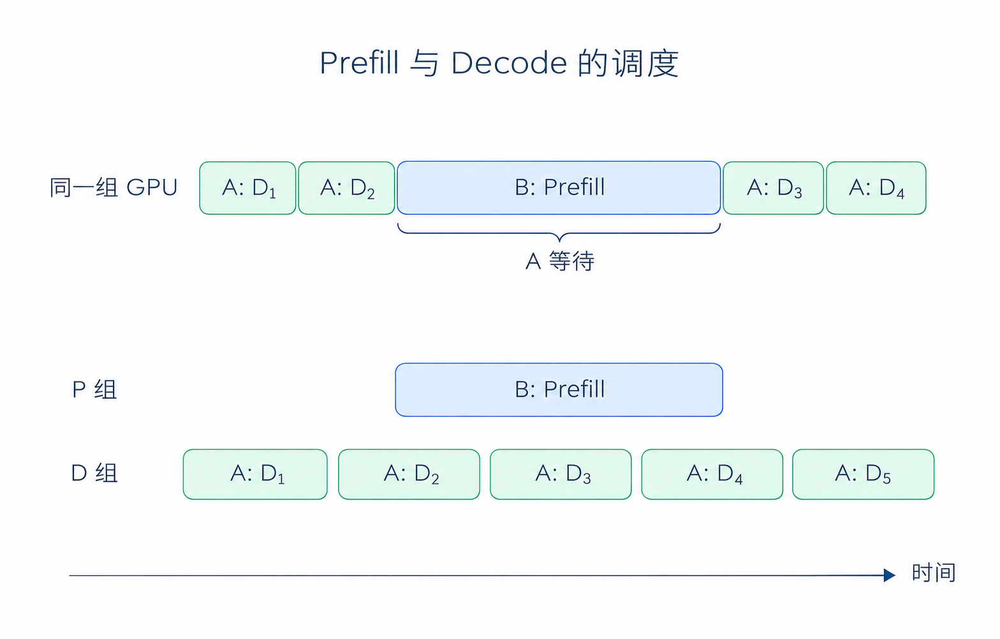
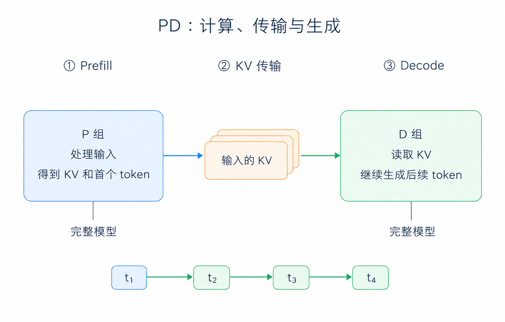
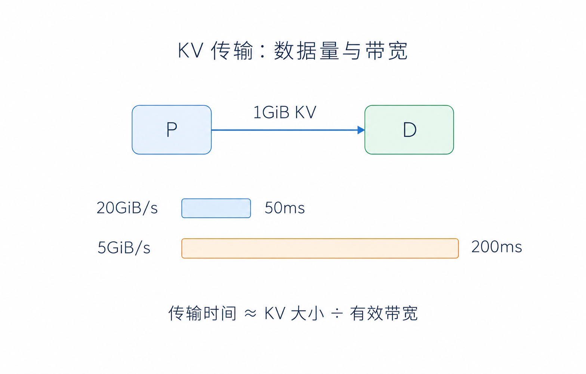
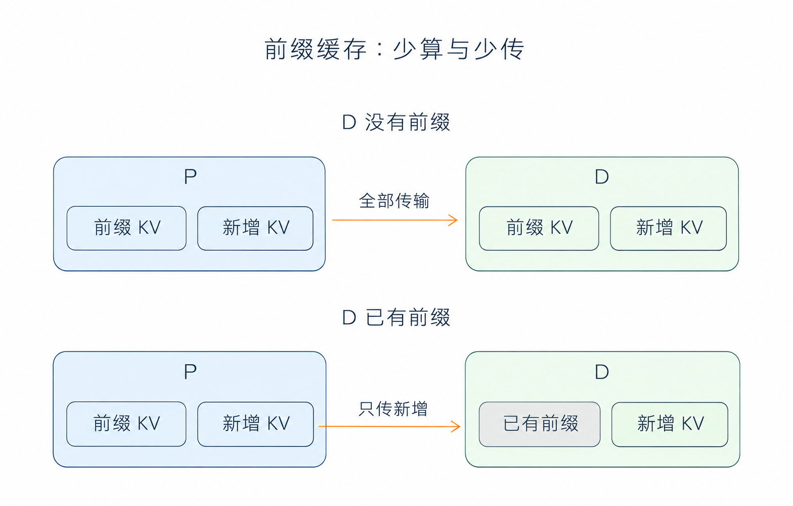

# 第 5 章 Prefill-Decode 分离

在 Part I 的[第 2 章](../part1/第2章_推理入门.md)中，我们介绍了推理的两个阶段：Prefill 处理输入，计算 KV Cache；Decode 使用这些 KV，逐个生成后续 token。在前面的实现中，这两步都由同一组 GPU 完成。

但服务同时处理多个请求时，会遇到一个问题：假设P和D在同一个Worker里面同时进行。如果这时来了一个很长的输入，GPU 要花较长时间做 Prefill，原本正在decode输出的回答就可能停下来等待。

为了适应不同工作负载，人们提出了Prefill-Decode 分离，简称 PD 分离的概念。就是把这两种工作交给不同的 GPU。减少PD之间的相互影响，本文会提及这带来的收益，以及分开以后要付出什么代价。

## 1 本章学习目标

学完本章后，你应该能回答以下问题：

1. 为什么一个新请求的 Prefill，会让其他请求的输出停顿？
2. P 和 D 分别做什么，它们之间需要传哪些数据？
3. 搬运 KV Cache 要花多少时间，P 和 D 各需要多少 GPU？
4. 什么场景适合 PD 分离，怎样判断分离后是否更快？
5. PD 分离怎样与前缀缓存、分层缓存配合？

## 2 Prefill 与 Decode 的相互影响

### 2.1 PD的workload差别

首先我们要明白一个本质：Prefill和Decode的工作负载特性是完全不同的。当来了一个新的请求，Prefill 要先处理这段输入，得到各层的 KV Cache 和首个 token。输入中的许多位置可以一起计算，形成较大的矩阵乘法。

进入 Decode 后，每条请求每轮只处理一个新位置，再生成下一个 token。单轮计算量小了，却仍要读取模型权重和历史 KV，而且这样的计算要反复执行。

因此，长 Prefill 通常更容易受算力限制，小 batch 的 Decode 则更容易受显存带宽限制。

### 2.2 长 Prefill 带来的停顿

假设请求 A 已经开始输出，请求 B 此时带着长文档到达。如果 GPU 接下来执行 B 的 Prefill，A 就要等这次计算完成，才能继续下一轮 Decode。

从 A 的角度看，前两个 token 还在正常输出，第三个却迟迟没有出现。这个停顿可以用相邻 token 的时间间隔，也就是 ITL 来观察。TPOT 是整条请求的平均值，可能会把这一次较长的等待平均掉，相关区别见 [Benchmark 入门](../part1/第5章_Benchmark入门.md)。

  
  
<em>图 1. B 的 Prefill 插入后，A 的下一轮 Decode 需要等待。下方展示分开调度的过程，时间为示意。</em>

### 2.3 Chunked Prefill 的作用与限制

在 Part II 的[连续批处理与调度](../part2/第6章_ContinuousBatching与调度.md)中，我们介绍过 Chunked Prefill：把 B 的长输入分成几块，每次只处理一部分，让 A 有机会穿插执行 Decode。

这样能缩短 A 的单次等待，但两种工作仍然共用 GPU。块切小了，B 需要更多轮才能处理完输入；块切大了，A 又要等得更久。如果请求持续到达，这种相互影响就会反复出现。

另一个办法是让它们使用不同的 GPU：B 在一组卡上做 Prefill，A 在另一组卡上继续 Decode。这就是 PD 分离的基本思路。

## 3 PD：按推理阶段分工

### 3.1 P 处理输入，D 继续生成

分离后，负责 Prefill 的一端称为 P，负责 Decode 的一端称为 D。每一端可以是一张 GPU，也可以是一组 GPU。（甚至可以是不同类型的GPU，NPU，etc。只需要做相应适配即可，技术上称之为异构PD分离）

例如，P 收到一份文档后，先计算文档的 KV Cache，再交给 D。D 拿到这些历史状态，就可以接着生成回答，不用重新计算整份文档。P 则可以去处理下一条请求。

两端都要经过模型的全部层，所以各自需要一份完整的模型权重。模型较大时，可以在各自的 GPU 组内使用上一章的 TP、EP 或 PP。PP 划分的是模型层，PD 划分的是输入处理和后续生成这两个阶段。

### 3.2 一条请求从 P 到 D

从请求进来，Router 为它选好 P 和 D 后，接下来会经历三个步骤：

1. **Prefill**：P 处理输入，计算各层的 KV，并采样出第一个 token。
2. **传输 KV**：D 准备好接收空间，P 将所需 KV、首个 token 和请求信息交给 D。
3. **Decode**：D 使用收到的 KV 和首个 token，计算出第二个 token，然后逐步生成剩余回答。

  
  
<em>图 2. P 算好输入的 KV 和首个 token，D 接收后继续生成。两端各自运行完整模型。</em>

这里搬过去的是输入对应的历史状态。交接完成后，D 每生成一步，就把新的 KV 加到自己的缓存中，后续生成继续在 D 上完成。SGLang 的 [PD 文档](https://docs.sglang.io/docs/advanced_features/pd_disaggregation)和 [Prefill 实现](https://github.com/sgl-project/sglang/blob/0c2e211930c10117beb4c52591bffe237525afdf/python/sglang/srt/disaggregation/prefill.py)介绍了这一过程。

### 3.3 两端分别调优

现在，B 在 P 上处理长文档，A 在 D 上继续生成，A 不必再等 B 的 Prefill 算完。P 可以集中处理较大的输入 batch，D 则可以根据正在生成的请求数量，控制每轮计算的耗时。

这给两端留下了分别调优的空间。不过，D 接收的请求太多时，输出仍然会变慢。因此，分开以后还需要安排好两端的设备数量，并保证 KV 能及时传过去。

## 4 PD 分离的代价

### 4.1 KV Cache 的传输时间

原来 Prefill 和 Decode 在同一组卡上，算好的 KV 留在显存里就能继续使用。分开以后，这些数据需要从 P 搬到 D。输入越长，要保存和传输的 KV 通常也越多。

假设一条请求需要传输 1GiB KV，可以用数据量除以有效带宽，粗略估算传输时间：

$$
T_{\mathrm{transfer}} \approx \frac{S_{\mathrm{transfer}}}{B_{\mathrm{effective}}}
$$

有效带宽为 20GiB/s 时，搬完约需 50ms；降到 5GiB/s，就约需 200ms。在 D 拿到所需 KV 之前，这条请求还不能继续生成后续 token。

  
  
<em>图 3. 同样传输 1GiB KV，有效带宽相差四倍，传输时间也相差四倍。数字为教学假设，未计入排队等开销。</em>

多条请求同时传输时，还会分享链路带宽。如果 P 很快算完了一批输入，但 KV 来不及搬到 D，请求仍然会堵在中间。所以，PD 分离需要较好的互联，尤其要看多条请求同时传输时，实际能达到多少带宽。

### 4.2 模型副本与显存占用

除了通信，还要考虑模型副本。P、D 各自保存权重，也都需要显存放 KV 和中间结果。传输过程中，同一份 KV 还可能在两端同时存在；D 接收以后，又要为后续生成留下空间。

如果模型只能勉强放进现有设备，就很难再单独划出一组卡运行另一份模型。PD 分离更适合已有一定部署规模、能够分别给两端分配资源的场景。

### 4.3 P 和 D 的资源分配

两端不一定要分到相同数量的 GPU。例如，文档问答往往输入长、回答短，P 要处理的工作较多；长文生成则可能输入不长，D 却要连续运行很多轮。前者可以考虑多分一些资源给 P，后者则更需要 D 的容量。

实际调整时，可以看请求在什么地方排队。P 前面排了很长的队，而 D 还有空余，就说明输入处理跟不上。反过来，如果 P 已经算完，D 上却积累了大量正在生成的请求，就需要给 D 更多资源。若请求都在等 KV 传输，则应该先检查网络。

前缀缓存也会影响这个比例。同一份长文档被反复使用时，P 可能只需计算新问题，工作量就比每次重算整篇文档小得多。

## 5 实战与性能评估

### 5.1 适用场景

可以用三种常见的请求来理解：

| 场景 | 主要问题 | PD 分离能做什么 |
|---|---|---|
| 长文档问答 | 新文档的 Prefill 影响已有回答的输出 | 将输入处理放到 P，让 D 继续生成；需要留意长文档 KV 的传输量 |
| 长回答生成 | 请求长时间留在 Decode，D 越来越忙 | 给 D 分配更多资源，P 使用较少资源处理输入 |
| 少量短问短答 | GPU 原本就没有太多工作 | 分离的收益可能很小，还会增加一次 KV 传输 |

因此，持续有请求进入、两阶段工作量差异明显的服务，更值得尝试 PD 分离。如果请求很少，一边的 GPU 空闲，另一边却在排队，分开反而可能降低设备利用率。

### 5.2 DeepSeek-V3 性能测试

SGLang 团队在 [2025 年 5 月的大规模部署文章](https://www.lmsys.org/blog/2025-05-05-large-scale-ep/)中报告了 DeepSeek-V3 的以下结果。每个节点有 8 张 H100，节点之间使用 InfiniBand：

| 测试阶段 | 测试配置 | 每节点吞吐 |
|---|---|---|
| Prefill | 4 个节点，EP32，输入长度 2K | 54,543 input token/s |
| Decode | 9 个节点，EP72，输入长度 2K | 22,282 output token/s |

两阶段是分别测试的，测试时假设另一端有足够资源。原文中，Decode 相对 TP16 基线最高提高约 5.2 倍，但这个结果同时使用了 EP、更大的 batch 等优化。因此，它展示的是整套部署方案的收益，不能把全部提升都归给 PD 分离。

### 5.3 KV Cache 传输优化

前面用“数据量除以带宽”估算过传输时间。要减少这部分等待，可以从三个方向入手：

- **量化优化，少传一些。** 在两端都支持的情况下，使用更低精度的 KV，减少每个元素占用的字节数。精度影响与后端要求可参见 [KV Cache 量化文档](https://docs.sglang.io/docs/advanced_features/quantized_kv_cache)。
- **增加传输带宽。** 使用适合设备拓扑的传输方式，例如 RDMA，减少不必要的中转。
- **重叠计算与传输。** P 算好一部分 KV 后就先发送，继续计算后面的部分，让传输与计算重叠。这样可以减少最后集中搬运的等待，相关支持见 [PD 文档](https://docs.sglang.io/docs/advanced_features/pd_disaggregation)。

  
  
<em>图 4. P 命中缓存可以少算；D 也有可复用前缀、且传输过程支持时，才能进一步少传。</em>

这也解释了 PD 分离与[分层缓存](./第3章_分层缓存.md)为什么可以配合。假设 P 已经保存了文档的 KV，第二次提问时可以直接复用。如果 D 没有这份缓存，P 机器可以把它传过去；或者如果 D 也保留了同样的前缀，而且传输过程支持复用，就可以只发送缺失部分。HiCache 让 P 有机会保留、恢复更多文档前缀，减少重复 Prefill；D 则专门负责后续生成。

## 6 总结与测试题

### 6.1 课程总结

本章介绍了按推理阶段分工的方法：P 处理输入，算好 KV Cache 后交给 D，由 D 继续生成。这样可以减少长 Prefill 对已有请求的干扰，也让两端分别选择合适的计算和调度配置。

代价是两端需要各自保存模型，并增加 KV 传输。实际部署时，要根据输入、输出的工作量分配 P 和 D，再结合传输带宽判断是否划算。同时，之前课程提到过的前缀缓存和分层缓存（RadixCache and Hicache）也可以减少重复计算。

### 6.2 测试题

1. 一条长文档请求到来后，已有对话出现一次明显停顿，但整条请求的平均 TPOT 变化不大。应该查看什么指标？Chunked Prefill 与 PD 分离分别怎样缓解这个问题？
2. 描述一条请求从进入 P 到在 D 上生成第二个 token 的过程。首个 token 在哪里产生？两端是否分别负责模型的一半层？
3. 某请求需要传输 2GiB KV，有效带宽为 10GiB/s。忽略其他开销，传输约需多久？若有效带宽因竞争降为一半，会发生什么？
4. 分别判断以下场景是否值得优先尝试 PD 分离，并说明还需要确认哪些条件：
   - 长文档问答请求持续到达，已有用户的流式输出经常停顿。
   - 少量短问短答，单组 GPU 大部分时间空闲。
   - 服务持续生成长回答，D 已经排满，P 仍有大量空闲。
5. 公开结果同时使用了 PD、EP 和更大的 batch。能否把相对 TP 基线的全部加速归因于 PD？如果要单独判断 PD 的收益，应固定哪些条件？
6. P 从 HiCache 恢复了某份文档的前缀 KV，而 D 没有该前缀。省下了什么，哪些数据仍需搬运？若想进一步少传 KV，还需要什么支持？

## 参考资料

- [Part I 第 2 章：推理入门](../part1/第2章_推理入门.md)
- [Part I 第 5 章：Benchmark 入门](../part1/第5章_Benchmark入门.md)
- [Part II 第 6 章：连续批处理与调度](../part2/第6章_ContinuousBatching与调度.md)
- [Part III 第 3 章：分层缓存](./第3章_分层缓存.md)
- [SGLang：PD Disaggregation](https://docs.sglang.io/docs/advanced_features/pd_disaggregation)
- [SGLang Prefill 实现：首个 token 与 KV 交接](https://github.com/sgl-project/sglang/blob/0c2e211930c10117beb4c52591bffe237525afdf/python/sglang/srt/disaggregation/prefill.py)
- [SGLang：KV Cache 量化](https://docs.sglang.io/docs/advanced_features/quantized_kv_cache)
- [SGLang：Benchmark and Profiling](https://docs.sglang.io/docs/developer_guide/benchmark_and_profiling)
- [SGLang 团队：Deploying DeepSeek with PD Disaggregation and Large-Scale Expert Parallelism on 96 H100 GPUs，2025-05-05](https://www.lmsys.org/blog/2025-05-05-large-scale-ep/)
