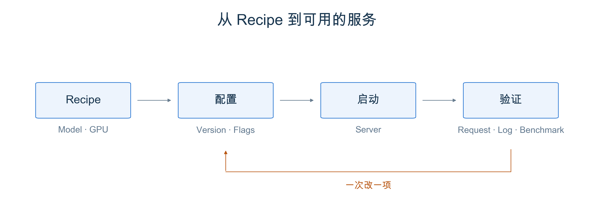
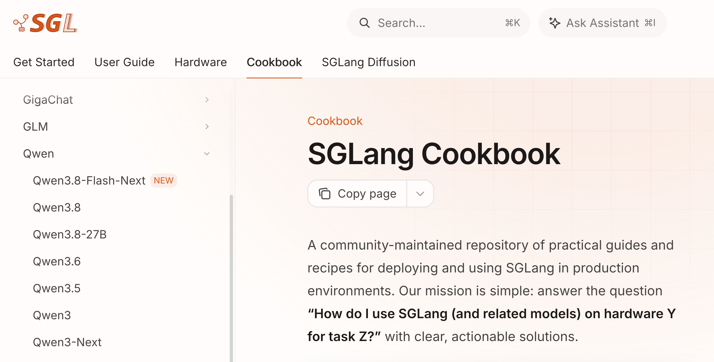
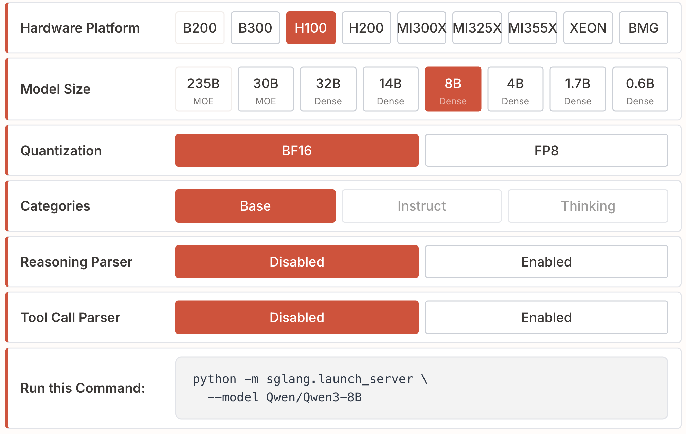

# 第 1 章 用 Cookbook 部署 SGLang

在前面的课程中，我们分别学过并行、量化、前缀缓存等技术。真正部署时，这些概念会一起出现在启动命令里：那么如何设置用哪个模型、几张卡、什么精度呢？

本章将从官方 Cookbook出发，介绍其使用方法。把这些选择连起来，各个主要的feature flag的作用是什么。再用一次简单的 benchmark，检查服务是否能正常工作。

## 1 本章学习目标

学完本章后，你应该能回答以下问题：

1. 怎样找到适合自己模型和硬件的 Cookbook 配置？
2. 启动命令中的几个关键参数，分别对应前面学过的什么概念？
3. 服务启动后，怎样验证它，并用数字描述一次配置调整？

## 2 Cookbook 是什么

[SGLang Cookbook](https://docs.sglang.io/cookbook/intro) 是官方文档中的部署 recipe 集合，由社区共同维护。它围绕一个具体问题组织内容：在某种硬件上，怎样把某个模型跑起来？模型页面通常会给出安装入口、推荐配置、调用方法和调优建议。

先照着 recipe 跑，可以少花一些时间试错。但配置有适用条件，复制前先核对模型版本、GPU 型号与数量、权重精度，以及 recipe 要求的 SGLang 版本。

<div align="center">
  
  <p><em>图 1. 先跑通 recipe，再检查服务；调整配置后，用相同条件重新测试。</em></p>
</div>

## 3 启动一个服务要做哪些决定

举个使用的栗子，打开 Cookbook 后，在左侧展开 `Autoregressive Models → Qwen`，选择 `Qwen3`，就能进入本章使用的 recipe。

<div align="center">
  
  <p><em>图 2. 从左侧模型目录找到 Qwen3。来源：<a href="https://docs.sglang.io/cookbook/intro">SGLang Cookbook</a>，截图于 2026-11-07；网页内容会随版本更新。</em></p>
</div>

以 [Qwen3 recipe](https://docs.sglang.io/cookbook/autoregressive/Qwen/Qwen3) 为例，在页面的 `Interactive Command Generator` 中选择 H100、8B、BF16，将可选的 `Reasoning Parser` 和 `Tool Call Parser` 设为 `Disabled`。下面保留它的单卡部署方式，并显式写出模型精度、卡数和本机监听地址，方便对照理解。

<div align="center">
  
  <p><em>图 3. 选项改变后，底部的 Run this Command 会更新。来源：<a href="https://docs.sglang.io/cookbook/autoregressive/Qwen/Qwen3#3-1-basic-configuration">Qwen3 配置选择器</a>，截图于 2026-11-07。截图中的 <code>--model</code> 与下文的 <code>--model-path</code> 是同一参数的两种写法。</em></p>
</div>

示例假设你有一张可用的 H100 80GB，已按 [Part 0 的环境准备](../part0/Part0-部署你的第一个SGLang服务.md)和[官方安装文档](https://docs.sglang.io/docs/get-started/install)安装好适配版本；命令在 GPU 机器上执行。如果课程分配的是其他设备，就在 recipe 中重新选择对应硬件。

```bash
python3 -m sglang.launch_server \
  --model-path Qwen/Qwen3-8B \
  --dtype bfloat16 \
  --tp-size 1 \
  --host 127.0.0.1 \
  --port 30000
```

读这条命令时，可以把参数还原成几个决定：

| 决定 | 对应配置 | 与前面课程的联系 |
|---|---|---|
| 跑哪个模型 | `--model-path` | 确定要加载的权重；首次使用可能需要下载 |
| 几张卡一起计算 | `--tp-size 1` | 本例不切分；改成多卡 TP 后，要考虑每卡显存与卡间通信 |
| 用什么精度 | `--dtype bfloat16` | 本例使用 BF16；量化需要匹配权重格式、硬件和后端，见 Part III 第 2 章 |
| 是否复用前缀 | 本例保留默认前缀缓存 | 对应 Part II 的 RadixAttention；`--disable-radix-cache` 可关闭跨请求的前缀复用 |

## 4 验证Cookbook Command

### 4.1 发一条请求

等服务完成权重加载和初始化后，在同一台机器的另一个终端发出请求。下面使用 Qwen3 的 non-thinking 模式，让第一次验证的回答短一些：

```bash
curl --fail-with-body http://127.0.0.1:30000/v1/chat/completions \
  -H 'Content-Type: application/json' \
  -d '{
    "model": "Qwen/Qwen3-8B",
    "messages": [{"role": "user", "content": "用一句话解释什么是 KV Cache。"}],
    "max_tokens": 128,
    "chat_template_kwargs": {"enable_thinking": false}
  }'
```

检查返回的 `choices[0].message.content` 是否有正常文本。接口能返回回答，说明请求已经走过模型推理；它还不能证明高并发下的性能或模型精度达标。

### 4.2 看日志和显存

回到服务终端，确认加载的是预期模型，初始化过程中没有异常，再用 `nvidia-smi` 看进程和显存占用。除了权重，SGLang 还会为 KV Cache 等数据准备空间，所以显存占用高不等于泄漏。首条请求可能包含额外初始化开销，后续测试应保持一致的 warmup 方式。

第一次部署常见的问题有三个：显存不足时，先看是权重加载还是运行阶段报错，再考虑小模型、受支持的量化或调整缓存预算；下载失败时检查网络、模型访问权限和磁盘空间；端口占用时更换 `--port`，请求端也要一起改。

### 4.3 跑一次简单的 benchmark

服务保持运行，在同一个 Python 环境中执行[官方 serving benchmark 工具](https://docs.sglang.io/docs/developer_guide/bench_serving)：

```bash
python3 -m sglang.benchmark.serving \
  --backend sglang \
  --host 127.0.0.1 --port 30000 \
  --model Qwen/Qwen3-8B \
  --dataset-name random \
  --random-input-len 256 --random-output-len 64 \
  --random-range-ratio 1 \
  --num-prompts 80 --max-concurrency 4 \
  --seed 42
```

这是一个小规模连通性与性能练习：随机输入长度设为 256，目标输出长度为 64，共 80 条请求，最多同时执行 4 条。旧版 SGLang 可能使用 `sglang.bench_serving` 入口；请按安装版本的文档和 `--help` 核对。

先确认请求是否全部成功，再看 TTFT、TPOT 和输出吞吐。这几个指标的含义见 [Benchmark 入门](../part1/第5章_Benchmark入门.md)。随机文本测试不能用来判断回答质量，这点在切换量化配置时尤其需要注意。

## 5 总结与测试题

### 5.1 课程总结

Cookbook 提供了经过实践的起点。部署时，先让模型、硬件和版本对上，再理解并行、精度和缓存的选择。服务启动后，依次确认请求返回、日志与显存、简单负载下的表现，才算完成了这次练习。

### 5.2 测试题

1. 使用课程提供的 GPU，选择一份适合它的 recipe，完成启动、请求和 benchmark。记录 recipe 链接、GPU、SGLang 版本、完整命令，以及成功请求数、TTFT、TPOT 和输出吞吐。
2. 只改变一个配置，再用相同输入、并发数和 warmup 方式测试。例如在硬件支持时比较 BF16 与 recipe 中的 FP8 权重，或者开关前缀缓存。测试前先停止旧服务；测缓存时使用有共同长前缀的请求，并让两组从相同的缓存状态开始。重复几次，用数字说明变化，也可以得到“没有明显收益”的结论。

## 参考资料

- [SGLang Cookbook](https://docs.sglang.io/cookbook/intro)
- [SGLang：Qwen3 recipe](https://docs.sglang.io/cookbook/autoregressive/Qwen/Qwen3)
- [SGLang：安装指南](https://docs.sglang.io/docs/get-started/install)
- [SGLang：Server Arguments](https://docs.sglang.io/docs/advanced_features/server_arguments)
- [Qwen3：SGLang 部署与调用](https://github.com/QwenLM/Qwen3/blob/main/docs/source/deployment/sglang.md)
- [SGLang：Bench Serving Guide](https://docs.sglang.io/docs/developer_guide/bench_serving)
