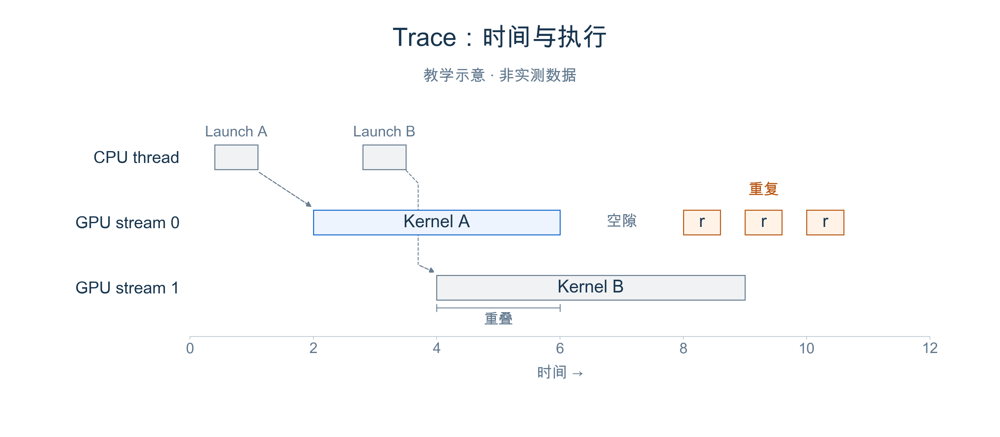
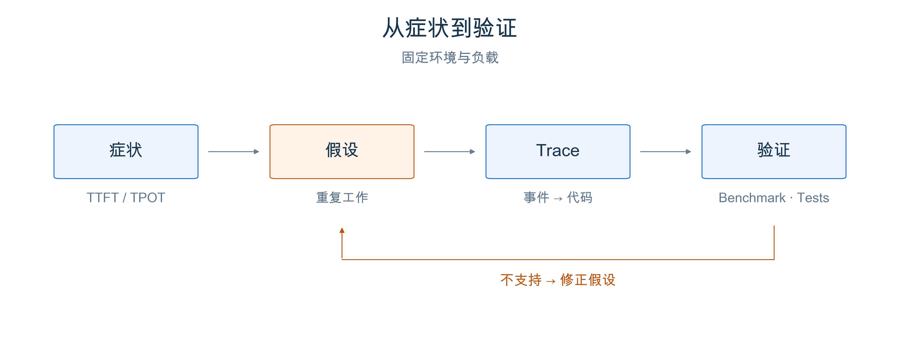
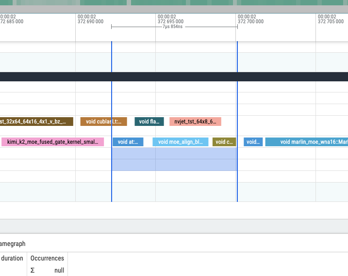
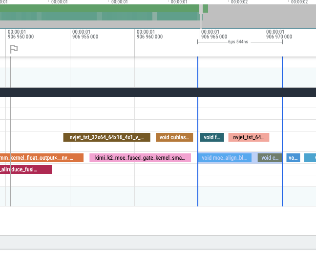

# 第 2 章 Profiling 与 Trace 分析

之前的所有章节讲了很多优化的方案，但是实战中，具体什么方案能带来提升，往往是需要具体情况具体分析的。只看一个吞吐数字，通常回答不了。

本章先介绍 benchmark、profiling 和 trace 的基本关系，再看 SGLang core maintainer **BBuf** 提交并已 merge 的 一个例子：[PR #13587](https://github.com/sgl-project/sglang/pull/13587)。我们沿着作者的原始截图、代码和 benchmark，看看怎样判断PR的价值。

## 1 本章学习目标

学完本章后，你应该能回答三个问题：

1. Benchmark 和 profiling 分别回答什么问题，trace 中应该看什么？
2. 怎样从症状提出假设，用真实 trace 定位问题，并验证代码改动？
3. 局部耗时和端到端吞吐的差距，理解局部加速不等于端到端的等量提升。

## 2 先理解 Profiling 在看什么

### 2.1 Benchmark 看结果，Profiling 找原因

Part I 中的 TTFT、TPOT 和吞吐，描述的是请求侧的表现：多久收到第一个 token、后续 token 生成得多快、单位时间完成多少工作。用固定负载跑 benchmark，可以确认“哪里慢了”，以及改动前后有没有改善。但 TTFT 高，可能是排队久，也可能是 prefill 慢，单看这个数字分不清。

Profiling 则记录程序内部的执行：CPU 在运行哪些 operator、GPU 执行了哪些 kernel、时间花在哪里。可以把 benchmark 看成黑盒测量，把 profiling 看成打开内部过程的白盒观察。两者要配合：先用指标明确问题，再用内部记录检验原因，修改后回到 benchmark 看结果。

可以用 [PyTorch Profiler](https://docs.pytorch.org/tutorials/recipes/recipes/profiler_recipe.html) 采集 CPU / GPU 事件，再用 Perfetto 打开生成的 trace。**Profiler 负责记录，trace 是记录下来的数据，viewer 负责展示。**

### 2.2 一张 Trace 要看哪些东西

Trace 通常展示成时间线：横轴是时间，不同 track 对应 CPU thread、GPU stream 等；一个色块代表一次事件，宽度表示它持续了多久。

值得关注的其实就是三件事情：**耗时长的事件、频繁重复的事件、事件之间的空隙**。一个 kernel 单次只有几微秒，重复很多层、很多步后也可能值得优化；一个 stream 上有空隙，则需要继续检查其他 stream、CPU 提交和依赖。

还要留意重叠执行。不同 stream 的 kernel 可以在时间上重叠，把所有 duration 加起来并不等于请求延迟。真正影响完成时间的是必须等待的那条执行路径。因此，trace 中某项工作少了，仍需要 benchmark 确认整体是否变快。如图是一个简单的展示：

<div align="center">
  
  <p><em>图 1. 教学示意，不代表实测数据。虚线连接 CPU 提交与对应的 GPU kernel。</em></p>
</div>

### 2.3 从症状到假设，再到验证

基本顺序是 **明确症状 → 提出假设 → 用 trace 检查 → 修改并验证**：

1. **明确症状。** 固定模型、硬件、版本、输入输出长度和并发，看慢的是 TTFT、TPOT，还是吞吐；先排除负载变化造成的差异。
2. **提出可以检查的假设。** TTFT 高，就检查排队和 prefill；TPOT 抖，就检查 decode 是否被 prefill 插入或其他工作阻塞；吞吐上不去，就检查实际 batch、并发和计算 / 通信等待。指标决定从哪里查，但本身不是原因的证明。
3. **验证假设和改动。** 在相同 rank、相同执行阶段采集短 trace，把可疑事件对应到代码。每次集中改一个问题，确认目标开销减少，再关闭 profiler，重复跑同条件 benchmark，并补正确性检查。

<div align="center">
  
  <p><em>图 2. 从指标提出可检查的假设，再用 trace、benchmark 和正确性检查验证；证据不支持时，回到假设继续排查。</em></p>
</div>

下面打个比方，用 BBuf 的 PR #13587 走一遍这个过程。它提供了一个很具体的假设：MoE 的准备阶段单独跑了一次 padding，如果已有 kernel 能顺手完成，能不能省掉这次独立执行？

## 3 实例：怎样省掉一个 padding kernel

[PR #13587](https://github.com/sgl-project/sglang/pull/13587) 由 **BBuf** 提交，于 2025-11-21 合并。这个案例属于 Kimi K2 优化系列，改动集中在一个 MoE 公共函数，作者还补充了 DeepSeek-R1 的端到端 benchmark。

MoE 把 token 分配给不同 expert 后，需要把每个 expert 的工作量补齐到 block size 的整数倍，方便后续矩阵计算。比如某个 expert 有 3 个 token，block size 为 4，就需要一个 padding 位置；这个位置填入无效 token 的标记，后续计算会忽略它。

优化前，`moe_align_block_size()` 根据 buffer 大小选择两条路径：小 buffer 在 alignment kernel 内完成 padding；超过 4,096 个元素时，先调用 `sorted_ids.fill_()`，再执行 alignment。后者多了一次独立的 GPU kernel。

所以要检查的是：**已有 alignment kernel 的 padding 能力，能否覆盖这条路径，从而省掉单独的 fill？** 下面先看作者的 profiling，再回到代码确认 padding 有没有被正确保留。

### 3.1 看作者的原始 trace：究竟少了什么

PR 提供了 main 和 PR 两张原始截图，并报告这段局部路径从约 **7.8μs 降到 6.5μs**。读图时先对齐同一段 MoE alignment 工作，再检查独立的 fill 事件和后续 alignment；不要只比较截图中色块的像素宽度。

Before 的蓝色选区从 `void at:...` 事件开始，后面是 `void moe_align_bl...` 和另一个事件；After 的选区直接从 `void moe_align_bl...` 开始。截图里的名称被截断了，结合下一节的 diff，才能把少掉的操作对应到 `sorted_ids.fill_()`。

<div align="center">
  
  <p><em>图 3a. Before：main 版本。直接引用 <a href="https://github.com/sgl-project/sglang/pull/13587">BBuf 的 PR #13587</a>，保留原始像素与标注。<a href="https://github.com/user-attachments/assets/b9d82fb5-c289-45bc-a6b0-55666b12662b">查看原图</a>。</em></p>
</div>

<div align="center">
  
  <p><em>图 3b. After：PR 版本。来源同上。<a href="https://github.com/user-attachments/assets/589a56b1-e924-4587-ad0e-b1a50f816686">查看原图</a>。</em></p>
</div>

可以把它理解成：**原来专门叫 GPU 做一次填充，再做 alignment；现在让 alignment kernel 顺手把填充也做了。** 填充本身还要做，但不用为这点工作再单独启动一个 kernel。因为启动和执行一个 kernel 也有成本，所以少拆出这一步，就有机会省下一点时间。

看图时，找到 `moe_align_bl...` 所在的那一行。Before 在它前面还有一个 `void at:...` 色块，对应单独的填充；After 里这个色块没了，填充交给 alignment kernel 内部完成。再看上方两条蓝线圈住的时间：Before 是 7.854μs，After 是 6.544μs。也就是说，**该做的事还在，但少了一次单独执行，这一段总共快了约 1.3μs。** 这是这段工作的耗时下降了约 16.7%，模型还有很多其他计算，整体能快多少，要看后面的 benchmark。

### 3.2 对照代码：把 padding 交给已有 kernel

[合并 diff](https://github.com/sgl-project/sglang/commit/bfcf15a129fd4e26ef8d4af140f30cbcf02a6696) 很短，核心变化如下。

```python
# Before
fuse_sorted_ids_padding = sorted_ids.shape[0] <= 4096
if not fuse_sorted_ids_padding:
    sorted_ids.fill_(topk_ids.numel())
sgl_moe_align_block_size(..., fuse_sorted_ids_padding)

# After
sgl_moe_align_block_size(..., True)
```

最后一个参数控制 kernel 是否负责 padding。改成 `True` 后，原来由独立 `fill_` 完成的工作交给已有 kernel，Python 层的大小判断和单独填充就可以删除。

这并不是对未初始化的 buffer 放任不管。[该版本的 CUDA 实现](https://github.com/sgl-project/sglang/blob/bfcf15a129fd4e26ef8d4af140f30cbcf02a6696/sgl-kernel/csrc/moe/moe_align_kernel.cu)在 `pad_sorted_token_ids` 为真时，会把 padding 区域填成 `numel`，也就是无效 token 的标记。**省掉的是独立执行的开销，正确性需要的填充仍然保留。**

### 3.3 回到 benchmark：局部快了，服务快多少

作者在 [benchmark 评论](https://github.com/sgl-project/sglang/pull/13587#issuecomment-3558359315)中测试了 **DeepSeek-R1、TP8**，random input / output length 都设为 1,000，`random-range-ratio=1`，每组有 5 个 warmup 请求。下表保留所有并发档位；

| 最大并发 | 请求数 | Output throughput：main → PR（token/s） | 变化 | Mean TPOT：main → PR（ms） |
|---|---:|---:|---:|---:|
| 1 | 5 | 105.806 → 105.542 | −0.25% | 9.067 → 9.164 |
| 4 | 20 | 372.914 → 373.976 | +0.28% | 10.243 → 10.211 |
| 16 | 80 | 1,049.407 → 1,060.126 | +1.02% | 14.590 → 14.482 |
| 32 | 160 | 1,657.395 → 1,675.659 | +1.10% | 18.158 → 18.030 |

正确性也有记录：PR 正文附了一次 GSM8K 测试，实际完成 1,319 道题，accuracy 为 0.938，invalid 为 0。它说明作者检查了模型输出，但没有给出成对的 main / PR accuracy，不能据此声称两版完全等价。

这个 PR 值得示范，在于 **scope 小，证据能对应到代码**：多余的独立 fill 是具体目标，已有 kernel 接手 padding 是具体机制，多个并发档位的 benchmark 则限定了收益范围。读完后，我们知道改了什么、为什么可能更快，也知道哪些结论还需要更多测量。

## 4 总结与测试题

### 4.1 课程总结

Benchmark 确认性能表现，profiling 帮助检验原因；读 trace 时，要同时看耗时、重复、空隙和执行依赖。

分析性能问题时，先固定环境和负载，用指标明确症状，再提出可以检查的假设。通过 trace 把可疑开销对应到代码，每次集中修改一个问题；修改后，既要确认目标开销减少，也要检查必要的计算是否仍然正确完成。

最后关闭 profiler，重复跑同条件的端到端 benchmark，并补正确性检查。局部耗时下降不等于整体按同比例加速，结论应说明在哪些负载下有效、收益有多大，以及还有哪些未验证的部分。

### 4.2 测试题

1. 如果 benchmark 显示 TTFT 升高，你会提出哪些假设？需要结合哪些 trace 信息来区分这些原因？
2. 一个 GPU stream 上出现空隙，能否说明整个 GPU 都在空闲？一个 kernel 耗时明显下降，又为什么不一定带来同等比例的端到端收益？
3. 如何设计一组可信的优化前后对比？请说明需要固定的条件、profiler 的使用时机，以及性能和正确性应分别检查什么。

## 参考资料

- [BBuf 的 SGLang PR #13587：原始截图、代码与测试记录](https://github.com/sgl-project/sglang/pull/13587)
- [作者的 DeepSeek-R1 benchmark](https://github.com/sgl-project/sglang/pull/13587#issuecomment-3558359315)
- [合并 commit：bfcf15a](https://github.com/sgl-project/sglang/commit/bfcf15a129fd4e26ef8d4af140f30cbcf02a6696)
- [SGLang profiling 文档](https://docs.sglang.io/docs/developer_guide/benchmark_and_profiling)
