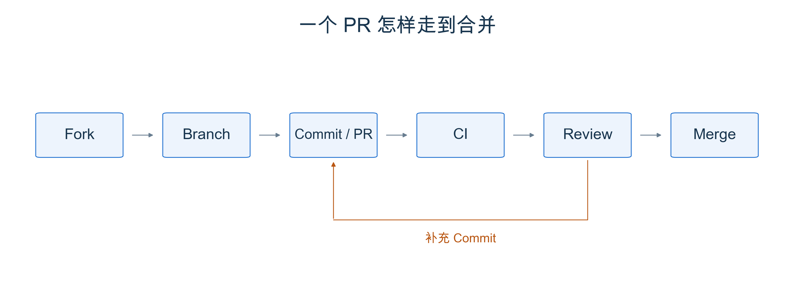

# 第 3 章 SGLang PR 工作流

跑完课程之后，你可能有一个疑问，那我们最后学了这么多，要怎么真正实操落到实处呢？其实不难，你可能已经遇到过一个文档里的过期命令，或者发现某种配置下的推理比预期慢。把问题描述清楚，补上修改和验证，就可以成为一次开源贡献的起点。

本章介绍一个 PR 从提出到合并的过程。包括每一步为什么存在，以及怎样让维护者看懂、验证并接手你的修改。

## 1 本章学习目标

学完本章后，你应该能回答以下问题：

1. 提问或修改之前，应该先准备哪些信息？
2. Fork、分支、CI 和 Review 分别解决什么问题？
3. 怎样选一个范围合适的任务，完成自己的第一次贡献？

## 2 如何做好开源协作

在 [Part 0 的编码伦理与开源精神](../part0/Part0-编码伦理与开源精神.md)中，我们讨论过对代码负责。到了实际协作中，可以从三件小事做起。

**定义明确的问题。** 先说清楚要解决什么，再给出证据。如果是性能优化，在相同硬件、模型和负载下做好修改前后的 profiling，说明瓶颈在哪里、改动带来了什么变化。如果是 bug，提供最小复现步骤、相关 log、模型、GPU、SGLang 版本或 commit，以及启动命令，并说明预期行为和实际结果。

**较大的改动，先讨论。** 新功能、接口调整或较大的性能优化，先通过 RFC 或 issue 说明使用场景、改动范围和方案，与维护者讨论方向，再开始实现。错别字或明确的小修复通常可以直接开 PR，不必为流程额外造一个 issue。

**让 PR 保持有限的 scope。** 一个 PR 解决一个问题，修调度 bug 时，不要顺手重排整个文件。使用 AI 辅助时，author 也必须自己读懂代码、实际验证，并如实说明没有测试的部分。不能不负责任地提交 agent slop，更不能批量制造低质量 issue 和 PR，形成 DDoS 式的负担，消耗维护者的 review 时间和 CI 资源。

## 3 一个 PR 的生命周期

假设你发现 Cookbook 的一条启动命令已经过期，准备修正它。整个过程可以这样走：

  
  
<em>图 1. 提交让改动可追踪，CI 和 Review 检查它能否进入主线；收到意见后继续在原分支修改。</em>

| 步骤 | 做什么 | 这一步在保护什么 |
|---|---|---|
| Fork | 在自己的 GitHub 账号下建立仓库副本 | 没有上游写权限，也能提出修改 |
| 分支 | 从上游最新主线建立任务分支 | 让这次修改与其他工作分开 |
| 提交并开 PR | 检查 diff，提交到自己的分支，再向上游 `main` 发起 PR | 留下改了什么、为什么改、怎样验证的记录 |
| CI 检查 | 运行格式、测试等自动检查，阅读失败日志 | 尽早发现可自动检查的错误与回归 |
| Review | 回答问题、补充证据，在同一分支继续提交 | 检查正确性、设计取舍和长期维护成本 |
| 合并 | 按项目要求取得审批，由维护者完成合并 | 把经过 Review 的修改纳入共同维护的主线 |

具体开发环境和检查命令见 [SGLang Contribution Guide](https://docs.sglang.io/docs/developer_guide/contribution_guide)。已有本地仓库就直接使用它；先检查工作区，再更新上游引用、建立分支，避免覆盖自己的其他修改。

### 3.1 让别人看懂你的 PR

PR 描述不需要长，但要回答三个问题：原来有什么问题，改完会怎样，凭什么认为改对了。例如，修 Cookbook 命令时，写出哪个模型、哪种硬件上的命令失效，更新了哪个参数，以及新命令是否真的启动并返回了回答。没有 GPU 实测就直接说明，不把“文档构建通过”写成“部署验证通过”。

如果涉及性能，附上相同硬件、模型、输入输出长度和并发条件下的前后数据；需要时用上一章的 Profiling 方法说明时间花在哪里。如果影响模型输出，还要补相应的精度检查。测试范围应跟着改动走。

开 PR 前先跑相关测试和项目要求的格式检查，再看一遍最终 diff。标题与描述使用仓库当前模板；SGLang 的标题规则、测试目录和运行方式都可以从贡献指南查到。

### 3.2 CI 与 Review 往返

CI 是自动检查，但不是所有检查都会在开 PR 后立即运行。SGLang 的 GPU 测试有资源与权限限制，部分流程需要 `run-ci` 标签及有权限的人触发。没有启动时，按贡献指南请维护者协助；失败时先读日志，分清代码错误与环境问题，不要反复重跑来碰运气。

Reviewer 提出意见后，说明你改了哪里、补了什么验证；如果不同意，也可以给出代码或数据解释取舍。继续向原分支 push，原 PR 就会更新，无需为同一轮修改再开一个 PR。新增提交可能需要重新测试和 Review，先前的绿色检查不能代替对新版本的验证。

CI 通过也不代表自动合并。测试覆盖不到的设计和维护问题仍需要人判断，取得项目要求的审批后，再由维护者安排合并。

## 4 贡献举例

可以按自己已经掌握的内容，逐步扩大贡献范围：

| 起点 | 做到什么程度就有价值 |
|---|---|
| 修文档 | 修正自己读到的错字、失效链接或过期命令，检查修改后的页面 |
| 补 Cookbook | 记录真实跑过的模型、GPU、版本和配置，让下一位读者能复现 |
| 复现与定位问题 | 给出最小复现，用日志或 Profiling 结果缩小问题范围，即使暂时没有修复 |
| 修小 bug | 解释原因，提供集中修改，并补一个能区分修复前后的回归测试 |

找任务时，先看 [SGLang 的 issue](https://github.com/sgl-project/sglang/issues)，再读对应模块和贡献指南。文档修改可以从[文档贡献说明](https://github.com/sgl-project/sglang/blob/main/docs/CONTRIBUTING.md)进入；Cookbook 也已在 SGLang 主仓库的 `docs/cookbook/` 下维护。选不准时，可以在相关 issue 中说明自己复现到哪一步，请维护者指向合适的入口。

## 5 总结与测试题

### 5.1 课程总结

一次贡献从可描述、可复现的问题开始。用小范围的修改解决它，提供与改动匹配的验证，再通过 CI 和 Review 把它带入主线。第一步可以很小，能让下一位使用者少踩一个坑，就已经有价值。

### 5.2 测试题

1. 找一个真实的小问题，搜索已有讨论，准备一份说明问题、scope 和验证方式的 PR 草稿。可以先留在本地自查，不必为了完成作业提交没有实际价值的改动。
2. 一次优化在更换 GPU、缩短输入后快了一倍，这能证明代码改动有效吗？如果 CI 还没有启动，你应该怎样处理？

## 参考资料

- [Part 0：编码伦理与开源精神](../part0/Part0-编码伦理与开源精神.md)
- [SGLang：Contribution Guide](https://docs.sglang.io/docs/developer_guide/contribution_guide)
- [SGLang：文档贡献说明](https://github.com/sgl-project/sglang/blob/main/docs/CONTRIBUTING.md)
- [SGLang：文档与 Cookbook 目录](https://github.com/sgl-project/sglang/blob/main/docs/README.md)
- [SGLang：Issue 列表](https://github.com/sgl-project/sglang/issues)
