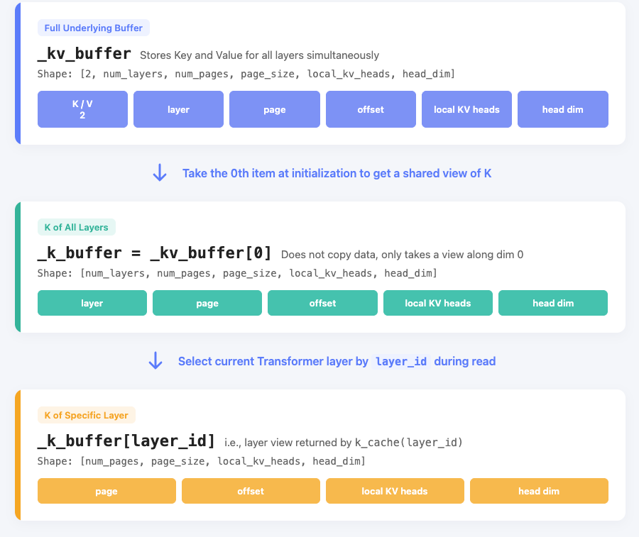

# Chapter 4 KV Cache Optimization (Code Walkthrough)

The previous chapter explained that KV Cache prevents recomputation of historical tokens during decode. This chapter answers a more concrete question: **where are the newly computed K/V tensors stored, and how are they found again in the next iteration?**

In mini-sglang, the system must handle three things at once: storing the actual K/V tensors; recording where each token should be written; and deciding which completed positions may be reused by later requests.

## 1 Learning Objectives

After completing this chapter, you will understand the following workflow:

1. Where newly computed K/V tensors are stored on the GPU.
2. How a request finds the K/V for one of its tokens.
3. When a completed segment of K/V can be reused by another request.

## 2 Source Modules Involved in KV Cache Reads and Writes

The code discussed in this chapter is primarily in mini-sglang's `python/minisgl/` directory. First, become familiar with the responsibilities of these files so that you do not get lost while following the flow across modules.

**1. Interfaces and entry points**

| File | Responsibility |
|---|---|
| `kvcache/base.py` | Defines the abstract read/write interface for the physical KV pool. |
| `kvcache/__init__.py` | Creates the KV pool and registers cache policies. |

**2. Storage and initialization**

| File | Responsibility |
|---|---|
| `kvcache/mha_pool.py` | Stores K/V tensors for all layers on the GPU and provides per-layer read/write methods. |
| `engine/engine.py` | Initializes the KV pool, global `page_table`, and other runtime objects at startup. |

**3. State and scheduling**

| File | Responsibility |
|---|---|
| `core.py` | Records request progress and the logical span whose K/V must be written in the current iteration. |
| `scheduler/cache.py` | Allocates and reclaims pages, and manages prefix caching. |
| `scheduler/prefill.py` | Matches and locks reusable prefixes during prefill. |
| `scheduler/scheduler.py` | Organizes batches, determines K/V write locations for the current iteration, and cleans up completed requests. |

**4. Computation**

| File | Responsibility |
|---|---|
| `attention/fa.py` | Reads and writes KV Cache during the attention forward pass and performs attention computation. |

The entire flow can first be remembered as three steps:

1. The scheduler prepares physical locations for the tokens being computed in this iteration.
2. Attention writes new K/V to those locations, then reads the required historical K/V.
3. When a request finishes or temporarily leaves a batch, the system retains reusable locations and returns the rest.

## 3 K/V Storage, Position Mapping, and Prefix Reuse

To understand KV Cache, do not begin with paging and scheduling. First answer four questions: **Where is K/V stored? How does a request find it? How are completed positions reused? Who allocates and reclaims positions?**

| Component | Problem it solves | Core data |
|---|---|---|
| `MHAKVCache` | Where the floating-point K/V tensors reside | `_kv_buffer`, per-layer K/V views |
| `page_table` and `Batch.out_loc` | Which physical position a token in this iteration should write to | `int32` physical-position indices |
| `BasePrefixCache` | Whether a completed prefix can be used by another request | `BaseCacheHandle`, `cached_len`, matched indices |
| `CacheManager` | Which pages can be allocated and which can be reclaimed | `free_slots`, page allocation and reclamation |

`MHAKVCache` stores only numerical values. It does not know which request owns a position or which token ID it represents. The scheduler uses `out_loc` to tell it where to write the rows of K/V.

A prefix cache does not store floating-point K/V values either. It records which physical positions correspond to a segment of tokens that has already been computed. Therefore, multiple requests can find the same K/V through their own `page_table` rows.

### 3.1 Per-Layer Reads from Physical KV Cache

Attention needs to do only three things with the physical KV pool: obtain the K for the current layer, obtain the V for the current layer, and write the newly computed K/V for the current iteration. `BaseKVCachePool` defines these three actions through a common interface:

```python
# python/minisgl/kvcache/base.py (excerpt)
class BaseKVCachePool(ABC):
    @abstractmethod
    def k_cache(self, index: int) -> torch.Tensor: ...

    @abstractmethod
    def v_cache(self, index: int) -> torch.Tensor: ...

    @abstractmethod
    def store_kv(
        self, k: torch.Tensor, v: torch.Tensor, out_loc: torch.Tensor, layer_id: int
    ) -> None: ...

    @property
    @abstractmethod
    def device(self) -> torch.device: ...

    @property
    @abstractmethod
    def dtype(self) -> torch.dtype: ...

    @property
    @abstractmethod
    def num_layers(self) -> int: ...
```

The first three methods perform the actual reads and writes:

- `k_cache(layer_id)`: obtains the Key cache for a specified layer.
- `v_cache(layer_id)`: obtains the Value cache for a specified layer.
- `store_kv(k, v, out_loc, layer_id)`: writes newly computed K/V from the current iteration to specified locations.

The remaining three properties describe where the pool runs, which data type it uses, and how many layers it contains. The rest of this chapter focuses on the first three read/write operations.

This interface does not handle request logic. It knows only the layer number and target slot. Which slots a request may use is determined by `page_table`; whether those slots may be reused by other requests is determined by the prefix cache.

### 3.2 How Prefix Cache Policies Reuse Existing K/V Locations

The system must also decide whether K/V that has already been written can be used directly by subsequent requests. `kvcache/__init__.py` creates the physical KV pool and registers the corresponding reuse policies:

```python
# python/minisgl/kvcache/__init__.py (excerpt)
def create_kvcache_pool(model_config, num_pages, page_size, dtype, device):
    from .mha_pool import MHAKVCache

    return MHAKVCache(
        num_kv_heads=model_config.num_kv_heads,
        num_pages=num_pages,
        page_size=page_size,
        num_layers=model_config.num_layers,
        head_dim=model_config.head_dim,
        device=device,
        dtype=dtype,
    )


@SUPPORTED_CACHE_MANAGER.register("naive")
def create_naive_cache(device: torch.device):
    return NaivePrefixCache(device=device)


@SUPPORTED_CACHE_MANAGER.register("radix")
def create_radix_cache(device: torch.device):
    return RadixPrefixCache(device=device)
```

`naive` and `radix` are not two K/V tensor layouts. Whichever policy is selected, Attention reads and writes the same `MHAKVCache`, using the same `k_cache`, `v_cache`, and `store_kv` interface.

Their only difference is how existing physical locations are matched for later requests. How Radix matches, locks, and evicts prefixes is discussed in [Chapter 8](./Chapter8_RadixAttention-and-Prefix-Caching_code.md).

## 4 Physical KV Storage and Position Mapping

### 4.1 MHAKVCache Stores K/V for All Layers

Before any request begins, the system needs GPU storage to hold the K/V subsequently computed for every layer. `MHAKVCache` allocates this space at once:

```python
# python/minisgl/kvcache/mha_pool.py (excerpt)
class MHAKVCache(BaseKVCachePool):
    def __init__(
        self,
        num_kv_heads: int,
        num_layers: int,
        head_dim: int,
        num_pages: int,
        page_size: int,
        dtype: torch.dtype,
        device: torch.device,
    ) -> None:
        tp_info = get_tp_info()
        local_kv_heads = div_even(num_kv_heads, tp_info.size, allow_replicate=True)
        self._kv_buffer = torch.empty(
            (2, num_layers, num_pages, page_size, local_kv_heads, head_dim),
            device=device,
            dtype=dtype,
        )
        self._num_layers = num_layers
        self._k_buffer = self._kv_buffer[0]
        self._v_buffer = self._kv_buffer[1]
        self._storage_shape = (num_pages * page_size, local_kv_heads, head_dim)
```

Read this shape from outermost to innermost. First distinguish K from V; then distinguish Transformer layers; only then locate a page, a token, and the values for a KV head.

| Dimension | Meaning |
|---|---|
| `2` | Dimension 0 distinguishes Key and Value. |
| `num_layers` | Every Transformer layer has its own K/V. |
| `num_pages` | Number of physical pages. |
| `page_size` | Number of tokens each page can hold. |
| `local_kv_heads` | Number of KV heads held by the current tensor-parallel rank. |
| `head_dim` | Dimension of one attention head. |

In distributed execution, one GPU may not hold all KV heads. The code first uses `get_tp_info()` to determine the number of tensor-parallel ranks, then uses `div_even(..., allow_replicate=True)` to calculate the `local_kv_heads` to be stored on the current rank. Thus, the number of heads in this cache always matches the attention computation performed by the current rank.

When Attention needs K/V from one layer, it calls `k_cache(layer_id)` and `v_cache(layer_id)`:

```python
# python/minisgl/kvcache/mha_pool.py (excerpt)
def k_cache(self, index: int) -> torch.Tensor:
    return self._k_buffer[index]


def v_cache(self, index: int) -> torch.Tensor:
    return self._v_buffer[index]
```

For K, the system first selects K for all layers from the complete cache, then selects the current layer using `layer_id`. The following diagram shows these two slicing steps and the dimensions retained by each step:

<div align="center">
  
  <p><em>Figure 4-8: Read path from the full KV buffer to a specified layer's Key tensor</em></p>
</div>

Reading V is identical, except that `_v_buffer` is obtained from `_kv_buffer[1]`. These are views, so no data is copied. The final tensor has shape `[num_pages, page_size, local_kv_heads, head_dim]`, representing page number, token position within the page, local KV head, and within-head dimension respectively.

This layer view contains all physical pages for the current layer, but a request does not read every position. The specific tokens it uses are determined by `page_table` and Attention's effective lengths. Even when two layers use the same physical slot number, their values are in different `layer_id` dimensions and therefore are not the same K/V data.

### 4.2 Mapping Free Pages to Writable Token Slots

When allocating cache for new tokens, the system first needs to know which entire pages are free. `CacheManager` uses `free_slots` to record the starting token slot of every free page:

```python
# python/minisgl/scheduler/cache.py (excerpt)
self.free_slots = torch.arange(num_pages, dtype=torch.int32, device=device) * page_size
```

For example, with `page_size=4`, each page-start slot corresponds to four consecutive token positions. If three pages are currently free, `free_slots` is:

```text
[0, 4, 8]
```

| Page start | Expanded token slots |
|---:|---|
| 0 | `[0, 1, 2, 3]` |
| 4 | `[4, 5, 6, 7]` |
| 8 | `[8, 9, 10, 11]` |

Pages are allocated as a whole, but Attention ultimately needs precise locations for each token. The system therefore expands page starts into token slots. `_page_to_token` performs this expansion:

```python
# python/minisgl/scheduler/cache.py (excerpt)
def _page_to_token(self, pages: torch.Tensor) -> torch.Tensor:
    if self.page_size == 1:
        return pages
    offsets = torch.arange(self.page_size, device=self.device, dtype=torch.int32)
    return (pages.unsqueeze(1) + offsets).flatten()
```

For this chapter, remember only this: `free_slots` records free space by page, while `out_loc` points to the actual write locations by token. Page allocation, fragmentation, and PagedAttention are covered in [Chapter 7](./Chapter7_Paged-KV-Cache-and-Memory-Management.md).

### 4.3 page_table Maps Logical Positions to Physical Positions

The physical KV pool stores data, but does not know which request owns it. The system must also answer: **which physical slot should be read or written for the nth token of a request?** At startup, `Engine` creates both the KV pool and the global `page_table`:

```python
# python/minisgl/engine/engine.py (excerpt)
self.num_pages = self._determine_num_pages(init_free_memory, config)
num_tokens = self.num_pages * config.page_size
self.ctx.kv_cache = self.kv_cache = create_kvcache_pool(
    model_config=config.model_config,
    num_pages=self.num_pages + 1,  # +1 for dummy page
    page_size=config.page_size,
    device=self.device,
    dtype=self.dtype,
)

self.max_seq_len = min(config.max_seq_len, num_tokens)
aligned_max_seq_len = _align_up_32(self.max_seq_len)
self.ctx.page_table = self.page_table = torch.zeros(
    (config.max_running_req + 1, aligned_max_seq_len),
    dtype=torch.int32,
    device=self.device,
)
```

This initialization code first calculates the number of normal pages from available memory, then creates K/V storage. Next, it reserves one `page_table` row for every running request. This table stores the mapping from logical positions to physical slots.

Two details are important:

1. The physical KV pool uses `num_pages + 1`. The extra page is for CUDA Graph's dummy request; the scheduler still manages only the `num_pages` normal available pages.
2. One `page_table` row corresponds to one running request. Entries store **raw token slots**, not page IDs. The attention backend converts them to the representation it needs immediately before calling the kernel.

Thus, `page_table[request_row, position]` can be read directly as: **the physical token slot holding K/V for this request's token at `position`.**

## 5 Writing, Reading, and Reclaiming KV Cache for a Request

Now return to an individual request. Before every forward pass, the system must distinguish tokens whose K/V is already available from tokens that still need to be computed.

```python
# python/minisgl/core.py (excerpt)
@dataclass(eq=False)
class Req:
    input_ids: torch.Tensor
    table_idx: int
    cached_len: int
    output_len: int
    cache_handle: BaseCacheHandle

    def __post_init__(self) -> None:
        self.device_len = len(self.input_ids)
        self.max_device_len = len(self.input_ids) + self.output_len

    @property
    def extend_len(self) -> int:
        return self.device_len - self.cached_len

    def complete_one(self) -> None:
        self.cached_len = self.device_len
        self.device_len += 1
```

Read these three lengths by viewing a request as a sequence split into two parts: the first part already has K/V, while the second part must compute K/V in this iteration.

- `cached_len`: the length of the first part. These tokens already have K/V and can be read directly by Attention.
- `device_len`: the total sequence length processed in the current iteration.
- `extend_len = device_len - cached_len`: the length of the second part—the number of tokens whose K/V must actually be computed in this iteration.
- `complete_one()`: after the current iteration finishes, moves the processed portion into the already-cached region and reserves a position for the next generated token.

### 5.1 Prefill Matches and Uses Existing Prefixes

When a new request arrives, the system naturally wants to compute as few tokens as possible. However, the final token of the prompt cannot be skipped because the model still needs logits at that position to sample the first output token.

For this reason, `CacheManager.match_req` matches only the prefix before the final token:

```python
# python/minisgl/scheduler/cache.py (excerpt)
def match_req(self, req: PendingReq) -> MatchResult:
    input_len = req.input_len
    assert input_len > 0
    return self.prefix_cache.match_prefix(req.input_ids[: input_len - 1])
```

After matching, `PrefillAdder` must first verify that enough cache space exists, then use the physical positions it hit. Here, `cached_len` is the matched-prefix length and `extend_len` is the number of tokens that still need computation in this iteration:

```python
# python/minisgl/scheduler/prefill.py (excerpt)
handle = self.cache_manager.match_req(req).cuda_handle
cached_len = handle.cached_len
extend_len = req.input_len - cached_len
estimated_len = extend_len + req.output_len

if estimated_len + self.reserved_size > self.cache_manager.available_size:
    return None
self.cache_manager.lock(handle)
if estimated_len + self.reserved_size > self.cache_manager.available_size:
    return self.cache_manager.unlock(handle)

if cached_len > 0:
    device_ids = self.table_manager.token_pool[table_idx][:cached_len]
    page_entry = self.table_manager.page_table[table_idx][:cached_len]
    device_ids.copy_(req.input_ids[:cached_len].pin_memory(), non_blocking=True)
    page_entry.copy_(handle.get_matched_indices())
```

Two different kinds of data are copied here: token IDs for matched tokens go into `token_pool`; physical slots holding their existing K/V go into `page_table`. The model needs the former, while Attention needs the latter.

Matched positions must be locked before use. Otherwise, another request could evict the prefix and reassign its slots, leaving the current request's `page_table` pointing to incorrect data.

Unmatched tokens do not yet have K/V, so only their token IDs need to be placed in `token_pool` at this stage. Their physical pages are allocated together after the batch is finalized:

```python
# python/minisgl/scheduler/prefill.py (excerpt)
_slice = slice(cached_len, cached_len + chunk_size)
device_ids = self.table_manager.token_pool[table_idx, _slice]
device_ids.copy_(pending_req.input_ids[_slice].pin_memory(), non_blocking=True)
```

### 5.2 The Scheduler Allocates K/V Locations

Before a batch begins computation, the system must determine where to store the newly calculated K/V. The scheduler allocates the required new cache pages and records the storage location for every current token in `out_loc`; after K/V is calculated, Attention writes it according to this list.

`Scheduler._prepare_batch` splits this work into several steps: fill the page table, create logical positions and two-dimensional indices, then read the actual write locations from the page table:

```python
# python/minisgl/scheduler/scheduler.py (excerpt)
def _prepare_batch(self, batch: Batch) -> ForwardInput:
    self.engine.graph_runner.pad_batch(batch)
    self.cache_manager.allocate_paged(batch.reqs)
    batch.positions = _make_positions(batch, self.device)
    input_mapping = _make_input_tuple(batch, self.device)
    write_mapping = _make_write_tuple(batch, self.device)
    batch.out_loc = self.engine.page_table[input_mapping]
    self.engine.attn_backend.prepare_metadata(batch)
    ...
```

First consider allocation. A request does not request storage every time one more token arrives; it requests storage by page. `allocate_paged` fills positions only for pages covering `[cached_len, device_len)`:

```python
# python/minisgl/scheduler/cache.py (excerpt)
def allocate_paged(self, reqs: List[Req]) -> None:
    for req in reqs:
        first_page = div_ceil(req.cached_len, self.page_size)
        last_page = div_ceil(req.device_len, self.page_size)
        if last_page > first_page:
            allocation_info.append((req.table_idx, first_page, last_page))
    if needed_pages > 0:
        allocated = self._page_to_token(self._allocate(needed_pages))
        _write_page_table(self.page_table, allocated, allocation_info, self.page_size)
```

Only after the page table is filled can the scheduler retrieve addresses token by token. `_make_positions` generates logical positions for the tokens computed in this iteration; `_make_input_tuple` combines each position with its request's `table_idx` into a two-dimensional index. Looking up this index in `page_table` produces the physical slot for every newly added token:

```text
batch.positions               = logical positions for tokens in this iteration
input_mapping                 = (request row, logical position)
page_table[input_mapping]     = batch.out_loc
```

Therefore, `batch.out_loc` is neither the complete page table nor an entire row for a request. It is just the list of write addresses for newly added tokens in the current batch and iteration. Its length equals the sum of `extend_len` across all requests, and its order matches the order in which the model actually processes tokens.

### 5.3 How Attention Writes New K/V and Reads Historical K/V

After the model obtains q, k, and v for tokens in the current iteration, it must do two things: put the new k and v into cache, and let the current Query read historical K/V plus the K/V just written. The FlashAttention backend performs both operations in one `forward` call:

```python
# python/minisgl/attention/fa.py (excerpt)
def forward(
    self, q: torch.Tensor, k: torch.Tensor, v: torch.Tensor, layer_id: int, batch: Batch
) -> torch.Tensor:
    metadata = batch.attn_metadata
    self.kvcache.store_kv(k, v, batch.out_loc, layer_id)
    return _fa_sgl_impl(
        q=q,
        k_cache=self.kvcache.k_cache(layer_id),
        v_cache=self.kvcache.v_cache(layer_id),
        page_table=metadata.page_table,
        cache_seqlens=metadata.cache_seqlens,
        ...
    )
```

The order cannot be reversed. The current token's K/V must be written into the current layer's cache first; only then can Attention read both historical K/V and newly written K/V within the causal mask's permitted range.

`store_kv` needs per-token write addresses. The current-layer cache is originally arranged as `[num_pages, page_size, ...]`; the code views its first two dimensions as one contiguous token dimension, then writes using `out_loc`:

```python
# python/minisgl/kvcache/mha_pool.py (excerpt)
def store_kv(
    self, k: torch.Tensor, v: torch.Tensor, out_loc: torch.Tensor, layer_id: int
) -> None:
    from minisgl.kernel import store_cache

    store_cache(
        k_cache=self._k_buffer[layer_id].view(self._storage_shape),
        v_cache=self._v_buffer[layer_id].view(self._storage_shape),
        indices=out_loc,
        k=k,
        v=v,
    )
```

The flattened view has shape:

```text
[num_pages * page_size, local_kv_heads, head_dim]
```

For example, if `out_loc=[4, 5]`, K/V for the two new tokens in this iteration is written to physical token slots 4 and 5 respectively. `layer_id` has already selected the current layer, so these slots affect only that layer; in their own Attention calls, other layers write K/V for the same logical tokens into their own layer views.

The Attention kernel does not directly use the token slots in the global page table. It reads cache by page, so `FlashAttentionBackend.prepare_metadata` first retrieves the starting slot for each page from the global table, then converts it to a page ID:

```python
# python/minisgl/attention/fa.py (excerpt)
page_table = get_global_ctx().page_table
new_page_table = torch.stack(
    [page_table[req.table_idx, : max_seqlen_k : self.page_size] for req in reqs]
)
if self.page_size > 1:
    new_page_table.div_(self.page_size, rounding_mode="floor")
```

This step only adapts positions to the attention backend's input format. Internally, the system continues to represent positions as token slots and converts them only when the backend needs page IDs.

### 5.4 Reusing and Releasing K/V After a Request Finishes

After a prefill iteration finishes, the system must decide how to handle the positions it just wrote. Parts that can be reused as prefixes should be retained; parts no longer needed by the current request and not reusable should be returned.

When a request continues decoding, the scheduler calls `cache_req(req, finished=False)`; when a request finishes or is cancelled, `_free_req_resources` calls `cache_req(req, finished=True)`:

```python
# python/minisgl/scheduler/scheduler.py (excerpt)
def _free_req_resources(self, req: Req) -> None:
    self.table_manager.free(req.table_idx)
    self.cache_manager.cache_req(req, finished=True)
```

`cache_req` passes the valid portion `[0, cached_len)` to the prefix cache. The prefix cache returns which locations already existed and which were newly registered; `CacheManager` then unlocks the old prefix and reclaims unnecessary positions:

```python
# python/minisgl/scheduler/cache.py (excerpt)
def cache_req(self, req: Req, *, finished: bool) -> None:
    insert_ids = req.input_ids[: req.cached_len]
    page_indices = self.page_table[req.table_idx, : req.cached_len]
    old_handle = req.cache_handle
    cached_len, new_handle = self.prefix_cache.insert_prefix(insert_ids, page_indices)
    self.unlock(old_handle)
    self._free(page_indices[old_handle.cached_len : cached_len])
    if finished:
        self._free(page_indices[new_handle.cached_len :])
    else:
        req.cache_handle = new_handle
        self.lock(new_handle)
```

These positions can be divided into three categories:

1. **Previously matched prefixes**: these were protected by `old_handle`; they are unlocked after the current request finishes using them.
2. **Complete prefixes newly computed by this request and successfully registered**: these remain in the physical KV pool for later requests with the same prefix.
3. **Unregisterable suffixes, or duplicate positions already registered by another request**: these are returned to `free_slots` and may be allocated to new requests later.

Returning a position does not mean zeroing its K/V tensor. It only means that the slot no longer belongs to the current request; newly computed K/V may overwrite it when it is allocated again.

## 6 Summary and Exercises

### 6.1 Summary

Review the complete KV Cache read/write path in the following order:

1. **Prepare storage**: `MHAKVCache` uses a GPU tensor shaped `[K/V, layer, page, offset, kv_head, head_dim]` to store K/V for all layers.
2. **Determine addresses**: `page_table` maps a request's logical positions to physical token slots; the scheduler generates `batch.out_loc` from positions in `[cached_len, device_len)` for the current iteration.
3. **Write and read**: Attention writes new K/V with `store_kv(k, v, out_loc, layer_id)`, then reads the required context from the current layer's K/V pool.
4. **Retain or return**: the prefix cache retains complete prefixes reusable by later requests, while suffix positions the request no longer needs return to the free-page list.

### 6.2 Exercises

1. What do dimensions 0, 1, 2, and 3 of `MHAKVCache._kv_buffer` represent? Why is `layer_id` still required when reading?
2. If `page_size=4` and one value in `free_slots` is `8`, which page does it represent? Into which token slots does `_page_to_token` expand it?
3. Why must the scheduler call `allocate_paged` before generating `batch.out_loc` with `page_table[input_mapping]`? Where would K/V be written if those steps were out of order?

## References

- [mini-sglang](https://github.com/sgl-project/mini-sglang)
- [SGLang](https://github.com/sgl-project/sglang)
