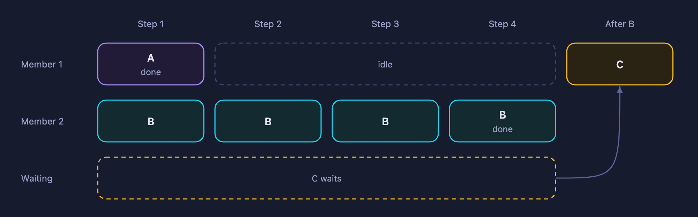
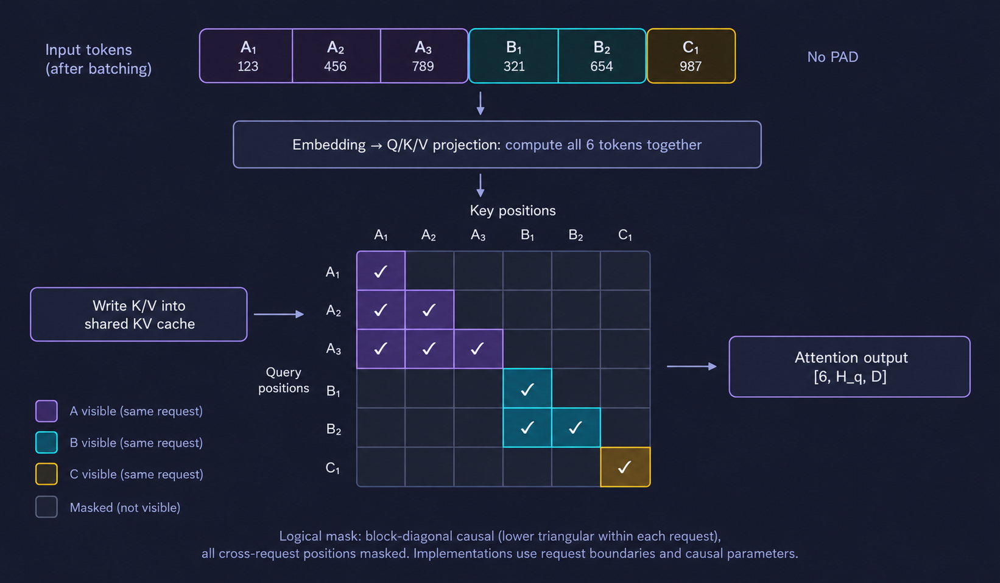
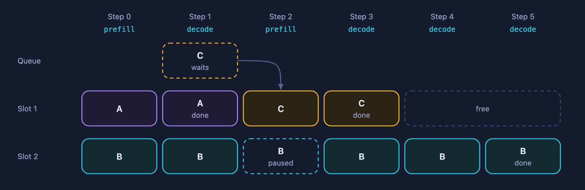
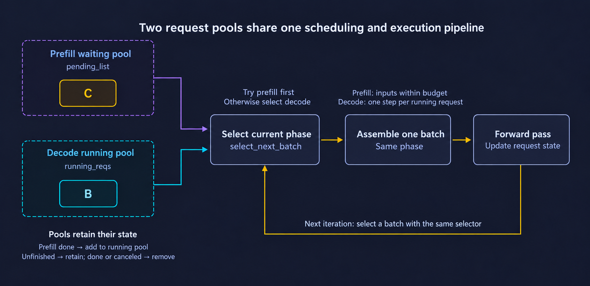
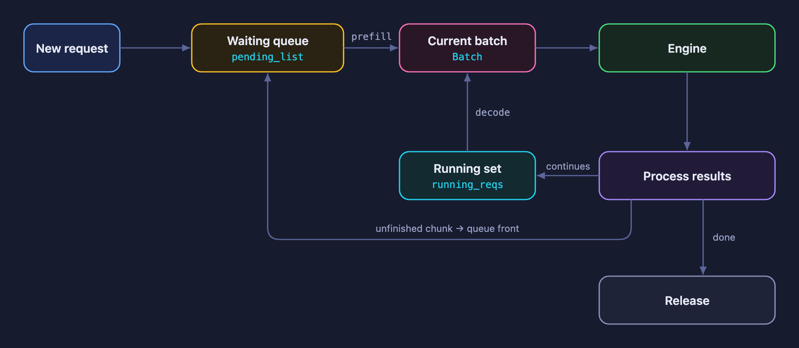
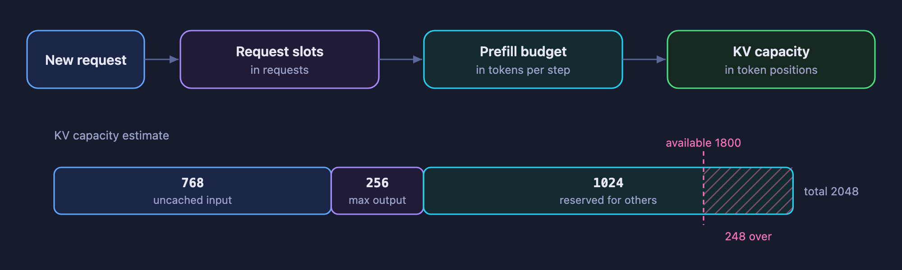
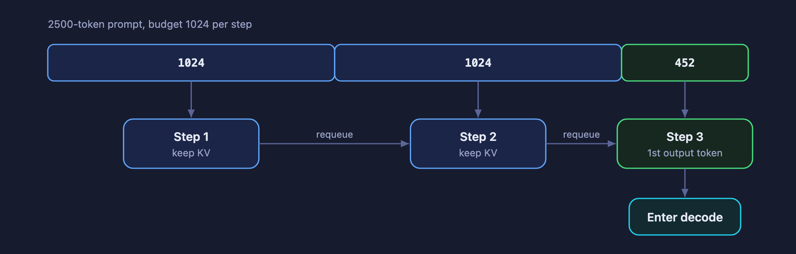
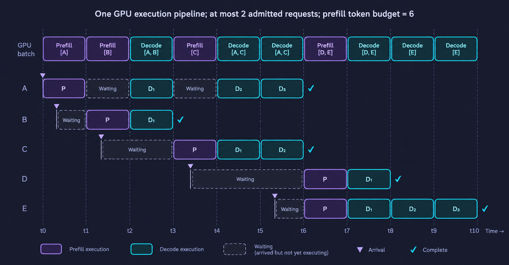

# Chapter 6 Continuous Batching and the Scheduler

The previous chapter turned the generation program into an HTTP service: while A is still generating, the service can receive requests from B and C. Once those requests arrive, how can we process them together more efficiently? How do we decide which requests run together as new ones arrive and completed ones release their resources? These are the questions this chapter addresses.

This chapter starts with the limitations of fixed batching and introduces continuous batching and the scheduler. The implementation is covered in the companion [code walkthrough](https://github.com/datawhalechina/zero-to-sglang/pull/88). The mini-sglang behavior described here matches that walkthrough and is pinned to commit [9a91cfa](https://github.com/sgl-project/mini-sglang/tree/9a91cfafe754aa85daee49998176275667eb58f2).

## 1 Learning Objectives

After reading this chapter, you should be able to:

- Explain why long requests can hold up fixed batches and what continuous batching changes.
- Distinguish the waiting queue, the set of requests still generating, and the current batch.
- Distinguish request slots, the prefill token budget, and KV capacity, and explain why a new request may still have to wait.
- Explain how prefill priority, chunked prefill, and resource cleanup affect request latency.

## 2 The Limitations of Fixed Batching

### 2.1 What is batching?

For a single request, each step feeds its input into the model, obtains logits, and samples the next token. When several requests use the same model, we can organize them into a **batch** and execute them together.

This lets one model execution process more tokens, reuse weight reads across requests, and spread some fixed overhead across more requests. In particular, each request in a small decode batch processes only one new position per step, so batching can often improve hardware utilization.

Requests in a batch remain independent. Each has its own input, KV cache, sampling parameters, and stopping conditions. Sharing a model execution does not concatenate different users' conversations into one context. Attention must still respect request boundaries and read each request's own history.

### 2.2 Requests arrive and finish at different times

A simple approach collects a group of requests, fixes its membership, and waits for the whole group to finish before running another group. This is **fixed batching**. Collection may use a short waiting window, but the same problem remains if new requests cannot join after execution starts.

Suppose A and B have completed prefill and need another 1 and 4 decode steps, respectively. C now arrives, and there will be enough resources to admit it after A finishes:

| Decode step | A | B | C |
| --- | --- | --- | --- |
| 1 | Generates and finishes | Continues generating | Waits |
| 2 | Finished | Continues generating | Waits |
| 3 | Finished | Continues generating | Waits |
| 4 | Finished | Generates and finishes | Waits |

<div align="center">
    
<p><em>Figure 1. Fixed batching: C waits for the whole group even after A finishes</em></p>
</div>

A needs no further computation after the first step, but fixed membership makes C wait until B also finishes. An implementation may mask A's remaining computation or remove A from the execution tensors. As long as C cannot enter, however, B runs alone for the remaining steps. The GPU is not necessarily idle, but it loses the opportunity to process more requests together.

Generation workloads are particularly prone to this problem: prompt lengths vary, and actual output lengths are unknown in advance. `max_tokens` is only an upper bound; a request may produce an end marker earlier. It is difficult to form groups whose members will all finish together. The main limitation of fixed batching is therefore **unequal request lengths: choosing a fixed batch size cannot make all the requests in a batch finish together**.

### 2.3 How can requests of different lengths compute together?

Consider A, B, and C with no reusable historical KV. Their input token IDs are `[123, 456, 789]`, `[321, 654]`, and `[987]`. mini-sglang packs the valid tokens without first padding the shorter inputs:

```text
input_ids = [123, 456, 789, 321, 654, 987]  # [6]
Shape after embedding: [6, d_model]
```

All six tokens participate in the layers' linear operations together. Arranged by attention head, Q has shape `[6, H_q, D]`, while each new K and V has shape `[6, H_kv, D]`. Here `H_q` and `H_kv` are the query and KV head counts, and `D` is the head dimension. K after positional encoding and V are written into this layer's shared cache pool, logically retaining histories of length 3, 2, and 1 for A, B, and C.

During attention, the backend uses request boundaries, cache indices, and causal constraints so A's queries can access only A's valid context; B and C follow the same rule. The logical visibility pattern is a block-diagonal set of lower-triangular masks. Implementations need not construct the full `[6, 6]` matrix:

<div align="center">
    
<p><em>Figure 2. Prefill input packing and the logical attention mask</em></p>
</div>

During decode, each request provides one new token, giving a packed embedding tensor of shape `[3, d_model]`. Attention uses the current Q and each request's own historical KV. Different context lengths can still be processed together using cache indices and lengths. With one query position per request, the combined output is `[3, H_q, D]`; merging heads and applying the output projection restores `[3, d_model]` for the remaining computation.

Batching therefore organizes both inputs and request boundaries. KV stays with its request regardless of the current batch order. The code walkthrough and later cache chapters explain the mappings; the next section considers which requests resource limits allow into the batch.

## 3 Continuous Batching: Reconsider Membership Every Step

### 3.1 Schedule one iteration at a time

Continuous batching adjusts membership **between model execution steps**. After a step, the scheduler retains requests that need more generation, removes completed requests, and admits new requests when resources allow. A new request need not wait for every member of the original group to finish.

“Continuous” does not mean inserting a request into a GPU operator that is already executing, nor does it mean new requests must join every step. It means batch membership can keep changing as requests arrive and finish.

This does not remove the autoregressive dependency within a request. Ordinary decode still needs the current token before computing the next one. What changes is which other requests participate in the next execution.

### 3.2 Follow A, B, and C through a complete schedule

Use the same assumptions as the code walkthrough: two request slots, sufficient KV capacity, no prefix-cache hits, and prompts that each fit into one prefill step. A, B, and C generate 2, 5, and 2 tokens, respectively, without early end markers. C arrives after step 0. Scheduling follows this mini-sglang version's rule: each step runs either prefill or decode, and prefill runs first whenever a prefill batch can be formed.

Output counts include the first token sampled when prefill finishes. The steps below indicate scheduling order, not equal time slices or performance measurements.

| Step | Current execution | Cumulative output tokens (A / B / C) | Scheduling reason |
| --- | --- | --- | --- |
| 0 | Prefill: A, B | 1 / 1 / 0 | A and B occupy both slots and finish processing their prompts |
| 1 | Decode: A, B | 2 / 2 / 0 | C has arrived, but no slot is free; A finishes at the end of this step |
| 2 | Prefill: C | 2 / 2 / 1 | C uses the slot released by A; B does not execute this step |
| 3 | Decode: B, C | 2 / 3 / 2 | C finishes; B remains active |
| 4 | Decode: B | 2 / 4 / 2 | Only B still needs generation |
| 5 | Decode: B | 2 / 5 / 2 | B finishes |

<div align="center">
    
<p><em>Figure 3. Continuous batching: C takes the slot released by A</em></p>
</div>

C starts computing before B finishes, which is the benefit of continuous batching in this example. B also pauses decode for step 2: admitting a new request earlier can affect a request that is already generating. We will return to this tradeoff when discussing scheduling policy.

**Check your understanding:** Why cannot C enter at step 1? Does B's absence from step 2 mean it has left the system?

## 4 The Scheduler

In the previous section, C starts prefill after A finishes, then decodes alongside B. The scheduler makes these decisions: it tracks each request's progress and chooses which requests compute together in the next step.

### 4.1 What state does the scheduler maintain?

When C arrives, it first needs to wait. B has already started answering and needs to keep generating. The scheduler tracks these requests separately, then selects the batch to execute this step.

| State | What it records | Example from A, B, and C |
| --- | --- | --- |
| Waiting queue | Requests waiting for prompt processing | C enters this queue when it arrives |
| Decode running set | Requests that have finished prompt processing and need more generation | B has not finished at step 2, so it remains here |
| Current batch | Requests submitted to the model this step, with a prefill or decode phase | C's prefill at step 2; B and C's decode at step 3 |

For example, step 2 executes only C's prefill, so the current batch contains only C. B does not compute this step, but its answer is unfinished. The scheduler keeps B in the decode running set so it can continue in the next step.

In mini-sglang, the waiting queue is stored in `PrefillManager.pending_list`, and the decode running set in `DecodeManager.running_reqs`. Once the scheduler has selected the requests for this step, it submits them to the model in a `Batch`.

Figure 4 connects both request pools to the same selector. At the start of step 2 in the earlier example, B remains in the running pool and C is in the waiting pool. Selecting C's prefill for this step does not remove B from the running pool.

<div align="center">
    
<p><em>Figure 4. Two request pools share one scheduling and execution pipeline</em></p>
</div>

### 4.2 How does one scheduling iteration proceed?

The scheduler repeatedly receives messages, chooses a batch, executes the model, and processes results. Step 1 of the earlier example shows how these four stages connect:

1. **Receive messages**: C arrives, and the scheduler adds it to the waiting queue.
2. **Choose a batch**: A and B still occupy both request slots, so C cannot enter yet. This step therefore continues decoding A and B.
3. **Execute the model**: The Engine computes this batch and generates one token for A and one for B.
4. **Process results**: A receives its second token and reaches its output limit. The scheduler removes A from the running set and returns its resources. B still needs generation, so it remains.

In the next iteration, the scheduler checks the waiting queue again. With a slot now available, it can schedule C's prefill. Once C completes prefill, the next decode execution can process B and C together. These repeated checks and updates change batch membership from one step to the next.

<div align="center">
    
<p><em>Figure 5. One scheduler iteration and request state transitions</em></p>
</div>

## 5 What Must Be Checked Before a New Request Joins?

The earlier example assumed sufficient resources, so C could enter as soon as A finished. What if ten or twenty more requests were waiting? Could the scheduler admit them all?

In practice, it cannot admit them all because resources are limited. Each request needs its own state, KV cache storage, and computation to process its prompt. These requirements determine how many requests can enter and how much input the current step can process.

### 5.1 The number of requests is limited

mini-sglang uses a request table to store token and KV position mappings for each active request. Each request occupies one row; an unused row is a **request slot**. The number of rows limits how many requests can be accommodated at once.

When A and B occupy both slots, C stays in the waiting queue. Once A finishes and returns its slot, C has somewhere to store its state. This limit counts requests: A occupies one slot whether its prompt contains 100 or 10000 tokens.

### 5.2 Leave room in the KV cache to avoid headaches later

The same number of requests can require very different amounts of GPU memory. A 10000-token prompt needs much more KV storage than a 100-token prompt. Even with a free slot, the scheduler must check whether C's KV will fit.

It must also account for growth once C starts answering. Prefill builds the input's KV cache, and subsequent decode steps compute KV for new tokens. If admitting C fills all remaining capacity with prompt KV, there may be no room to continue generating. B has not finished either, so its future generation also needs room.

mini-sglang estimates a new request's demand as **uncached input length plus maximum output length**. It adds the reservation estimate for other requests and checks whether sufficient KV capacity is available. For example:

| Demand to account for | Token count |
| --- | --- |
| C's uncached input | 768 |
| C's maximum output | 256 |
| Reservation estimate for B and other requests | 1024 |
| Total | 2048 |

If the cache manager reports room for only 1800 more token positions, C must wait. Capacity is counted in token positions because each position needs the corresponding K/V stored across the model's layers. The byte count depends on the model and cache precision.

<div align="center">
    
<p><em>Figure 6. Admission checks and KV capacity estimation</em></p>
</div>

This estimate includes the maximum output length even though a request may finish earlier. It limits current admission to leave capacity for subsequent generation. Actual KV pages are allocated as computation needs them; Chapters 7 and 8 cover paging and reclaimable cache accounting.

### 5.3 The problem with long prefill and how to handle it

After the slot and KV checks, the scheduler still needs to decide how much of C's prompt to process this step. Suppose C submits a long article. Processing it all at once can make that prefill execution lengthy.

To limit the size of one execution, the scheduler sets a **prefill token budget**: the maximum number of uncached input tokens a prefill batch can process. Requests in the batch share this budget. If it is 1024 and the first request uses 800, only 224 remain for the next request.

If C has 2500 uncached input tokens, **chunked prefill** can process them over several steps. With a budget of 1024 per step and no other request consuming it, the three steps process 1024, 1024, and 452 tokens.

<div align="center">
    
<p><em>Figure 7. Chunked prefill: one prompt over three steps</em></p>
</div>

Each chunk boundary gives the scheduler another opportunity to choose the next batch. Whether it processes C's next chunk or lets B decode another token depends on the scheduling policy.

### 5.4 A concrete scheduling example

Now define a new set of five requests, A through E, to connect request slots, the prefill token budget, and changes to the running set. Assume at most two admitted requests, a prefill token budget of 6 per iteration, sufficient KV capacity, and no prefix-cache hits. Keep this chapter's prefill-first policy. The arrivals and work are:

| Request | Arrival position | Input tokens | Generated tokens | Forward passes required |
| --- | --- | ---: | ---: | --- |
| A | t0 | 3 | 4 | 1 prefill + 3 decode |
| B | t0 + 0.4 | 2 | 2 | 1 prefill + 1 decode |
| C | t1 + 0.4 | 3 | 3 | 1 prefill + 2 decode |
| D | t3 + 0.4 | 4 | 2 | 1 prefill + 1 decode |
| E | t5 + 0.4 | 2 | 4 | 1 prefill + 3 decode |

The output lengths are chosen for illustration, with no early EOS or cancellation; the scheduler does not know each request's actual final output length. Counts include the first token sampled after prefill. Labels t0 through t10 mark scheduling boundaries on a schematic axis, and `+ 0.4` places an arrival during that iteration. Equal-width cells do not imply equal forward-pass durations.

<div align="center">
    
<p><em>Figure 8. Five requests share one continuous-batching pipeline</em></p>
</div>

P denotes prefill, while D₁, D₂, and D₃ identify a request's successive decode passes. Five transitions explain the timeline:

1. **t0 to t2: A prefills first, then B joins.** Only A has arrived at t0, so `Prefill[A]` starts immediately. B arrives during that execution and cannot enter the submitted batch. At t1 a slot is available, so the selector prioritizes `Prefill[B]`. A remains in the running pool while waiting. Each prefill produces that request's first output token.
2. **t2 to t3: C has arrived, but A and B occupy both slots.** C cannot be admitted, so prefill cannot form an executable batch. The selector chooses `Decode[A, B]`. Both advance one step; B receives its second output token, finishes, and returns its slot.
3. **t3 to t6: C enters while A stays active.** `Prefill[C]` takes the freed slot, followed by two `Decode[A, C]` passes. D and E arrive but remain queued because both slots are occupied. At t6, A and C finish and release both slots.
4. **t6 to t8: D and E prefill together, then decode together.** Their inputs total 6 tokens, exactly meeting the budget, so they form `Prefill[D, E]`. D was waiting for capacity; E had also arrived when capacity became available. The scheduler did not wait deliberately to fill a batch. The next pass is `Decode[D, E]`, after which D finishes.
5. **t8 to t10: E continues alone.** E is the only running request, so the last two passes are `Decode[E]`. Work continues even though the batch is not full.

The running set changes as requests are admitted and completed; an active request can also pause decode when the current iteration selects prefill. The next section examines how phase selection affects the latency of new and already-running requests.

## 6 Start a New Request or Continue Generating?

Now suppose C has passed the resource checks and B has not finished. Should the GPU execute C's prefill or B's decode next? Both choices advance a request, but they make different users wait.

### 6.1 Prefill priority versus decode priority

Return to step 2 in Section 3.2. A has just finished, C can enter, and B has generated two tokens.

| Choice for the next step | C's experience | B's experience |
| --- | --- | --- |
| Run C's prefill first | Starts processing its prompt and gets its first answer token sooner | Waits for this prefill execution before continuing generation |
| Run B's decode first | Keeps waiting for prefill | Gets its next token sooner |

C's wait for its first token contributes to time to first token (TTFT). B's wait between output tokens appears in inter-token latency (ITL). Giving GPU time to C postpones B's next decode; giving it to B makes C wait another step.

This mini-sglang version prioritizes prefill: it runs a prefill batch whenever one can be formed, and otherwise runs decode. It therefore processes C at step 2, while B continues at step 3. If new requests that can be admitted keep arriving, this rule may make B wait for several steps in a row. Always prioritizing decode, on the other hand, can leave new requests waiting a long time for their first prefill.

### 6.2 Scheduling priority between chunks

Splitting C's long prompt into three chunks is intended to reduce the time that long prefill blocks other requests. For B to benefit, its decode must be scheduled between those chunks. Compare these two orders, where C1, C2, and C3 are C's prefill chunks:

| Execution order | Effect on B and C |
| --- | --- |
| C1 → C2 → C3 → B's decode | C finishes prefill sooner; B waits for all three chunks |
| C1 → B's decode → C2 → B's decode → C3 | B can continue output along the way; C's first token arrives later |

The second order illustrates an alternative policy. This mini-sglang version returns C's unfinished prefill to the front of the queue and continues prioritizing prefill, so it follows the first order in this example. Reducing the budget and splitting the prompt into smaller pieces does not automatically give B execution time.

### 6.3 Batch size, throughput, and waiting time

Batch size matters alongside phase selection. Letting more requests participate in one execution can improve reuse of weight reads and increase the total tokens generated per unit time: output-token throughput. A larger batch can also take longer to execute, increasing each request's wait for its next token.

For prefill chunks, larger chunks generally occupy the GPU longer per execution; smaller chunks require more steps for the same prompt and add scheduling and execution overhead.

Evaluate a scheduling change using three measurements together: total tokens generated per second, new requests' time to first token, and pauses in answers already being generated. For example, a change might produce more tokens per second while making B's answer pause frequently. Throughput improved, but B's ITL worsened. Reporting only the first number would miss this problem for a chat service.

### 6.4 How batching improves GPU execution efficiency

Higher throughput also depends on how efficiently one batched execution runs. Consider a linear layer, ignoring bias and multi-GPU sharding:

```text
Single-request decode: [1, d_in] × W [d_in, d_out] → [1, d_out]
B-request decode:      [B, d_in] × W [d_in, d_out] → [B, d_out]
```

Both use the same weights W. A single-request decode may spend much of its time reading weights for one output row. A batched matrix-multiplication kernel can reuse weight tiles in on-chip storage, increasing arithmetic intensity. A larger matrix also usually exposes more parallel work; this does not imply that all of W is read from device memory only once.

Advancing B requests together can replace B separate forward passes with one batched forward pass, sharing some submission and launch overhead. Each forward pass still contains multiple CUDA kernels. Each request's historical KV must also be accessed separately, so longer contexts and larger batches can increase computation and cache traffic. Judge the benefit by useful work completed per unit time, alongside latency.

> NVIDIA's [matrix-multiplication performance guide](https://docs.nvidia.com/deeplearning/performance/dl-performance-matrix-multiplication/index.html) explains the compute and data-movement limits.

### 6.5 Why similar GPU utilization can accompany different throughput

When evaluating batch size or scheduling, we often inspect `nvidia-smi` or a monitoring dashboard backed by NVML. **The 85% discussed here is the GPU-Util / `utilization.gpu` reading.** Suppose two configurations both report around 85%, while the larger batch produces more output tokens per second. How can both observations hold? The percentage is an illustrative monitoring value, not a measurement reported by this chapter.

NVIDIA defines this metric as the fraction of a sampling window during which at least one CUDA kernel executes on the GPU. It measures the duration of kernel activity, not kernel launch counts or the number of concurrently active kernels. In a hypothetical one-second window, about 850 milliseconds of kernel activity corresponds to approximately 85%. Overlapping kernels do not count the same time twice. Actual sampling windows depend on the device and tool.

The reading does not reveal how many SMs are doing work, how much useful computation Tensor Cores perform, or how effectively memory bandwidth is used. A small kernel with limited parallel work, or one limited by memory reads, still contributes active time. Consequently, 85% does not mean 85% of peak compute performance, nor does it establish that only 15% performance headroom remains.

This matters for batched inference. Small-batch decode can keep kernels running while advancing few requests per execution. A larger batch can have similar active time yet advance more requests, reuse weights, and expose more parallel work. Similar GPU-Util can therefore accompany different token throughput. The metric helps identify intervals without kernel execution, but alone cannot assess batching efficiency or serving quality.

Evaluate scheduling with total throughput, per-user token rate, TTFT, and ITL together. For hardware bottlenecks, examine kernel timelines, per-SM activity, memory bandwidth, and compute throughput. Changing only batch size is also insufficient to establish a fixed-versus-continuous-batching comparison: identify the scheduling policy used by each configuration.

> See NVIDIA's [nvidia-smi query definitions](https://nvidia.custhelp.com/app/answers/detail/a_id/3751). This discussion concerns GPU-Util / `utilization.gpu`; other GPU metrics have their own definitions.

## 7 Filling Slots After Requests Finish

We have repeatedly said that C can use A's slot when A finishes. The scheduler must first detect A's completion and return its resources. Sending the final token to the user alone does not make room for C.

### 7.1 Detect when A has finished

The scheduler checks stopping conditions as it processes each step's output. In Section 3.2, A has an output limit of 2 and stops after its second token. It can also stop earlier by sampling EOS, the end-of-sequence token. For example, a request with a limit of 100 can finish when its twentieth token is EOS. This version ignores EOS when `ignore_eos` is set.

User cancellation also stops subsequent generation. When the scheduler receives the cancellation message, it removes the request from the waiting queue or running set. If the request has not started computing or received any resources, removing it from the waiting queue is sufficient. If it has started prefill or decode, its allocated resources also need to be returned.

### 7.2 Remove A from the running set and return its resources

Follow A's normal completion. After step 1 finishes computing, the scheduler handles these state changes:

| State | Before A finishes | After processing completion |
| --- | --- | --- |
| Decode running set | A, B | B |
| Free request slots | 0 | 1 |
| Waiting queue | C | C |

Removing A prevents further token generation for it. Returning its slot allows the system to register C. The cache manager then handles A's KV: reclaimable space returns to the cache pool, while reusable prefixes may remain for later requests. Some of A's computed KV can therefore stay cached after A leaves the running set.

At the next iteration, the scheduler checks C in the waiting queue again. Under the earlier assumption of sufficient resources, C takes the free slot, executes prefill, and subsequently decodes alongside B. If C still requires more KV capacity than is available, it keeps waiting. A's completion alone does not guarantee admission.

This is how a completed request makes way for a new one in continuous batching. The next chapter explains how the KV storage involved is allocated and reclaimed.

## 8 Summary and Exercises

### 8.1 Summary

Fixed batching can leave capacity released by short requests unavailable to new arrivals. Continuous batching adjusts membership between iterations so unfinished requests can continue and new requests can enter when resources permit.

The scheduler maintains a waiting queue, a decode running set, and the current batch, while checking request slots, the prefill budget, and KV capacity separately. New requests complete prefill before entering ordinary decode; completion and cancellation trigger state updates and resource cleanup.

This mini-sglang version prioritizes prefill and supports chunked prefill, but does not guarantee decode between chunks. Understand the effects on first-token latency, inter-token latency, and throughput before tracing the implementation in the code walkthrough.

### 8.2 Exercises

1. A and B run in a fixed batch. A finishes early while C waits. Why can this waste batching opportunities even if A's execution overhead is removed?
2. Why does continuous batching change membership between model execution steps? Does it remove the autoregressive dependency within a request?
3. Under the assumptions in Section 3.2, when could C first start prefill if A generated only one token? If C needed two prefill steps, how would B's execution change?
4. The GPU executes only C's prefill in one step, while B remains in the decode running set. Is there a contradiction? Why?
5. A new request has 600 uncached input tokens and a maximum of 200 output tokens. Other requests have a reservation estimate of 500, and available KV capacity is 1200. With a free slot, can it pass the capacity estimate described in this chapter?
6. Why must intermediate prefill chunks not submit answer tokens? Why does chunking alone fail to guarantee timely decode for existing requests?
7. A scheduling change increases output-token throughput, but users report more pauses in their answers. Which metrics and phase-selection behavior would you examine together?
8. Which state must be updated when a request produces EOS early? Why might its computed KV still be present in the cache pool?

9. Why can two configurations both report GPU utilization near 85% while producing different output-token throughput? Which additional metrics would you examine?

## References

- [mini-sglang: Scheduling loops and request cleanup](https://github.com/sgl-project/mini-sglang/blob/9a91cfafe754aa85daee49998176275667eb58f2/python/minisgl/scheduler/scheduler.py)
- [mini-sglang: Prefill admission and chunking](https://github.com/sgl-project/mini-sglang/blob/9a91cfafe754aa85daee49998176275667eb58f2/python/minisgl/scheduler/prefill.py)
- [mini-sglang: Decode running set and capacity reservation](https://github.com/sgl-project/mini-sglang/blob/9a91cfafe754aa85daee49998176275667eb58f2/python/minisgl/scheduler/decode.py)
- [mini-sglang: Request state and Batch](https://github.com/sgl-project/mini-sglang/blob/9a91cfafe754aa85daee49998176275667eb58f2/python/minisgl/core.py)
- [mini-sglang: Request table and slots](https://github.com/sgl-project/mini-sglang/blob/9a91cfafe754aa85daee49998176275667eb58f2/python/minisgl/scheduler/table.py)
- [mini-sglang: KV allocation and cache lifetime](https://github.com/sgl-project/mini-sglang/blob/9a91cfafe754aa85daee49998176275667eb58f2/python/minisgl/scheduler/cache.py)

- [NVIDIA: Matrix-multiplication performance](https://docs.nvidia.com/deeplearning/performance/dl-performance-matrix-multiplication/index.html)
- [NVIDIA: nvidia-smi queries and utilization.gpu definition](https://nvidia.custhelp.com/app/answers/detail/a_id/3751)
