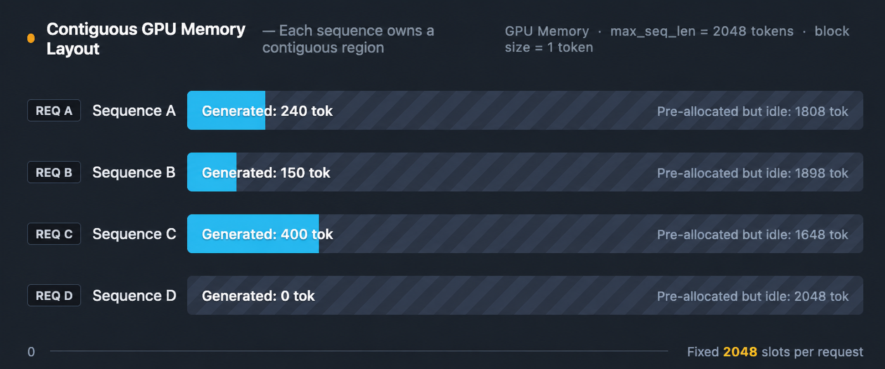
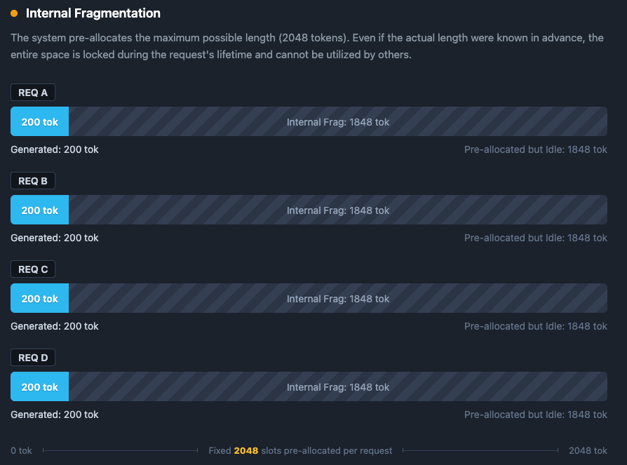
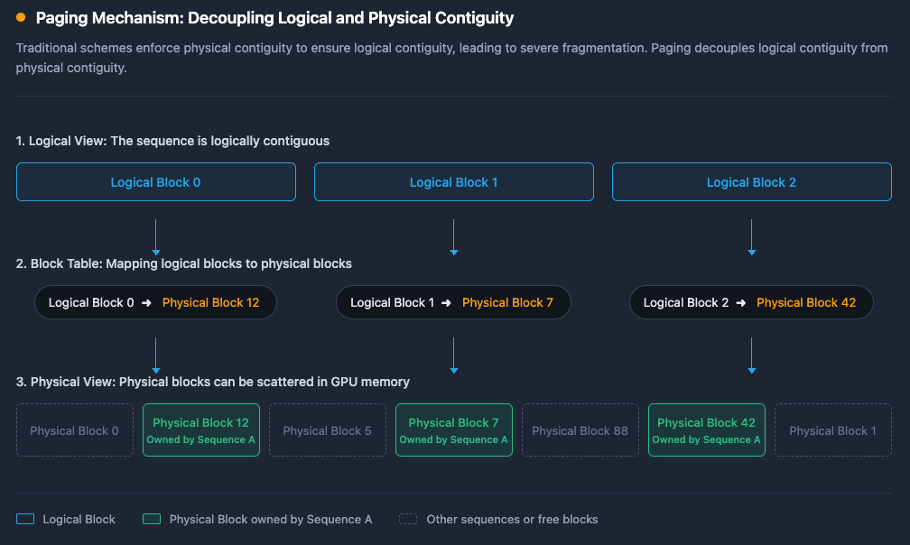
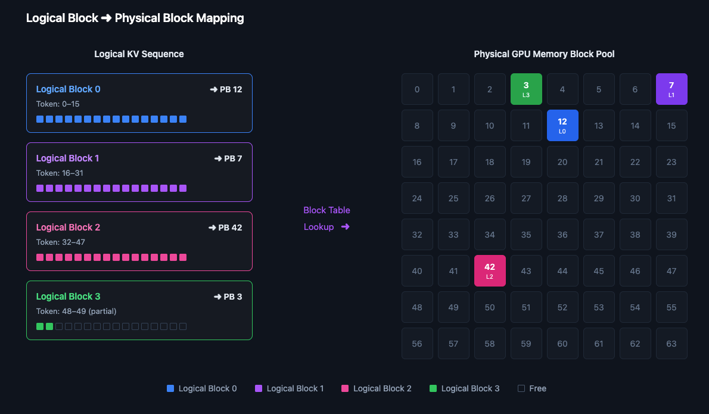

# Chapter 7 Paged KV Cache and Memory Management

Welcome to Chapter 7 of Part II of the zero-to-sglang course. We have covered the concrete inference workflow and the fundamentals of KV Cache. This chapter turns to **Paged KV Cache and memory management**. Because KV Cache is a major consumer of GPU memory in LLM inference, how efficiently it is managed directly determines an inference system's throughput and concurrency. To overcome this memory bottleneck, modern inference engines introduce a paging mechanism analogous to operating-system virtual memory. Let us examine this underlying GPU-memory management technique.

## 1 Learning Objectives

This chapter focuses on the **core principles of Paged KV Cache** in two parts:

1. **The memory problems of contiguous allocation**: Starting from conventional contiguous KV Cache allocation, analyze internal fragmentation, external fragmentation, and the difficulty of dynamic growth. This leads to the central tension paging addresses: **efficient, on-demand GPU-memory allocation (non-contiguous)** versus **Attention's need for a complete K/V sequence (logically contiguous)**.

2. **Paging abstractions and the PagedAttention algorithm**: Explain the core abstractions of paging, including physical Blocks, Slots, and the Block Table; describe the mapping from logical Blocks to physical Blocks; and examine how PagedAttention reads K/V block by block from non-contiguous GPU memory while remaining mathematically equivalent to ordinary Attention.

## 2 Why Paging Is Needed: The GPU-Memory Dilemma of Contiguous KV Cache

Before examining PagedAttention in detail, it is necessary to understand the problem it solves: **why does conventional contiguous KV Cache allocation waste so much GPU memory under real inference workloads?** This section begins with preallocation, analyzes the fragmentation it creates, and summarizes the central tension that paging resolves.

### 2.1 How Contiguous KV Cache Allocation Works and Where It Fails

During autoregressive decoding, Attention at step $t$ needs the Key and Value vectors of all preceding tokens from steps $1$ through $t-1$. To avoid recomputing them, an inference system caches these K/V vectors in GPU memory—the KV Cache introduced earlier. KV Cache size is proportional to sequence length, layer count, attention-head count, and related factors. Under high-concurrency, long-sequence workloads, KV Cache GPU-memory use grows **linearly** with both concurrency and sequence length, becoming a bottleneck for inference throughput.

**Traditional approach: preallocate a contiguous GPU-memory region for the maximum length**

<div align="center">
    
<p><em>Figure 1. Preallocated layout for a contiguous KV Cache</em></p>
</div>

Because efficient GPU computation favors contiguous tensor layouts, traditional inference engines allocate a **contiguous GPU-memory region** when a request arrives. Its size equals the request's **maximum possible sequence length**—for example, 2,048 tokens—multiplied by the KV-cache size per token. A system might therefore preallocate a contiguous KV Cache with shape `[batch, layers, max_seq_len, num_heads, head_dim]` for each request.

### 2.2 GPU-Memory Fragmentation and Waste

Preallocation creates three types of GPU-memory waste. Together, they significantly reduce utilization: only **a portion** of GPU memory holds actual token state, while the rest is idle.

**Internal fragmentation**

<div align="center">
    
<p><em>Figure 2. Internal fragmentation in a contiguous KV Cache</em></p>
</div>

Internal fragmentation is the most serious of the three. Because the system cannot predict a request's final length, it must allocate for the maximum possible length. If it allocates room for 2,048 tokens but the request generates only 200, the remaining 1,848 positions cannot be used by any other request during that request's lifetime. More importantly, **even if the final length were known in advance, preallocation would still be inefficient**: the entire region remains reserved for the request, and other shorter requests cannot use the portion that is not yet occupied.

Measurements from production workloads such as multi-turn conversations and code generation show that actual output lengths are often far smaller than their configured maxima. For example, if every request reserves capacity for 2,048 tokens but typically generates only about 200, roughly **90% of preallocated GPU memory is idle**.

**External fragmentation**

<div align="center">
    
<p><em>Figure 3. External fragmentation in a contiguous KV Cache</em></p>
</div>

Requests have different input and generation lengths, so their KV Cache allocation sizes vary widely. When requests of many different lengths arrive and depart, GPU memory accumulates many **free holes of unequal sizes**—external fragmentation. Their total free capacity may be large, but the **contiguity constraint** prevents a new request from using it.

For example, a system may have 3.60 GiB of free GPU memory split across five isolated, non-contiguous regions: 512 MiB, 256 MiB, 1,024 MiB, 768 MiB, and 1,024 MiB. When an eleventh request needs a contiguous 1.50 GiB region, allocation fails even though total free capacity is more than twice the request's need, because the largest contiguous region is only 1,024 MiB. This “memory exists but cannot be used” condition is common with contiguous allocation, and long requests can trigger OOM simply because no sufficiently large contiguous region remains.

**The difficulty of dynamic growth**

A defining feature of autoregressive generation is that **sequence length grows at every step and its final length is unknown**. This creates an additional problem for contiguous allocation. Reserving enough space at request arrival wastes a large amount of capacity; allocating a small region first instead requires **periodically reallocating and copying** the entire KV Cache into a larger contiguous region as the sequence grows. These repeated reallocations and copies add overhead and can fail when no larger contiguous region is available.

More fundamentally, contiguous allocation cannot **efficiently** support decoding algorithms that create multiple output branches. In parallel sampling and Beam Search, one request produces multiple candidate sequences that share most of their prefix KV Cache. Under contiguous allocation, each sequence keeps its KV Cache in an independent contiguous region, so the prefix can be shared only by duplicating and copying it, and **KV Cache cannot be shared efficiently**.

### 2.3 The Central Tension That Paging Resolves

The preceding analysis reduces paging to one central tension:

**Efficient GPU-memory use (requiring on-demand allocation and non-contiguous storage)** versus **Attention's need for a complete K/V sequence (requiring logically contiguous access).**

More specifically:

- **From the memory-management perspective**, the best strategy is **on-demand allocation**: allocate only as many token slots as a request currently needs, and append more as the sequence grows. Because free memory is distributed across GPU memory, this necessarily leads to physically non-contiguous storage.

- **From the Attention-computation perspective**, the computation needs access to the K/V vectors of every historical token in sequence order. This requires a **logically contiguous** K/V view: the K/V for token $i$ must be accessible in order so Attention can process the complete history.

The traditional approach enforces **physical contiguity** to obtain logical contiguity, at the cost of severe fragmentation and low utilization. Paging instead **decouples logical contiguity from physical contiguity**:

1. Divide the KV Cache into fixed-size **Blocks**, each storing the K/V for a fixed number of tokens.
2. Maintain a **Block Table** that maps logical Blocks to physical Blocks, allowing the sequence to remain logically contiguous while physical storage is scattered.
3. During Attention, use the Block Table to read K/V **block by block**, reconstructing a logically contiguous sequence view.

<div align="center">
    
<p><em>Figure 4. Logical-to-physical mapping for a Paged KV Cache</em></p>
</div>

This design borrows the classic idea of operating-system virtual memory: just as an operating-system page table maps a program's contiguous logical addresses to non-contiguous physical memory pages, an inference engine's Block Table maps a request's contiguous logical KV sequence to non-contiguous physical GPU-memory Blocks.

This decoupling solves three problems at once:

- **Internal fragmentation is bounded by the final Block**: at most one Block's worth of space is wasted.
- **External fragmentation is eliminated**: every Block has the same size and is interchangeable, so any free Block can serve any request.
- **Dynamic growth becomes natural**: as a sequence grows, the system allocates and appends new Blocks without copying existing data.

## 3 Paging Abstractions: Blocks, the Block Table, and Logical-to-Physical Mapping

The previous section analyzed the GPU-memory problems of contiguous allocation and identified paging's core idea: **decouple logical contiguity from physical contiguity**. This section introduces the three abstractions that make this possible—Block, Slot, and Block Table—and explains how they map a logical sequence to GPU memory.

### 3.1 Core Concepts and Their Hierarchy

Modern inference engines typically divide each sequence's KV Cache into fixed-size **KV Blocks**. Each Block stores the Key and Value vectors for a fixed number of tokens. A common default Block size is **16 tokens**, with 32 and 64 also supported. With a Block size of 16, a sequence of 2,048 tokens needs 128 logical Blocks, but those Blocks **do not need to be adjacent** in physical GPU memory.

A **Block (physical Block)** is the minimum unit of GPU-memory allocation and management. At initialization, the inference engine determines the total number of physical Blocks from available GPU memory and partitions memory into that many fixed-size Blocks. All physical Blocks have the same size and are interchangeable: any free Block can serve any request.

A **Slot** is the fine-grained storage unit inside a physical Block, corresponding to one token's storage position within that Block.

A **Block Table** bridges the logical and physical views. It is an array maintained per request that records which physical Block corresponds to each logical Block of that request. The Block Table is maintained on both CPU and GPU: the CPU copy supports scheduler allocation decisions, while the GPU copy lets the Attention kernel look up mappings during computation.

The hierarchy can be summarized as:

```text
Token → (logical Block number, in-Block offset) → Block Table → (physical Block number, Slot) → GPU-memory address
```

The logical Block number is computed by dividing the token's absolute position by the Block size. The Block Table translates that logical Block number into a physical Block number, and the Slot determines the token's exact offset within that physical Block. Together, these abstractions let a sequence retain a logically contiguous view while its physical storage is fully scattered.

### 3.2 How Logical Blocks Map to Physical Blocks

The key property of paging is that **logical Blocks and physical Blocks are not tied one-to-one in advance; the Block Table establishes their mapping dynamically**. As with an operating-system page table that maps contiguous virtual addresses to non-contiguous physical pages, an inference engine's Block Table maps a request's contiguous logical KV sequence to non-contiguous physical GPU-memory Blocks.

The mapping proceeds as follows:

**Step 1: partition the logical sequence into Blocks.** A request with 50 tokens and a Block size of 16 is divided into four logical Blocks: Block 0 holds tokens 0–15, Block 1 holds tokens 16–31, Block 2 holds tokens 32–47, and Block 3 holds tokens 48–49. Adjacent logical Blocks are naturally contiguous in the logical view, but they **do not need to be physically adjacent**.

**Step 2: allocate physical Blocks.** When a logical Block needs storage, the memory manager takes a Block from the free physical-Block pool and writes its physical Block number into the corresponding Block Table entry. Different logical Blocks can receive completely non-adjacent physical Blocks. For example, logical Blocks 0, 1, 2, and 3 might map to physical Blocks 12, 7, 42, and 3.

<div align="center">
    
<p><em>Figure 5. Mapping logical Blocks to physical Blocks</em></p>
</div>

**Step 3: translate addresses.** To access the KV data for a token during Attention, the GPU kernel derives the token's logical Block number and in-Block offset from its absolute sequence position, looks up the physical Block number in the Block Table, and combines that Block number with the Slot offset to locate the actual GPU-memory address.

**Step 4: access a sequence continuously across Blocks.** When a query must attend over K/V spanning multiple logical Blocks, the GPU kernel iterates through them in logical order. For each logical Block, it looks up the corresponding physical Block number in the Block Table and reads all valid Slots in that Block. This allows Attention to process sequences of arbitrary length without requiring physically contiguous storage.

This mapping provides three important benefits. **First, it eliminates external fragmentation**: all physical Blocks are equal-sized and interchangeable, so any free Block can serve any request. **Second, it bounds internal fragmentation**: only the final Block can be partially filled, wasting at most one Block rather than an entire preallocated region. **Third, it supports dynamic growth**: a growing sequence only needs another physical Block appended to its Block Table, without copying existing KV data.

## 4 PagedAttention: Performing Attention over Non-Contiguous KV

The previous section introduced Block, Slot, and Block Table, which together decouple logical contiguity from physically scattered storage. But the abstractions alone are not enough: **Attention must access the K/V vectors of all historical tokens even though the vectors are physically scattered across GPU memory**. PagedAttention addresses this by performing Attention over non-contiguous KV while remaining mathematically equivalent to standard Attention on contiguous memory.

### 4.1 How PagedAttention Reads KV

The core idea of PagedAttention is to **decompose Attention at KV-Block granularity: read K/V one Block at a time and accumulate the result**. This blockwise iteration removes the requirement that K/V be physically contiguous; the Block Table dynamically locates each logical Block's physical storage.

**Block-granular read path**

For each query token $i$, the kernel executes the following steps:

1. **Compute the number of logical blocks**: For query $i$, let its visible KV length be $L_i$. In causal decoding, we usually have $L_i=i+1$, or $L_i$ is the visible length of the current KV cache; if discussing the full sequence and temporarily not considering causal trimming, we may take $L_i=L$. The number of logical blocks is $\lceil L_i/b\rceil$, where $b$ is the block size (a common default value is 16, and it may also be set to 32 or 64).

2. **Iterate block by block**: The kernel traverses each logical block $j$ ($j=0,1,\ldots,\lceil L_i/b\rceil-1$), obtains the physical block number corresponding to this logical block by looking it up in `block_table`, and then reads the K/V data of all valid slots in this physical block. This process gathers the discrete physical blocks into the compute unit.

3. **Intra-block attention computation**: For the current logical block $j$, the global position of the $t$-th token in the block is

$$
p=jb+t,
$$

where $t=0,1,\ldots,b-1$, and the last block processes only valid slots with $p<L_i$. Compute the dot product of query $q_i$ with the keys in this block, and apply the causal mask:

$$
s_{i,j,t}=\frac{q_i^\top k_{j,t}}{\sqrt d},
\qquad
\tilde s_{i,j,t}=\begin{cases}s_{i,j,t}, & p\le i,\\-\infty, & p>i.\end{cases}
$$

The final attention output is

$$
o_i=
\sum_{j,t}
\frac{\exp(\tilde s_{i,j,t})}
{\sum_{j',t'}\exp(\tilde s_{i,j',t'})}
v_{j,t},
$$

where the summation is performed only over valid tokens; invalid tokens satisfy $\tilde s_{i,j,t}=-\infty$, and their exponential weights are 0. In implementation, K/V are read block by block and accumulated block by block using online Softmax; the result is equivalent to the above formula.

4. **Cross-block accumulation**: Because the exponential sum and weighted output of Softmax cannot be directly added under different references, the computation results of individual blocks cannot simply be added together. PagedAttention uses **Online Softmax** technology to maintain three running statistics—the current maximum $m_i$, the exponential sum $\ell_i$, and the weighted output $O_i$—and updates these three statistics after reading each new block, thereby correctly merging the results of individual blocks.

**Impact of and Optimizations for Non-contiguous Memory Access**

Non-contiguous memory access is the core engineering challenge faced by the PagedAttention kernel. Unlike a contiguous KV cache, the K/V data of PagedAttention is scattered across different locations in GPU memory, and a contiguous memory access pattern cannot be guaranteed.

We can mitigate this problem through two-level optimization: **Memory Coalescing** and **Shared Memory**:

- **Coalesced access**: The kernel carefully designs the thread-to-data mapping so that adjacent threads read adjacent GPU memory addresses. Specifically, when a thread group loads K/V data from global memory into shared memory, adjacent threads (such as thread 0 and thread 1) read adjacent memory locations, thereby maximizing memory bandwidth utilization.

- **Shared-memory staging**: K/V blocks read from global memory are first loaded into shared memory and then subjected to intensive computation in shared memory. Because the latency of shared memory is much lower than that of global memory, this design effectively hides the latency of non-contiguous global memory access.

- **Block size tuning**: The block size $b$ is a key parameter affecting kernel performance. A smaller block increases the lookup overhead of the Block Table, while a larger block increases internal fragmentation. Common implementations use 16 and evaluate 32 or 64 depending on the workload.

Although PagedAttention introduces the overhead of Block Table indirect addressing and non-contiguous reads, through the above optimizations these overheads are effectively controlled, and the benefits brought by memory management far exceed the kernel overhead.

### 4.2 Proof of Mathematical Equivalence and Its Premises

The core claim of PagedAttention is: **computing Attention in blocks on non-contiguous physical blocks is mathematically completely equivalent to computing standard Attention once in contiguous memory**. This equivalence is guaranteed by Online Softmax technology.

**Premise for Equivalence: Scores Can Be Computed per Token, and the Output Is a Weighted Sum of Values**

The key premise for equivalence to hold is: given the attention score and Value of each valid token, the attention output is a weighted sum of the Value vectors; block-wise reading only changes the computation order and does not change the numerical values of K/V.

Specifically, for a fixed query $i$, let $r$ range over valid keys satisfying $p_r\le i$. The score

$$
s_{i,r}=\frac{q_i^\top k_r}{\sqrt d}
$$

depends only on the query vector $q_i$ and the key vector $k_r$, and can be computed independently per token. To unify notation, define the causally masked score

$$
\tilde s_{i,r}=
\begin{cases}
s_{i,r}, & p_r\le i,\\
-\infty, & p_r>i.
\end{cases}
$$

The output

$$
o_i=\sum_r\alpha_{i,r}v_r
$$

is a weighted sum of the Value vectors; the weights $\alpha_{i,r}$ are obtained by Softmax-normalizing the scores of this query over all visible keys:

$$
\alpha_{i,r}
=
\frac{e^{\tilde s_{i,r}}}{\sum_{r'}e^{\tilde s_{i,r'}}}.
$$

Therefore, K/V can be grouped and processed at any granularity; Online Softmax is only responsible for correctly completing the merging of the exponential sum and weighted output during block-wise reading, without changing the final normalization result.

**Block Merging Mechanism of Online Softmax**

The mathematical definition of standard Softmax itself does not require two passes; however, to avoid exponential overflow, common numerically stable implementations usually first obtain all attention scores and compute the global maximum $m$, and then compute the exponential sum and weighted sum. This process usually requires two passes: the first pass determines the global maximum $m$, and the second pass computes the exponential sum $\ell$ and output $O$. In block-wise Attention that allows only a single-pass streaming read of K/V, the problem is: PagedAttention iteratively reads K/V block by block. If it is required to update the statistics after reading one block without rereading already-read blocks, then the global maximum cannot be obtained before all blocks have been read。

Online Softmax solves this problem through a **running recurrence**. For a fixed query $i$, iterate over logical blocks $j$ and maintain three running statistics:

- $m_i$: the **maximum of the scores seen so far** up to the current block. Before all blocks are processed, it is not the final global maximum but only the current “so far” running maximum; after all blocks are processed, it is the global maximum;
- $\ell_i$: the **exponential sum** up to the current block, using the current $m_i$ as the reference, i.e.

$$
\ell_i=\sum_{\text{seen}}e^{s-m_i};
$$

- $O_i$: the **unnormalized weighted output** up to the current block, using the current $m_i$ as the reference, i.e.

$$
O_i=\sum_{\text{seen}}e^{s-m_i}v.
$$

Initialize as

$$
m_i=-\infty,\qquad \ell_i=0,\qquad O_i=0.
$$

$\ell_i$ and $O_i$ **must always share the same reference $m_i$**. They are a coupled pair of quantities. If either one alone changes the reference without synchronously changing the other, subsequent normalization will be incorrect.

Below, denote the currently read logical block by $\mathcal B_j$. The scores in online Softmax all refer to the causally masked scores $\tilde s_{i,j,t}$; invalid positions are $-\infty$, their exponential weights are 0, and the local maximum is also taken only over valid tokens. After reading a new block, compute the **local statistics** of the block only if the block has at least one valid token for the current query:

$$
m_{i,j}=\max_{t\in\mathcal B_j}\tilde s_{i,j,t},
\qquad
\ell_{i,j}=\sum_{t\in\mathcal B_j}e^{\tilde s_{i,j,t}-m_{i,j}},
\qquad
O_{i,j}=\sum_{t\in\mathcal B_j}e^{\tilde s_{i,j,t}-m_{i,j}}v_{j,t}.
$$

If a block is entirely masked for the current query, its contribution is 0; it can be skipped directly and does not participate in subsequent merging.

The local statistics likewise use the “block's own maximum” $m_{i,j}$ as the reference. At this point, it cannot be directly added to the old $\ell_i,O_i$, because the old accumulated quantities use $m_i$ as the reference and the new block uses $m_{i,j}$ as the reference—**the two sides are not subtracting the same number**. The exponential function is nonlinear, and exponential sums and weighted outputs under different references cannot be directly added; direct addition is equivalent to mixing two quantities on different scales, and the result no longer corresponds to any valid Softmax.

Merging is completed in three steps.

**Step 1: Determine the new running maximum:**

$$
m_i'=\max(m_i,m_{i,j}).
$$

**Step 2: Convert the old accumulated quantities to the new reference.** There is only one core algebraic fact:

$$
e^{s-m_i}\cdot e^{m_i-m_i'}=e^{s-m_i'}.
$$

That is, each term in the old accumulated quantities, as long as it is uniformly multiplied by the factor $e^{m_i-m_i'}$, changes from “using $m_i$ as the reference” to “using $m_i'$ as the reference”. Since $m_i'\ge m_i$, this factor is always $\le 1$, so it shrinks the old terms—when the new maximum is larger, the old exponential terms should indeed become smaller relative to the new reference. $\ell_i$ and $O_i$ must be multiplied by **the same factor**; otherwise they no longer share the same reference:

$$
\ell_i\cdot e^{m_i-m_i'}, 
\qquad 
O_i\cdot e^{m_i-m_i'}.
$$

**Step 3: Convert the new block to the same new reference as well, and then add.** The new block originally uses $m_{i,j}$ as the reference; after multiplying by $e^{m_{i,j}-m_i'}$, it is on the same reference as the old accumulated quantities:

$$
\ell_i'= \ell_i e^{m_i-m_i'} + \ell_{i,j}e^{m_{i,j}-m_i'},
$$

$$
O_i'= O_i e^{m_i-m_i'} + O_{i,j}e^{m_{i,j}-m_i'}.
$$

These two equations are the merging formulas of online Softmax. Their meaning is not two isolated operations but **the same action**: convert two sets of quantities counted under different references each to the new reference $m_i'$, and then add them.

When the new maximum **indeed jumps**, i.e., $m_i'>m_i$, the correction factor $e^{m_i-m_i'}$ for the old accumulated quantities is strictly less than 1. If the old $\ell_i>0$, then the old $\ell_i$ decreases numerically after multiplication by this factor; each nonzero component of the old $O_i$ is also scaled by the same factor, and its absolute value decreases. This is not information loss; rather, the old terms have been converted to a larger reference scale; the magnitude of the decrease exactly corresponds to the magnitude of the reference increase. If the old $\ell_i=0$, it remains 0 after multiplication by this factor.

After all blocks have been processed, for each query $i$, the final output is

$$
o_i=\frac{O_i}{\ell_i}.
$$

At this point, $m_i$ is already the final running maximum. This result is mathematically equivalent to computing Softmax once over the complete set of visible keys; in actual floating-point operations, small differences may occur due to different rounding orders, but this is not an algorithmic approximation. The reason for the equivalence can be stated in one sentence: throughout the streaming process, $\ell_i$ and $O_i$ are always synchronously scaled using **the same running maximum $m_i$** as the reference. When performing the final division:

$$
o_i=\frac{O_i}{\ell_i}=\frac{\sum_{j,t}e^{\tilde s_{i,j,t}-m_i}v_{j,t}}{\sum_{j,t}e^{\tilde s_{i,j,t}-m_i}},
$$

where the summation is performed only over valid tokens. Because

$$
e^{\tilde s_{i,j,t}-m_i} = e^{\tilde s_{i,j,t}}e^{-m_i},
$$

both numerator and denominator contain the common factor $e^{-m_i}$, so it cancels:

$$
o_i =\frac{\sum_{j,t}e^{\tilde s_{i,j,t}}v_{j,t}}{\sum_{j,t}e^{\tilde s_{i,j,t}}}.
$$

This is exactly the definition of the standard Softmax weighted sum. Online Softmax does not change the mathematical object of Softmax; it merely chooses a **dynamically updated reference** to realize this object; since all intermediate quantities always use this reference synchronously, the final reference automatically disappears during normalization. This formulation of single-pass exact normalization computation can be traced back to [Milakov and Gimelshein: *Online Normalizer Calculation for Softmax*](https://arxiv.org/abs/1805.02867); on this basis, FlashAttention applies block-wise online Softmax to attention computation, computing a result that is mathematically exactly the same as standard attention, rather than a sparse or low-rank approximation.

**Combining Online Softmax with PagedAttention**

PagedAttention combines Online Softmax with blockwise reads. Each logical Block is processed independently; standard Attention is computed within the Block using a local Softmax, and the exact Online Softmax recurrence merges the results across Blocks. Because:

1. **Within-Block computation** is standard Attention over its local range;
2. **Cross-Block merging** uses the exact Online Softmax recurrence and is mathematically equivalent to global Softmax;
3. **Block boundaries** do not change any token's $q$, $k$, or $v$ values, nor their relative positions;

its output is **mathematically equivalent** to Attention computed once over contiguous memory. In numerical practice, different floating-point operation orders can introduce small rounding differences, but these remain within acceptable precision and do not change the algorithm's correctness.

It is important to emphasize that **PagedAttention changes only how K/V is addressed in memory; it does not change the mathematics inside Attention**. Whether computation occurs within a Block or merges across Blocks, it uses the same formulas as standard Attention. The key achievement of PagedAttention is not new mathematics; it is enabling standard Attention to run correctly over a non-contiguous memory layout.

Specifically, PagedAttention changes the following:

| Standard Attention | PagedAttention |
|---|---|
| Computes over a contiguous K/V matrix | Looks up the Block Table and gathers K/V Block by Block |
| Performs one Softmax normalization | Performs blockwise Online Softmax normalization through recurrence |
| Performs one matrix multiplication | Performs blockwise matrix multiplications with running accumulation |

Mathematical correctness follows from the equivalence theorem for Online Softmax, while engineering practicality depends on coalesced memory access and shared-memory optimization. Together, they let PagedAttention achieve paging's memory efficiency without sacrificing the mathematical correctness of Attention.

## 5 Summary and Exercises

### 5.1 Summary

This chapter built a complete chain of reasoning for Paged KV Cache and memory management, from the motivating problem through algorithm design to engineering implementation.

**First, the GPU-memory dilemma and the motivation for paging.** Traditional inference engines preallocate a contiguous GPU-memory region for each request's maximum sequence length. This assumption fails under real workloads: actual generation lengths are far shorter than maxima, causing substantial internal fragmentation; requests of varying lengths arrive and leave, creating unequal free holes and external fragmentation; and dynamically growing sequences are difficult to extend within contiguous regions. Together, these forms of waste can limit GPU-memory utilization to only 20%–40%. Paging decouples **logical contiguity from physical contiguity**: a sequence retains a continuous logical view even while its physical storage is fully scattered.

**Second, paging abstractions and PagedAttention.** Paging relies on three core abstractions: a **Block** is the minimum GPU-memory allocation unit and commonly holds 16 tokens; a **Slot** is the fine-grained storage unit within a physical Block; and a **Block Table** maps logical Blocks to physical Blocks, with a CPU copy for scheduler decisions and a GPU copy for runtime Attention lookups. PagedAttention performs Attention over non-contiguous KV by reading K/V one Block at a time and using Online Softmax to maintain running statistics and merge partial results correctly. PagedAttention **changes only K/V memory addressing, not the mathematical logic of Attention**, so paged and contiguous results are mathematically equivalent.

### 5.2 Exercises

1. Without consulting the chapter, draw the complete data flow of paging: start with a token sequence, partition it into logical Blocks, map it through the Block Table, and store it in Slots within physical Blocks.

2. In the paging abstraction, what roles do Block, Slot, and Block Table play? What is their hierarchy? What happens if a physical Block number for one logical Block is incorrectly modified in the Block Table?

3. Why is Attention over non-contiguous physical Blocks mathematically equivalent to standard Attention over contiguous memory? Starting from Online Softmax's running-statistics update equations, explain why merging Blocks does not introduce a mathematical error.

## References

- [Efficient Memory Management for Large Language Model Serving with PagedAttention](https://arxiv.org/abs/2309.06180)
- [Milakov and Gimelshein, Online Normalizer Calculation for Softmax](https://arxiv.org/abs/1805.02867)
- [Tencent Cloud developer article](https://cloud.tencent.cn/developer/article/2616536)
