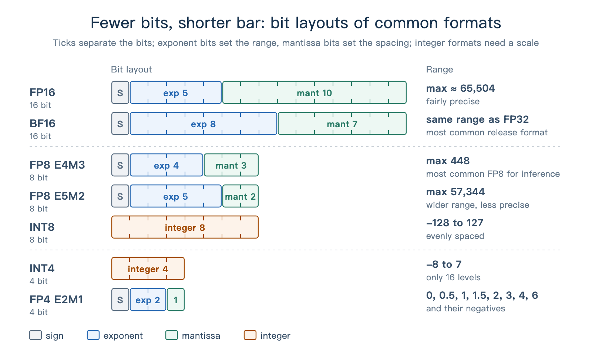
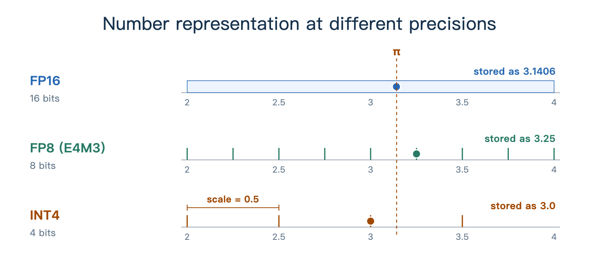
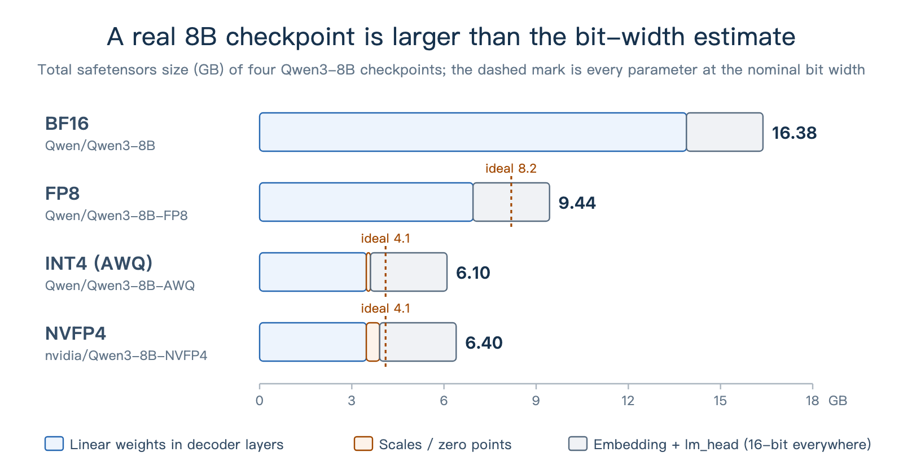
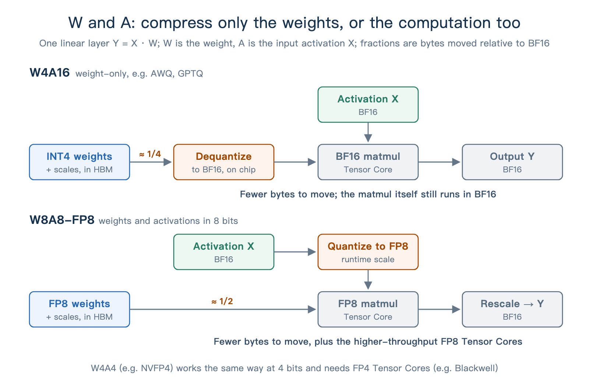
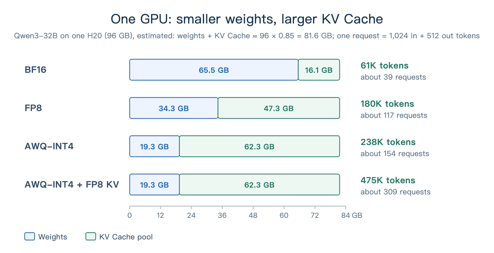
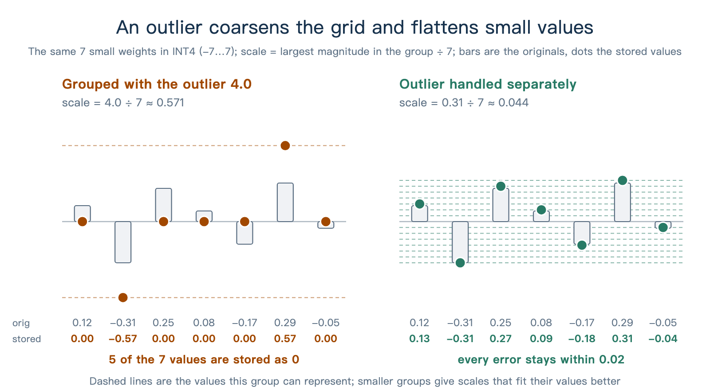

# Chapter 2 Quantization and Low-Precision Inference

The previous chapter showed how attention backends organize data movement and computation. This chapter covers quantization: compressing weights from 16 bits to 8 or even 4 bits, which reduces how much each Decode step reads and leaves the memory saved to the KV Cache. We look in detail at how quantized numbers are represented, and at the resulting performance gains and accuracy changes.

## 1 Learning Objectives

After completing this chapter, you will be able to:

1. Explain how quantization reduces storage and why it introduces errors.
2. Explain the performance gains of quantization from two angles: Decode data movement and KV Cache capacity.
3. Explain where accuracy loss comes from and use evaluation benchmarks to detect accuracy regressions.
4. Distinguish common schemes such as W4A16, W8A8, FP8, and NVFP4, and read the quantization labels on model download pages.

## 2 What Quantization Is

### 2.1 Representing Numbers with Fewer Bits

Weights are the model parameters, and activations are the intermediate inputs and outputs of each layer. Like the KV Cache, they are all stored in some numeric format. In the common BF16 format, each number takes 16 bits, or 2 bytes. **Quantization** converts these numbers to lower-precision representations such as 8 or 4 bits, reducing storage and, on suitable hardware, speeding up computation.

This resembles writing 3.14159 as 3.14: the representation is shorter and loses a little precision. In a computer, each format has a set of representable values, and a number stored in it is usually rounded to the nearest one. Take π as an example:

| Format | Storage per number | Representable values | π is stored as | Error |
| --- | --- | --- | --- | --- |
| FP32 | 32 bits (4 bytes) | about 4.3 billion | 3.1415927 | below 0.0000001 |
| FP16 | 16 bits (2 bytes) | 65,536 | 3.140625 | about 0.001 |
| FP8 (E4M3) | 8 bits (1 byte) | 256 | 3.25 | about 0.11 |
| FP4 (E2M1) | 4 bits (half a byte) | 16 | 3 | about 0.14 |

Quantization keeps the model architecture and changes only the numeric representation. Weights, activations, and the KV Cache can each use their own precision, and the combinations form different quantization schemes, that is, mixed precision. Scheme names often use W/A notation: W stands for weights, A for activations, and the number after each letter is the bit width. For example, W4A16 means 4-bit weights and 16-bit activations, and W8A8 means 8 bits for both. Common schemes:

| Scheme | Weights / activations | Common labels | Meaning |
| --- | --- | --- | --- |
| W4A16 | INT4 / BF16 | `-AWQ`, `-GPTQ-Int4` | Quantizes only weights and dequantizes them to BF16 before computing; saves memory and weight reads, with the most stable accuracy |
| W8A8-FP8 | FP8 / FP8 | `-FP8`, `-FP8-dynamic` | Quantizes weights and activations, so the matmul runs directly on FP8 Tensor Cores (Ada / Hopper / Blackwell) |
| W8A8-INT8 | INT8 / INT8 | `-W8A8` | Same idea on INT8 Tensor Cores, for GPUs without FP8 support |
| NVFP4 | FP4 / FP4 | `-NVFP4` | W4A4, native on Blackwell; SGLang falls back to W4A16 computation on earlier GPUs |
| MXFP4 | FP4 / depends on the implementation | `mxfp4` | Another 4-bit floating-point format, used for the MoE expert weights of gpt-oss |
| FP8 KV Cache | — | `--kv-cache-dtype fp8_e4m3` | The KV Cache precision is not part of the W/A notation and is set separately |

### 2.2 Floating Point, Integers, and Scales

First, look at how the bits of common formats are allocated. In Figure 1, the length of each bar is the number of bits:

<div align="center">
  
  <p><em>Figure 1. Bit layouts and ranges of common formats.</em></p>
</div>

Floating-point formats represent a value with an exponent and a mantissa: the exponent bits set the range, and the mantissa bits affect precision. Their grid is dense near 0 and sparser farther away.

Integer formats (INT8, INT4) have an evenly spaced grid, but on their own they cannot represent a fraction such as 0.3. Quantization pairs them with a **scale**. Without a zero-point offset, this can be written as:

$$
x \approx q \times s
$$

Here $q$ is the stored integer and $s$ is the scale. For example, with $s = 0.5$, the INT4 values −8 to 7 map to −4.0 to 3.5, with a spacing of 0.5. The scale is usually stored at higher precision and shared by a group of numbers.

FP8 and FP4 also have a limited range, so they too are usually paired with scales that bring a group of numbers into the representable range.

<div align="center">
  
  <p><em>Figure 2. Representable values of FP16, FP8, and INT4, and how π is rounded in each.</em></p>
</div>

In Figure 2, the fewer the bits, the fewer values are available near π, and the larger the rounding error.

### 2.3 Example: How Large Is an 8B Model After Quantization?

Storage can be estimated directly from the parameter count and the bit width. For a model with 8B parameters, if every parameter uses the same format:

- FP16 / BF16: 8B × 2 bytes, about 16 GB.
- FP8: 8B × 1 byte, about 8 GB.
- INT4: 8B × 0.5 bytes, about 4 GB.

Real quantized checkpoints are often larger than this estimate. Qwen3-8B has about 8.19B parameters, and the total safetensors size of its four versions on Hugging Face is:

| Version | Hugging Face repository | Bit-width estimate | Actual size |
| --- | --- | --- | --- |
| BF16 | [`Qwen/Qwen3-8B`](https://huggingface.co/Qwen/Qwen3-8B) | 16.4 GB | 16.38 GB |
| FP8 | [`Qwen/Qwen3-8B-FP8`](https://huggingface.co/Qwen/Qwen3-8B-FP8) | 8.2 GB | 9.44 GB |
| INT4 (AWQ) | [`Qwen/Qwen3-8B-AWQ`](https://huggingface.co/Qwen/Qwen3-8B-AWQ) | 4.1 GB | 6.10 GB |
| NVFP4 | [`nvidia/Qwen3-8B-NVFP4`](https://huggingface.co/nvidia/Qwen3-8B-NVFP4) | 4.1 GB | 6.40 GB |

The extra space goes to two places. First, the embedding and the output layer lm_head stay at 16 bits. Together they hold about 1.24 billion parameters, or about 2.49 GB.

Second, quantized weights carry scales and related data. The AWQ version shares one scale and zero point per 128 weights, about 0.14 GB in total; NVFP4 has one FP8 scale per 16 weights, about 0.43 GB in total. The smaller the group, the larger this extra storage.

<div align="center">
  
  <p><em>Figure 3. Weight size of four Qwen3-8B versions, split into linear layers, the embedding and lm_head, and quantization metadata.</em></p>
</div>

## 3 Why Quantization Speeds Up Inference

The logic is simple: once the weights are smaller, each inference step reads less data, and GPU memory has more room to spare.

### 3.1 Example: A Before-and-After Measurement

Qwen's official [Speed Benchmark](https://qwen.readthedocs.io/en/latest/getting_started/speed_benchmark.html) tested the BF16, FP8, and AWQ versions of Qwen3-8B with SGLang under these conditions:

| Item | Setting |
| --- | --- |
| Hardware | 1 NVIDIA H20 (96 GB) |
| Software | SGLang 0.4.6.post1, `mem_fraction_static=0.85`; the AWQ version uses the `awq_marlin` implementation |
| Workload | Batch size 1, 2,048 generated tokens per run, input lengths from 1 to about 129K tokens |
| Metric | Speed = (input tokens + generated tokens) ÷ total time, in tokens/s |

The results are below, with the speedup over BF16 in parentheses:

| Input length | BF16 | FP8 | AWQ-INT4 |
| --- | --- | --- | --- |
| 1 | 81.73 | 150.25 (1.84×) | 144.11 (1.76×) |
| 6,144 | 296.25 | 516.64 (1.74×) | 477.89 (1.61×) |
| 30,720 | 832.67 | 1,242.24 (1.49×) | 1,075.91 (1.29×) |
| About 129K | 1,173.32 | 1,393.21 (1.19×) | 1,198.06 (1.02×) |

In the first row, nearly all the time goes to Decode, and FP8 and INT4 both run about 1.8 times as fast as BF16. As the input grows, the speedup shrinks. The rest of this section explains these results from the time per step.

### 3.2 Fewer Weight Bytes per Step

In small-batch Decode, each weight read serves only a few tokens, so data movement easily becomes the bottleneck. Counting only weight reads gives a lower bound on the time per step:

$$
\text{time per step} \gtrsim \frac{\text{weight bytes}}{\text{memory bandwidth}}
$$

For example, the H20 has about 4 TB/s of memory bandwidth. Approximating the weights read per step by the checkpoint size, the 16.4 GB of BF16 corresponds to about 4.1 ms, the 9.4 GB of FP8 to about 2.4 ms, and the 6.1 GB of INT4 to about 1.5 ms.

The measured BF16 step takes about 12.2 ms (81.73 tokens/s). It also includes Attention, sampling, scheduling, and kernel launches, and weight reads depend on the bandwidth actually achieved. Quantization shortens the weight reads, while the rest of the work still takes part of the latency.

This also helps explain the INT4 result: its weights are 37% of BF16, and it runs 1.76 times as fast, slightly slower than FP8. The INT4 version here takes the W4A16 path: weights are dequantized to BF16 before the matmul, which adds dequantization overhead, while FP8 can use the H20's FP8 Tensor Cores directly. Figure 4 compares the two computation paths:

<div align="center">
  
  <p><em>Figure 4. Computation flow of W4A16 and W8A8-FP8, from weight reads through the matmul to the output.</em></p>
</div>

The table shows one more pattern: as the input grows, the speedup from quantization shrinks. FP8 drops from 1.84 times to 1.19 times, and AWQ-INT4 from 1.76 times to 1.02 times, nearly the same as BF16. The longer the input, the more time goes to Prefill and to Attention over the long KV sequence, and the smaller the share of weight reads. Prefill is mostly limited by compute throughput: W4A16 only reduces weight reads and still runs the matmul in BF16, so it gains little; FP8 also quantizes activations, so it can run the matmul on FP8 Tensor Cores and keep part of the speedup.

### 3.3 More GPU Memory for the KV Cache

When serving many requests, the memory saved on weights can go to the KV Cache pool and hold more requests. Take Qwen3-32B: it has 64 layers, 8 KV heads per layer, and 128 dimensions per head. In BF16, each token needs:

$$
2 \times 64 \times 8 \times 128 \times 2\ \text{bytes} = 262{,}144\ \text{bytes} = 256\ \text{KiB}
$$

The first 2 counts K and V, and the final 2 bytes is the size of one BF16 number. A request with 1,024 input tokens and 512 output tokens takes up to 1,536 × 256 KiB, or 384 MiB.

Taking 96 GB × 0.85 ≈ 81.6 GB on the H20 as the budget, subtracting the weight size, and dividing by the KV Cache size per token gives the estimate in Figure 5. At startup, SGLang also accounts for other memory overhead and logs the actual capacity as `max_total_num_tokens`.

<div align="center">
  
  <p><em>Figure 5. Memory allocation of Qwen3-32B on one H20, with the estimated token and request capacity of each scheme.</em></p>
</div>

Assuming every request uses all 1,536 tokens, the BF16 version holds about 39 requests and AWQ-INT4 about 154; converting the KV Cache to FP8 then halves the storage per token. With enough requests, a larger KV Cache pool supports larger batches, so one weight read serves more tokens and throughput rises.

The larger the share of GPU memory taken by the weights, the larger this capacity gain. For example, on the same H20, switching Qwen3-8B from BF16 to INT4 grows the KV Cache capacity by only about 16%, while Qwen3-32B in the figure gains much more.

## 4 The Cost: Trading Accuracy for Throughput

The speedup in Section 3 comes from fewer bits, and the price is a coarser grid. Quantization is a trade-off: throughput goes up, and accuracy may go down. This section looks at where the accuracy loss comes from and how to detect it.

### 4.1 Rounding Errors and Outliers

Besides the rounding error in the π example, a shared scale is also affected by outliers. When the scale is chosen from the largest magnitude in a group, one unusually large number enlarges the scale, so the differences among the other small values are hard to keep, and they may all round to 0.

<div align="center">
  
  <p><em>Figure 6. INT4 quantization results when the outlier shares a scale with the other weights, and when it is handled separately.</em></p>
</div>

In Figure 6, once the outlier is handled separately, the other values can use a smaller scale and keep more detail. Common schemes shrink the groups (NVFP4 uses one scale per 16 values, block-wise FP8 one per 128×128 block) or assign scales per channel or per token, all to reduce this kind of error.

Weights are fixed, so their scales can be chosen offline. Activations change with the input and may contain channels with very large values, which makes them harder to quantize; going down to 4 bits usually requires finer groups.

Errors propagate to later layers, and a quantized KV Cache is read again and again by later tokens. Next, we use evaluations to observe their effect on the final output.

### 4.2 Detecting Accuracy Regressions

To evaluate a quantized model, fix the evaluation set, the prompt template, and the sampling parameters, change only the quantization, and compare the scores before and after. This shows how quantization affects task performance.

On the [Qwen3-8B-AWQ](https://huggingface.co/Qwen/Qwen3-8B-AWQ) and [Qwen3-32B-AWQ](https://huggingface.co/Qwen/Qwen3-32B-AWQ) model pages, the Qwen team published evaluations of BF16 versus AWQ-INT4. The table excerpts some results, with the score change after quantization in parentheses:

| Model and mode | LiveBench | GPQA | MMLU-Redux | AIME24 |
| --- | --- | --- | --- | --- |
| Qwen3-8B, thinking | 67.1 → 65.5 (−1.6) | 62.0 → 59.0 (−3.0) | 87.5 → 86.4 (−1.1) | 76.0 → 71.3 (−4.7) |
| Qwen3-8B, non-thinking | 53.5 → 48.9 (−4.6) | 39.3 → 35.9 (−3.4) | 79.5 → 79.1 (−0.4) | — |
| Qwen3-32B, thinking | 74.9 → 73.1 (−1.8) | 68.4 → 69.0 (+0.6) | 90.9 → 90.8 (−0.1) | 81.4 → 79.4 (−2.0) |
| Qwen3-32B, non-thinking | 59.8 → 59.8 (0) | 54.6 → 53.1 (−1.5) | 85.7 → 85.6 (−0.1) | — |

Qwen3-8B loses at most 1.1 points on MMLU-Redux, while AIME24 in thinking mode drops 4.7 points. Putting the two evaluations side by side shows how differently quantization affects different tasks. In these results, the 8B model also generally drops more than the 32B model.

Scores occasionally rise: Qwen3-32B gains 0.6 points on GPQA in thinking mode. The size of the evaluation set and the randomness of generation both cause score fluctuations. Running the baseline and the quantized version several times and comparing their means and ranges helps tell such small changes apart.

KV Cache quantization also needs to be tested on tasks of different difficulty. In the GPT-OSS-120B evaluation from the SGLang documentation, the change varies widely across evaluation sets:

| Evaluation set | KV Cache BF16 | KV Cache FP8 E4M3 | KV Cache FP4 E2M1 |
| --- | --- | --- | --- |
| GSM8K | 0.9161 | 0.9163 | 0.9152 |
| AIME25 | 0.7533 | 0.7667 | 0.3533 |
| GPQA Diamond | 0.5081 | 0.5434 | 0.3202 |

On GSM8K, the FP4 KV Cache scores almost the same as BF16; on AIME25, the score falls from about 0.75 to about 0.35. In the same documentation, Qwen3-235B-A22B and DeepSeek-R1-0528 drop by about one fifth on AIME25. Evaluations therefore need to cover the model you plan to deploy, along with the task difficulty and output length of real use, to show how the scheme performs in the target setting.

In practice, check against this list:

- **Choose evaluations close to the real workload**, covering basic tasks as well as difficult tasks with long outputs.
- **Fix the evaluation conditions**: dataset version, number of few-shot examples, prompt template, and sampling parameters all match the BF16 baseline.
- **Run several times and measure the variation first.** Record the mean and range of both the baseline and the quantized version, and check whether a score change shows up consistently.
- **Validate long contexts separately**, especially when the KV Cache is quantized.
- **Report performance and accuracy together.** The Benchmark chapter in Part I notes that performance comparisons must fix precision and quantization; conversely, a reported quantization speedup should come with accuracy results.

## 5 In Practice: Quantization Labels and Loading Models

### 5.1 Reading Quantization Labels on Model Pages

After finding the quantization label in a model name, open `quantization_config` in `config.json`, or the separate quantization configuration file, to confirm the format and grouping. Terms often seen in configurations, such as group size, dynamic / static, and per-tensor / per-channel / per-token, all describe how scales are assigned: how many values share one, whether it is computed at runtime or fixed offline, and whether it is shared across a whole tensor, a channel, or a token.

| Model | What the name says | What the configuration adds |
| --- | --- | --- |
| [`Qwen/Qwen3-8B-AWQ`](https://huggingface.co/Qwen/Qwen3-8B-AWQ) | INT4 weights produced by AWQ, i.e. W4A16 | `bits: 4`, `group_size: 128`, `zero_point: true` |
| [`Qwen/Qwen3-8B-FP8`](https://huggingface.co/Qwen/Qwen3-8B-FP8) | FP8 weights | `fmt: e4m3`, `weight_block_size: [128, 128]`, and `activation_scheme: dynamic`, so activations are also quantized to FP8 at runtime |
| [`nvidia/Qwen3-8B-NVFP4`](https://huggingface.co/nvidia/Qwen3-8B-NVFP4) | NVFP4, i.e. W4A4 | Stored in `hf_quant_config.json`: `group_size: 16` and `kv_cache_quant_algo: FP8`, so the KV Cache is FP8 as well |
| [`openai/gpt-oss-120b`](https://huggingface.co/openai/gpt-oss-120b) | No quantization suffix | `quant_method: mxfp4`, but Attention, the router, the embedding, and lm_head are not quantized; only the MoE expert weights are MXFP4 |

The name is a hint; the configuration is the evidence.

### 5.2 Loading Quantized Models in SGLang

For a pre-quantized model, pass its path and SGLang reads the configuration to choose the implementation; do not add `--quantization`. On compatible GPUs, AWQ checkpoints also switch to the faster `awq_marlin` automatically. `--quantization fp8` converts BF16 weights to FP8 online, which suits quick experiments. The KV Cache precision is set separately with `--kv-cache-dtype`:

```bash
# Pre-quantized model
python3 -m sglang.launch_server --model-path Qwen/Qwen3-8B-AWQ
# Online quantization to FP8
python3 -m sglang.launch_server --model-path Qwen/Qwen3-8B --quantization fp8
# Keep the weights, set only the KV Cache to FP8
python3 -m sglang.launch_server --model-path Qwen/Qwen3-8B --kv-cache-dtype fp8_e4m3
```

For supported methods, hardware, and parameters, see the [official quantization documentation](https://docs.sglang.io/docs/advanced_features/quantization) and the [quantized KV Cache documentation](https://docs.sglang.io/docs/advanced_features/quantized_kv_cache). In the source code, every quantization method is registered in [`layers/quantization/__init__.py`](https://github.com/sgl-project/sglang/blob/75878f27c88c2ffd296425d94226d0dc9bd42518/python/sglang/srt/layers/quantization/__init__.py).

## 6 Summary and Exercises

### 6.1 Summary

In short, quantization stores data in fewer bits, so the model takes less GPU memory, moves less data, and sometimes computes faster. Fewer bits do not always mean faster inference, though. The trade-off is that quantization may affect answer quality. When choosing a scheme, check which parts are quantized and whether the hardware supports them, then measure speed and quality on real tasks.

### 6.2 Exercises

1. What do W4A16, W8A8-FP8, and an FP8 KV Cache each save, and what do they speed up?
2. Why is an 8B model still 6.1 GB to download after INT4 quantization, rather than 4 GB?
3. Why does W4A16 speed up single-request Decode noticeably but help little with long-input Prefill?
4. Why does KV Cache quantization become more useful as conversations get longer?
5. If GSM8K drops by only 0.3 percentage points, can you say quantization has no effect? What else would you check?
6. Which quantization scheme does each of these models use, and how would you confirm it from the configuration files?
   - `Qwen/Qwen3-32B-AWQ`
   - `RedHatAI/Llama-3.3-70B-Instruct-FP8-dynamic`
   - `nvidia/DeepSeek-R1-0528-NVFP4`
   - `openai/gpt-oss-20b`

## References

- [SGLang: Official Quantization Documentation](https://docs.sglang.io/docs/advanced_features/quantization)
- [SGLang: Official Quantized KV Cache Documentation](https://docs.sglang.io/docs/advanced_features/quantized_kv_cache)
- [SGLang: Quantization Method Registry](https://github.com/sgl-project/sglang/blob/75878f27c88c2ffd296425d94226d0dc9bd42518/python/sglang/srt/layers/quantization/__init__.py)
- [SGLang: AWQ Implementation and Automatic Marlin Selection](https://github.com/sgl-project/sglang/blob/75878f27c88c2ffd296425d94226d0dc9bd42518/python/sglang/srt/layers/quantization/awq/awq.py)
- [Hugging Face: Qwen/Qwen3-8B](https://huggingface.co/Qwen/Qwen3-8B)
- [Hugging Face: Qwen/Qwen3-8B-FP8](https://huggingface.co/Qwen/Qwen3-8B-FP8)
- [Hugging Face: Qwen/Qwen3-8B-AWQ (BF16 vs. AWQ-INT4 Accuracy)](https://huggingface.co/Qwen/Qwen3-8B-AWQ)
- [Hugging Face: nvidia/Qwen3-8B-NVFP4](https://huggingface.co/nvidia/Qwen3-8B-NVFP4)
- [Microscaling (MX) Data Formats Paper](https://arxiv.org/abs/2310.10537)
- [Qwen: Speed Benchmark (SGLang Measurements of Quantized Qwen3 Models)](https://qwen.readthedocs.io/en/latest/getting_started/speed_benchmark.html)
- [Hugging Face: Qwen/Qwen3-32B-AWQ (BF16 vs. AWQ-INT4 Accuracy)](https://huggingface.co/Qwen/Qwen3-32B-AWQ)
- [LMSYS: INT4 QAT End-to-End Practice](https://lmsys.org/blog/2026-01-26-int4-qat/)
- [LMSYS: Native NVIDIA Model Optimizer Quantization in SGLang](https://lmsys.org/blog/2025-12-02-modelopt-quantization/)
- [AWQ: Activation-aware Weight Quantization Paper](https://arxiv.org/abs/2306.00978)
- [GPTQ: Accurate Post-Training Quantization Paper](https://arxiv.org/abs/2210.17323)
- [DeepSeek-V3 Technical Report (Block-wise FP8 Training and Inference)](https://arxiv.org/abs/2412.19437)
