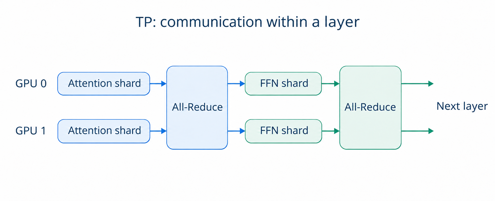
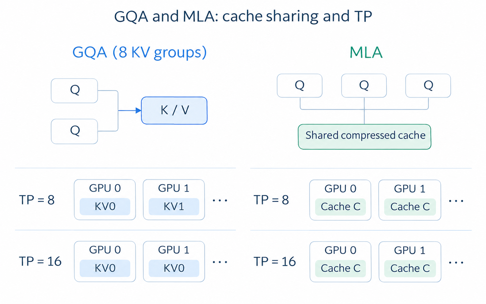
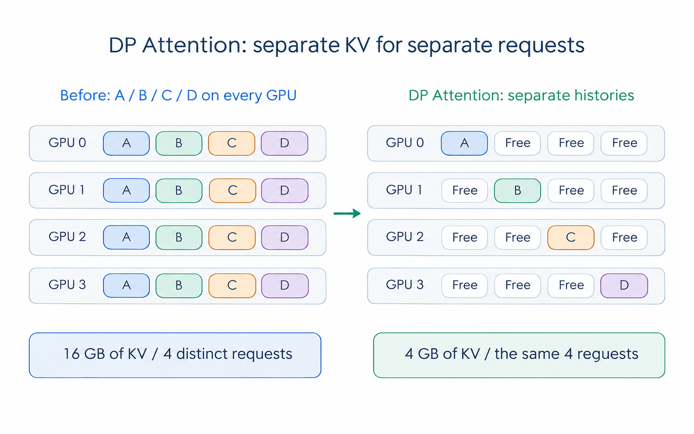
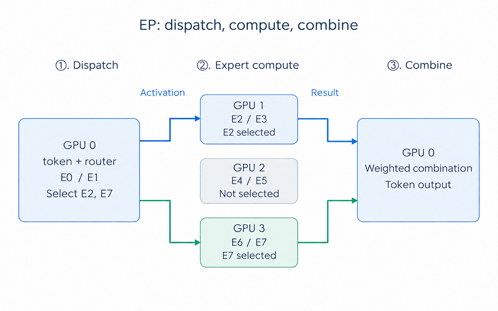
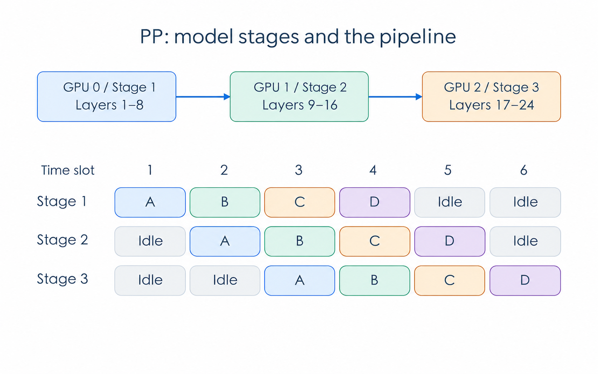

# Chapter 4 Scaling Out: DP Attention, EP, PP

In [Chapter 9 of Part II](../part2/Chapter9_Multi-process-and-Tensor-Parallelism.md), we introduced Tensor Parallelism (TP): splitting the large matrices within a layer across multiple GPUs. Weights that do not fit on one GPU can be shared across several, which also work together on the computation.

Adding more GPUs does not necessarily make inference faster. Each GPU has less computation to do, but the GPUs still need to exchange data and wait for one another. Some models' KV caches also cannot be partitioned further as TP grows. At that point, what else can we distribute besides smaller pieces of the same matrix?

This chapter introduces three approaches: DP Attention assigns different requests' Attention computation to different GPUs, EP distributes MoE experts across GPUs, and PP places different model layers on different devices. We start with the limits of TP, then work through how each approach operates.

## 1 Learning Objectives

After completing this chapter, you should be able to answer these questions:

1. Why can communication offset the computation time saved by adding TP GPUs? What limits KV cache partitioning in GQA and MLA?
2. How does DP Attention divide requests, and when can it reduce duplicated KV caches?
3. How does a token reach its selected MoE experts, complete computation, and receive the results?
4. Why does PP introduce pipeline bubbles, and how do micro-batches reduce waiting?
5. Which parallelism approaches should you consider when memory is insufficient, communication is costly, or workloads are uneven?

## 2 Where TP Runs into Limits

### 2.1 Smaller Compute Shards Do Not Necessarily Mean Less Communication

Recall matrix multiplication with TP: each GPU computes part of the result. Communication operations such as All-Reduce then combine those results for the computation that follows.

These exchanges happen repeatedly inside the model. In common Transformer TP implementations, operations such as the Attention output projection and the FFN output projection may require communication. Generating one token passes through dozens of layers, with many exchanges between GPUs along the way.

  
  
<em>Figure 1. Two communication steps within a layer: combine partial Attention and FFN results.</em>

Suppose we expand a matrix multiplication from 4 GPUs to 8. Each GPU performs fewer multiplications, but starting communication, transferring data, and synchronizing still take time. During small-batch Decode, each GPU already has little computation to do. Splitting it further may save less time than the additional communication costs. If the GPUs span multiple machines, network bandwidth and latency also matter.

Whether more TP GPUs improve performance therefore depends on **whether the computation time saved covers the additional communication and scheduling overhead**.

### 2.2 KV Caches Cannot Always Be Partitioned Further

In standard multi-head attention, the KV cache can be partitioned along the head dimension, with different GPUs storing KV for different heads. GQA and MLA reduce the data that needs to be cached through their model architecture, and each has its own partitioning constraints.

- **GQA**: multiple Query heads share a group of KV heads, so there are fewer KV heads than Query heads. A model with 8 KV heads can place one KV head on each GPU under 8-way TP. At 16-way TP, a scheme that partitions by whole KV heads has no more heads to distribute. Some GPUs must store the same KV, so per-GPU KV usage cannot halve again.
- **MLA**: historical information is stored primarily as compressed latent states used by multiple Query heads. Assigning different KV heads to different GPUs does not transfer directly to this structure. In TP implementations that replicate these states, multiple GPUs each store a copy of the same request's cache.

Whether KV memory can be reduced further depends on the model architecture and implementation. GQA can still partition KV when enough heads are available, and MLA can use other parallelism schemes. Increasing TP alone, however, may not reduce the KV stored on each GPU. SGLang's [DP Attention documentation](https://docs.sglang.io/docs/advanced_features/dp_dpa_smg_guide) explains duplicated MLA caches and the idea of assigning Attention work by request.

  
  
<em>Figure 2. For the same request and length, more GPUs may not reduce KV per GPU. The examples use head-sharded GQA and cache-replicated MLA; see <a href="https://arxiv.org/abs/2305.13245">GQA</a> and <a href="https://arxiv.org/html/2405.04434v5#S2.SS1">MLA</a>.</em>

We start with DP Attention: if each GPU handles different requests, where should their KV caches live?

## 3 DP Attention: Partitioning Requests

### 3.1 Separate Requests, Separate KV Caches

Attention computation is generally independent across requests. Generating user A's next token only requires A's historical KV, and the same holds for user B. We can therefore assign these requests to different GPUs, each performing Attention for its own requests.

Consider 4 GPUs processing requests A, B, C, and D. To make the change in KV storage clear, assume each GPU can perform Attention independently, while the original TP scheme stores all four requests' complete caches on every GPU. With DP Attention, we can assign the work as follows:

| GPU | Original TP scheme with replicated KV | With DP Attention |
|---|---|---|
| GPU 0 | Stores KV for A, B, C, and D | Handles Attention for A and stores A's KV |
| GPU 1 | Stores KV for A, B, C, and D | Handles Attention for B and stores B's KV |
| GPU 2 | Stores KV for A, B, C, and D | Handles Attention for C and stores C's KV |
| GPU 3 | Stores KV for A, B, C, and D | Handles Attention for D and stores D's KV |

GPU 0 now handles A's Attention throughout, with A's historical KV kept on GPU 0. The other three GPUs no longer need to store A's cache. The same applies to B, C, and D, freeing the memory previously occupied by duplicate KV. SGLang's [v0.4 release article](https://www.lmsys.org/blog/2024-12-04-sglang-v0-4/) introduces this design.

  
  
<em>Figure 3. For the same four requests at 1 GB of KV each, removing fourfold replication reduces total KV usage from 16 GB to 4 GB.</em>

### 3.2 How Many More Requests Can Fit?

Continuing the example, suppose each request's KV occupies 1GB and each GPU has 4GB available for KV caches. In the original scheme, the caches for A, B, C, and D fill that 4GB on every GPU. The four GPUs use 16GB in total to store the histories of just four distinct requests.

With DP Attention, each GPU stores only its own requests. One GPU can hold four requests, so four GPUs can hold 16: four times the original capacity.

The factor of four comes from the fourfold replication assumed in this example. If TP already partitions the KV evenly, there are fewer duplicate caches to remove. Actual request capacity also depends on memory used by Attention weight replicas and temporary buffers, as well as request lengths and how evenly requests are distributed. Even with enough memory for four times as many requests, processing them still requires computation and communication. Throughput needs to be measured.

### 3.3 Independent Attention Does Not Eliminate Communication Throughout the Layer

After Attention, tokens still pass through an FFN or MoE. These components can use TP, EP, or other strategies, so GPUs still need to exchange data.

If the FFN uses TP, for example, token activations from the GPUs must first be arranged into the required data layout. After computation, results return to the GPUs responsible for the corresponding requests. If the MoE uses EP, token activations are sent to the GPUs hosting the selected experts. These transfers carry the activations and results for the current computation; historical KV can stay on the GPUs responsible for Attention.

This is also how DP Attention differs from ordinary DP. Ordinary DP deploys a complete model replica on each GPU group, allowing each group to run inference independently. DP Attention divides only Attention work by request; the subsequent FFN or MoE can still be shared across GPU groups. Attention itself can also combine DP with TP, using a small GPU group to process a request. See SGLang's [large-scale EP article](https://www.lmsys.org/blog/2025-05-05-large-scale-ep/) for details.

## 4 EP: Partitioning Experts

### 4.1 A Brief Review of MoE

A conventional FFN processes every token with the same network. A Mixture of Experts (MoE) contains several expert networks. A router selects a few experts for each token, then their outputs are combined using the routing weights.

Each expert is a set of trained network parameters, rather than a manually designated specialist in mathematics or writing. If a layer has 8 routed experts and selects 2 per token, processing that token only requires running the two selected expert networks.

Although one token uses only two experts, the next may select two others. Deployments with GPU-resident expert weights still need memory for every expert. Expert Parallelism (EP) distributes these experts across GPUs, so each GPU stores and runs a subset.

### 4.2 Tokens Travel to Experts, and Results Return

Suppose we distribute 8 experts evenly across 4 GPUs, with two experts per GPU:

| GPU | Resident experts |
|---|---|
| GPU 0 | E0, E1 |
| GPU 1 | E2, E3 |
| GPU 2 | E4, E5 |
| GPU 3 | E6, E7 |

The router assigns a token on GPU 0 to E2 and E7. Both experts are on other GPUs, so processing requires these steps:

1. **Dispatch**: send the token's activation to GPU 1 and GPU 3.
2. **Expert computation**: GPU 1 runs E2, and GPU 3 runs E7.
3. **Combine**: return both expert results to GPU 0 and combine them using the routing weights to produce the token's output.

  
  
<em>Figure 4. One token route: dispatch activations, run the selected experts, and return and combine their results.</em>

Tokens in a batch often select experts spread across several GPUs. Each GPU sends activations out and receives activations from others, creating many-to-many exchanges. Typical EP uses All-to-All-style communication for dispatch and return, sending each token only to its selected experts. SGLang provides dedicated communication and computation backends for this process; see the [Expert Parallelism documentation](https://docs.sglang.io/docs/advanced_features/expert_parallelism).

### 4.3 Distributed Weights Still Require Communication and Load Balancing

With EP, each GPU stores fewer expert weights. But each pass through MoE may require sending token activations to other GPUs and waiting for the results. The more data sent to remote experts, the more demanding the workload becomes for the GPU interconnect.

Uneven workloads are another concern. In our example, every GPU hosts two experts. If most tokens in a batch select E2, however, GPU 1 has more computation to do. Other GPUs may finish their work and wait for it. Assessing the distribution requires looking at the number of tokens each expert actually receives.

When deploying EP, check not only whether the expert weights fit, but also how long dispatch and return take, and whether computation is concentrated on a few experts. Attention and KV cache placement still need to be arranged separately.

## 5 PP: Partitioning Model Layers into a Pipeline

### 5.1 Each GPU Handles a Model Segment

Alongside partitioning matrices and experts within layers, we can divide the model by layer. Pipeline Parallelism (PP) groups consecutive layers into stages.

For example, a 24-layer model can be divided into three stages, responsible for layers 1–8, 9–16, and 17–24. Inputs pass through the first stage, then the second and third. Each stage stores the weights and KV for its assigned layers. Once it finishes computation, it passes intermediate activations to the next stage.

A stage can run on one GPU or several working together. Start by imagining one GPU per stage, like a factory production line: each station completes its work and passes the intermediate product to the next. Transfers between stages happen at stage boundaries, so stages can be placed on different nodes while using other parallelism strategies within each node. See the [SGLang PP documentation](https://docs.sglang.io/docs/advanced_features/pipeline_parallelism) for an introduction.

### 5.2 Bubbles: Devices Waiting for Work

After splitting the model into three stages, suppose only one batch moves through the pipeline from start to finish. The GPUs then work in turn: GPU 0 finishes and passes its output to GPU 1, which finishes and passes its output to GPU 2. While one GPU computes, the other two wait.

These gaps without useful computation are called pipeline **bubbles**. Although the model is distributed across three GPUs, only one is working at a time for much of the run.

To keep them busy together, we can split a batch of requests into micro-batches. After GPU 0 passes the first micro-batch to GPU 1, it starts the second without waiting for the first to finish the entire pipeline.

The following example divides a batch of requests into micro-batches A, B, C, and D. Assume every stage needs one time slot per micro-batch, and ignore communication:

  
  
<em>Figure 5. Partition layers into stages and overlap micro-batches of different requests; timing and communication assumptions are illustrative.</em>

By slot 3, A has reached the third stage, B is in the second, and C is in the first. All three GPUs are computing, and the same is true in slot 4. Sending A, B, C, and D through the entire pipeline one after another would take 12 slots; the schedule in Figure 5 takes 6. There are still bubbles at the beginning while data enters each stage, and at the end while the last micro-batches finish.

### 5.3 Smaller Micro-batches Are Not Always Better

Making micro-batches smaller is not always helpful. If each contains too little computation, it may use the GPU poorly while increasing scheduling and communication operations. Stage runtimes should also be close to one another; otherwise, faster stages finish and wait for the slowest one.

Autoregressive inference adds another constraint: a request must generate its current token before computing the next one. A, B, C, and D in Figure 5 therefore contain different requests. We cannot fill the pipeline with future tokens from the same request that have not yet been generated.

PP distributes a large model across more devices in stages. With enough requests, multiple micro-batches can keep the stages working at the same time. A single request decoding one token at a time still has to pass through every stage, so adding stages does not guarantee lower per-token latency.

## 6 The Full Picture: Combining Parallelism Strategies

The approaches covered above assign different parts of the work to GPUs:

| Strategy | What it partitions | Main problem addressed | Main costs |
|---|---|---|---|
| TP: Tensor Parallelism | Weight and computation dimensions within a layer | Shares per-layer weights and matrix computation | Frequent communication within layers; overly fine partitioning can reduce compute efficiency |
| DP Attention: Data Parallel Attention | Requests' Attention computation and KV | Reduces avoidable KV replicas and lets groups process different requests | Attention weight replicas, request load balancing, and exchanges with subsequent layers |
| EP: Expert Parallelism | MoE experts | Distributes expert weights and computation across GPUs | Token dispatch and return communication; uneven expert loads |
| PP: Pipeline Parallelism | Consecutive model layers | Distributes the model across more devices in stages | Transfers between stages, pipeline bubbles, and uneven stage workloads |

In a deployment, PP can first divide the model into stages. Within each stage, Attention can be assigned by request and MoE by expert, with TP used for some computations. To count the total GPUs, first establish which GPUs each strategy uses. The same GPUs can serve different roles in Attention and MoE, so multiplying all parallelism degrees does not necessarily give the GPU count.

[Section 3.4 of the DeepSeek-V3 Technical Report](https://arxiv.org/html/2412.19437v2#S3.SS4) describes a deployment that uses TP and DP for Attention and EP for MoE. Choosing a combination should likewise start with the model and workload at hand: identify which weights or KV caches fill GPU memory, then check whether time is spent mainly on computation, communication, or waiting. Use those observations to decide how to assign the GPUs.

## 7 Summary and Exercises

### 7.1 Summary

This chapter started with two limits of TP: adding GPUs introduces communication overhead, and KV caches may not be partitionable any further. We then introduced three ways to scale: DP Attention assigns different requests' Attention and KV to different GPU groups, EP distributes MoE experts across GPUs, and PP divides consecutive model layers into stages.

Choosing between these approaches means weighing the memory and computation time saved against the additional communication and waiting. For DP Attention, examine how evenly requests are assigned. For EP, check how many tokens each expert receives. For PP, look at stage runtimes and pipeline bubbles. The final measure is latency and throughput under the actual workload.

### 7.2 Exercises

1. **Matching**: choose the parallelism strategy most directly related to each situation (TP, DP Attention, EP, or PP), and name one cost it introduces.
   - You want several GPUs to share a linear layer's weights and computation.
   - Identical caches for a batch of MLA requests are replicated across GPUs, limiting request capacity.
   - There are too many MoE expert weights, and each GPU should hold only a subset.
   - You want consecutive model layers on different machines, with multiple batches passing through them in order.
2. A GQA model has 8 KV heads. Why can you not assume that expanding from 8-way to 16-way TP will halve per-GPU KV cache usage?
3. In the example in Section 3, removing fourfold KV replication quadruples capacity for equal-length requests. Why does this not guarantee four times the throughput?
4. GPU 0 handles a token's Attention, but the token selects experts on GPUs 1 and 3. Describe its path through MoE and back. Must its complete historical KV travel with it?
5. Does placing two experts on every GPU guarantee equal workloads? If not, what else should be measured?
6. Following Figure 5, draw the three-stage pipeline for only two micro-batches, A and B. Where are the bubbles? Why can a request's next, not-yet-generated token not be treated as another independent micro-batch?

## References

- [Part II, Chapter 9: Multi-process and Tensor Parallelism](../part2/Chapter9_Multi-process-and-Tensor-Parallelism.md)
- [SGLang Documentation: DP, DPA and SGLang DP Router](https://docs.sglang.io/docs/advanced_features/dp_dpa_smg_guide)
- [SGLang v0.4: Data Parallelism Attention For DeepSeek Models](https://www.lmsys.org/blog/2024-12-04-sglang-v0-4/)
- [Deploying DeepSeek with PD Disaggregation and Large-Scale Expert Parallelism on 96 H100 GPUs](https://www.lmsys.org/blog/2025-05-05-large-scale-ep/)
- [SGLang Documentation: Expert Parallelism](https://docs.sglang.io/docs/advanced_features/expert_parallelism)
- [SGLang Documentation: Pipeline Parallelism for Long Context](https://docs.sglang.io/docs/advanced_features/pipeline_parallelism)
- [DeepSeek-V3 Technical Report, Section 3.4: Inference and Deployment](https://arxiv.org/html/2412.19437v2#S3.SS4)
- [GQA: Training Generalized Multi-Query Transformer Models from Multi-Head Checkpoints](https://arxiv.org/abs/2305.13245)
- [DeepSeek-V2 Technical Report, Section 2.1: Multi-Head Latent Attention](https://arxiv.org/html/2405.04434v5#S2.SS1)
