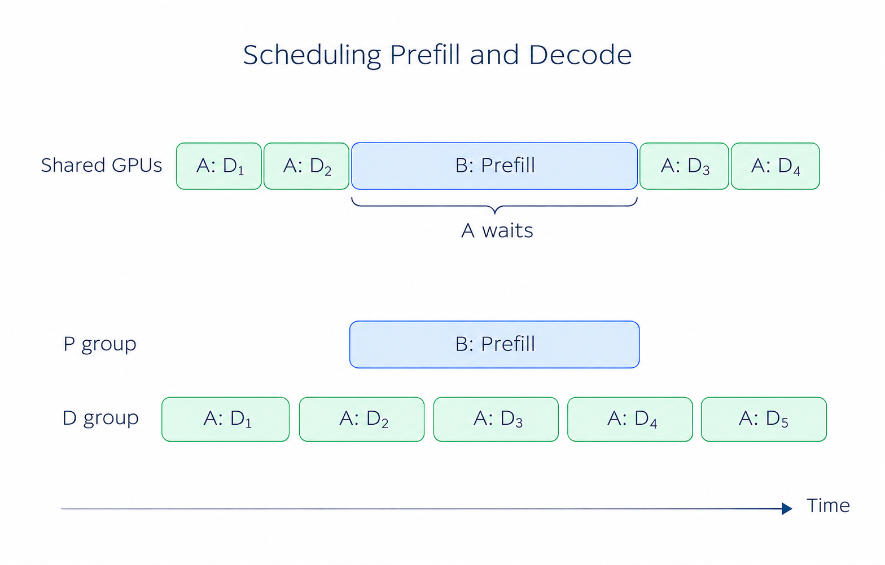
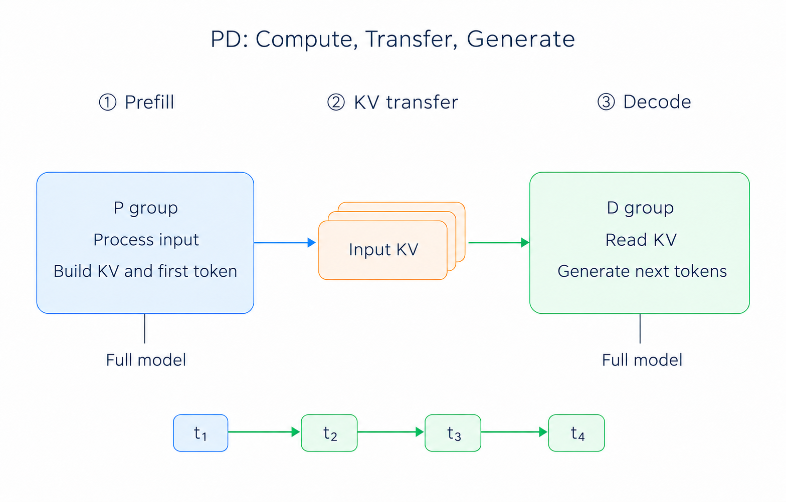
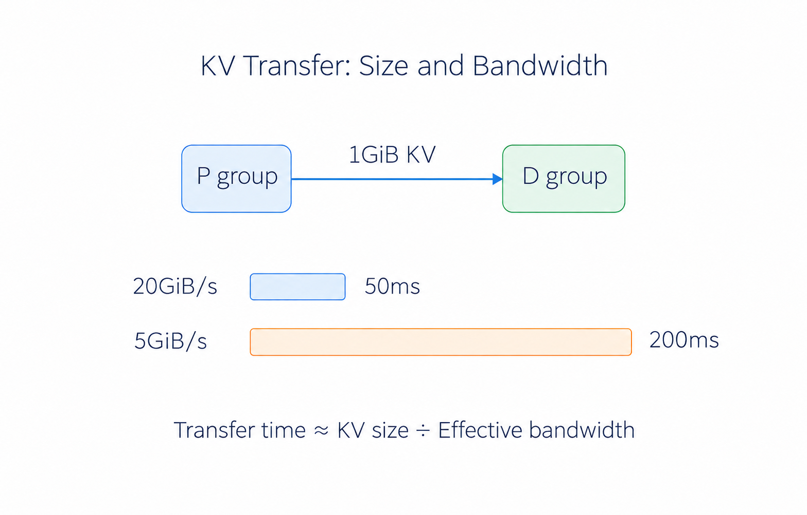
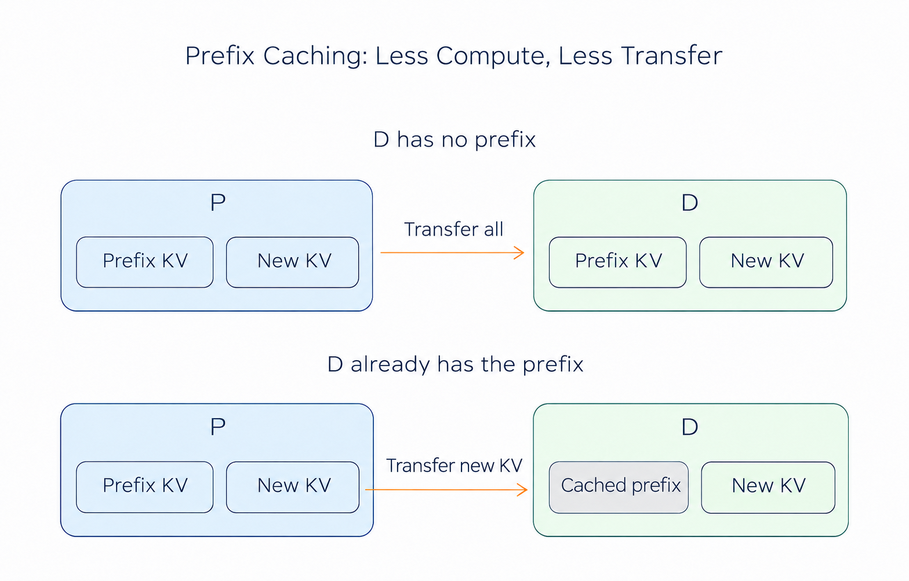

# Chapter 5 Prefill-Decode Disaggregation

In [Chapter 2 of Part I](<../part1/Chapter2_Introduction to Inference.md>), we introduced the two phases of inference: Prefill processes the input and builds the KV cache; Decode uses that cache to generate subsequent tokens one at a time. In the implementations covered so far, the same GPU group performs both phases.

When a service handles several requests at once, a problem can arise if P and D run in the same worker. If a new request has a long input, its Prefill takes longer on the GPUs, and responses already being generated by Decode may have to pause and wait.

To accommodate different workloads, Prefill-Decode disaggregation, or PD disaggregation, assigns these two jobs to different GPUs to reduce interference between them. This chapter covers the benefits and the costs of separating them.

## 1 Learning Objectives

After completing this chapter, you should be able to answer these questions:

1. Why can a new request's Prefill interrupt another request's output?
2. What do P and D each do, and what data passes between them?
3. How long does KV transfer take, and how many GPUs should each side receive?
4. Which workloads suit PD disaggregation, and how can we tell whether it helps?
5. How does PD disaggregation work with prefix caching and hierarchical caching?

## 2 Interference Between Prefill and Decode

### 2.1 Differences Between Prefill and Decode Workloads

First, we need to understand a fundamental difference: Prefill and Decode have very different workload characteristics. When a new request arrives, Prefill processes its input, producing each layer's KV cache and the first output token. Many input positions can be computed together, forming large matrix multiplications.

During Decode, each request processes just one new position per iteration to produce the next token. Each iteration involves less computation, but it still reads model weights and historical KV, and repeats this work for every new token.

Long Prefill is therefore more likely to be compute-bound, while small-batch Decode is more likely to be limited by GPU memory bandwidth.

### 2.2 Pauses Caused by Long Prefill

Suppose request A is already generating when request B arrives with a long document. If the GPUs run B's Prefill next, A must wait for that computation to finish before its next Decode iteration.

From A's perspective, the first two tokens arrive normally, but the third takes much longer. We can observe this pause through the interval between consecutive tokens, or ITL. TPOT averages across the request and can hide a single long wait. See [Introduction to Benchmark](../part1/Chapter5_Introduction_to_Benchmark.md) for the distinction.

  
  
<em>Figure 1. B's Prefill makes A wait for its next Decode iteration. The lower rows illustrate separate scheduling; timings are schematic.</em>

### 2.3 Benefits and Limits of Chunked Prefill

In Part II's [Continuous Batching and the Scheduler](../part2/Chapter6_Continuous-Batching-and-the-Scheduler.md), we introduced Chunked Prefill: divide B's long input into smaller pieces, processing one piece at a time so A can run Decode in between.

This shortens each wait for A, but both jobs still share the GPUs. Smaller chunks mean more rounds to finish B's input; larger chunks make A wait longer. When requests keep arriving, this interference keeps recurring.

Another approach is to give them different GPUs: B runs Prefill on one group while A continues Decode on another. This is the basic idea behind PD disaggregation.

## 3 PD: Dividing Work by Inference Phase

### 3.1 P Processes Input; D Continues Generation

After separation, we call the Prefill side P and the Decode side D. Each side can use one GPU or a group of GPUs. The two sides can even use different types of GPUs, NPUs, or other accelerators with the appropriate adaptations. This is known as heterogeneous PD disaggregation.

For example, P receives a document, computes its KV cache, and passes it to D. With that historical state, D can continue generating the answer without recomputing the whole document. P can then process another request.

Both sides pass through all model layers, so each needs a complete set of model weights. For a large model, each group can use TP, EP, or PP from the previous chapter. PP divides the model by layers; PD divides inference into input processing and subsequent generation.

### 3.2 A Request from P to D

After a request arrives and the router chooses P and D for it, it goes through three steps:

1. **Prefill:** P processes the input, computes KV for each layer, and samples the first token.
2. **KV transfer:** D prepares space to receive the data. P hands over the required KV, the first token, and request information.
3. **Decode:** D uses the received KV and first token to produce the second token, then generates the rest of the answer step by step.

  
  
<em>Figure 2. P computes input KV and the first token; D receives them and continues generation. Each side runs the full model.</em>

The transferred data represents the input's historical state. After handoff, D appends new KV to its own cache at each step, and the rest of generation stays on D. SGLang's [PD documentation](https://docs.sglang.io/docs/advanced_features/pd_disaggregation) and [Prefill implementation](https://github.com/sgl-project/sglang/blob/0c2e211930c10117beb4c52591bffe237525afdf/python/sglang/srt/disaggregation/prefill.py) describe this process.

### 3.3 Tuning Each Side Independently

B now processes its long document on P while A continues generating on D. A no longer has to wait for B's Prefill to finish. P can focus on larger input batches, while D can manage iteration time according to the number of requests generating at once.

This lets each side be tuned separately. D can still slow down if it receives too many requests, however. After separation, we still need to allocate enough devices to each side and make sure KV arrives in time.

## 4 Costs of PD Disaggregation

### 4.1 KV Cache Transfer Time

When Prefill and Decode share a GPU group, the computed KV can stay in GPU memory for continued use. After separation, that data must move from P to D. Longer inputs generally mean more KV to store and transfer.

Suppose a request needs to transfer 1GiB of KV. Dividing data size by effective bandwidth gives a rough estimate of transfer time:

$$
T_{\mathrm{transfer}} \approx \frac{S_{\mathrm{transfer}}}{B_{\mathrm{effective}}}
$$

At 20GiB/s, the transfer takes about 50ms; at 5GiB/s, it takes about 200ms. The request cannot continue generating subsequent tokens until D has the KV it needs.

  
  
<em>Figure 3. For the same 1GiB of KV, a fourfold bandwidth difference produces a fourfold transfer-time difference. These are illustrative values, excluding queuing and other overhead.</em>

Concurrent transfers also share link bandwidth. P may finish a batch of inputs quickly, yet requests still get stuck between the two sides because their KV cannot reach D fast enough. PD disaggregation therefore needs a suitable interconnect, especially enough effective bandwidth when many requests transfer at once.

### 4.2 Model Replicas and Memory Usage

Besides communication, there are model replicas to consider. P and D each store weights and need GPU memory for KV and intermediate results. During transfer, the same KV may exist on both sides. D also needs room for the KV added during generation.

If the model barely fits on the available devices, there may be no room to run another copy on a separate group. PD disaggregation is better suited to deployments with enough resources to allocate devices to each side.

### 4.3 Allocating Resources to P and D

P and D do not need equal GPU counts. Document question answering often has long inputs and short answers, giving P more work. Long-form generation may have a short input but require many Decode iterations. The former may need more resources on P; the latter needs more capacity on D.

To adjust the allocation, look at where requests queue. A long queue before P with spare capacity on D suggests input processing cannot keep up. If P has finished but many active requests have accumulated on D, D needs more resources. If requests are waiting for KV transfer, check the network first.

Prefix caching also affects the balance. When the same long document is reused, P may only need to compute the new question, which is much less work than processing the whole document each time.

## 5 Deployment and Performance Evaluation

### 5.1 Suitable Workloads

Consider three common workloads:

| Workload | Main problem | What PD disaggregation can do |
|---|---|---|
| Long-document question answering | New document Prefill interrupts existing answers | Put input processing on P so D can keep generating; account for the document's KV transfer size |
| Long-answer generation | Requests stay in Decode for a long time, keeping D busy | Give D more resources and use fewer resources on P for input processing |
| A few short questions and answers | GPUs already have little work | Separation may offer little benefit while adding KV transfer |

Services with a steady flow of requests and distinctly different demands in each phase are better candidates for PD disaggregation. With few requests, separation can leave one side idle while the other queues, reducing device utilization.

### 5.2 DeepSeek-V3 Benchmark Results

SGLang's [May 2025 deployment report](https://www.lmsys.org/blog/2025-05-05-large-scale-ep/) gives these DeepSeek-V3 results. Each node has 8 H100 GPUs, with InfiniBand between nodes:

| Phase | Configuration | Throughput per node |
|---|---|---|
| Prefill | 4 nodes, EP32, 2K input | 54,543 input token/s |
| Decode | 9 nodes, EP72, 2K input | 22,282 output token/s |

The phases were tested separately, assuming sufficient resources on the other side. The report shows up to 5.2× higher Decode throughput than the TP16 baseline, but that result also uses EP, larger batches, and other optimizations. It demonstrates the benefit of the combined deployment, so the full gain cannot be attributed to PD disaggregation alone.

### 5.3 Optimizing KV Cache Transfer

Earlier, we estimated transfer time by dividing data size by bandwidth. There are three ways to reduce this wait:

- **Quantize to send less data.** Where both sides support it, lower-precision KV reduces the bytes stored per element. See the [KV cache quantization documentation](https://docs.sglang.io/docs/advanced_features/quantized_kv_cache) for accuracy considerations and backend requirements.
- **Increase transfer bandwidth.** Use a transfer path suited to the device topology, such as RDMA, and avoid unnecessary intermediate copies.
- **Overlap computation and transfer.** Send completed KV while P continues computing later portions. Overlapping transfer and computation reduces the wait for a final bulk transfer. See the [PD documentation](https://docs.sglang.io/docs/advanced_features/pd_disaggregation) for support.

  
  
<em>Figure 4. A cache hit on P saves computation. Reducing transfer also requires a reusable prefix on D and support from the transfer process.</em>

This explains how PD disaggregation can work with [hierarchical caching](./Chapter3_Hierarchical-Caching.md). Suppose P already has a document's KV and can reuse it for a second question. If D has no copy, P can transfer it to D. If D retains the same prefix and the transfer process supports reuse, only the missing portion needs to be sent. HiCache lets P retain and restore more document prefixes, reducing repeated Prefill work, while D handles subsequent generation.

## 6 Summary and Exercises

### 6.1 Summary

This chapter introduced dividing work by inference phase: P processes input, then hands its KV cache to D for continued generation. This reduces interference from long Prefill work and lets each side choose suitable computation and scheduling settings.

The cost is a model copy on each side and an additional KV transfer. In practice, allocate P and D resources according to input and output workloads, then account for transfer bandwidth to judge the benefit. Prefix caching and hierarchical caching (RadixCache and HiCache), covered in earlier chapters, can also reduce repeated computation.

### 6.2 Exercises

1. An existing conversation pauses noticeably after a long-document request arrives, but its average TPOT barely changes. Which metric should you inspect? How do Chunked Prefill and PD disaggregation each address the problem?
2. Trace a request from entering P to producing its second token on D. Where is the first token produced? Does each side handle half the model's layers?
3. A request must transfer 2GiB of KV at an effective bandwidth of 10GiB/s. Ignoring other overhead, how long does transfer take? What happens if contention halves the effective bandwidth?
4. For each scenario, decide whether PD disaggregation should be an early option to try, and state what else needs checking:
   - Long-document requests arrive continuously, and existing users see frequent streaming pauses.
   - A few short question-and-answer requests leave one GPU group mostly idle.
   - The service continually generates long responses; D is saturated while P has ample spare capacity.
5. A published result combines PD, EP, and larger batches. Can its entire speedup over a TP baseline be attributed to PD? Which conditions should be fixed to isolate PD's benefit?
6. P restores a document's prefix KV from HiCache, while D has no such prefix. What work is saved, and what data still needs to move? What additional support would reduce transfer further?

## References

- [Part I, Chapter 2: Introduction to Inference](<../part1/Chapter2_Introduction to Inference.md>)
- [Part I, Chapter 5: Introduction to Benchmark](../part1/Chapter5_Introduction_to_Benchmark.md)
- [Part II, Chapter 6: Continuous Batching and the Scheduler](../part2/Chapter6_Continuous-Batching-and-the-Scheduler.md)
- [Part III, Chapter 3: Hierarchical Caching](./Chapter3_Hierarchical-Caching.md)
- [SGLang: PD Disaggregation](https://docs.sglang.io/docs/advanced_features/pd_disaggregation)
- [SGLang Prefill implementation: first token and KV handoff](https://github.com/sgl-project/sglang/blob/0c2e211930c10117beb4c52591bffe237525afdf/python/sglang/srt/disaggregation/prefill.py)
- [SGLang: Quantized KV Cache](https://docs.sglang.io/docs/advanced_features/quantized_kv_cache)
- [SGLang: Benchmark and Profiling](https://docs.sglang.io/docs/developer_guide/benchmark_and_profiling)
- [SGLang Team: Deploying DeepSeek with PD Disaggregation and Large-Scale Expert Parallelism on 96 H100 GPUs, May 5, 2025](https://www.lmsys.org/blog/2025-05-05-large-scale-ep/)
