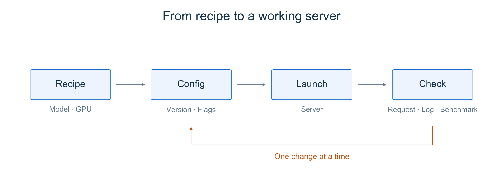
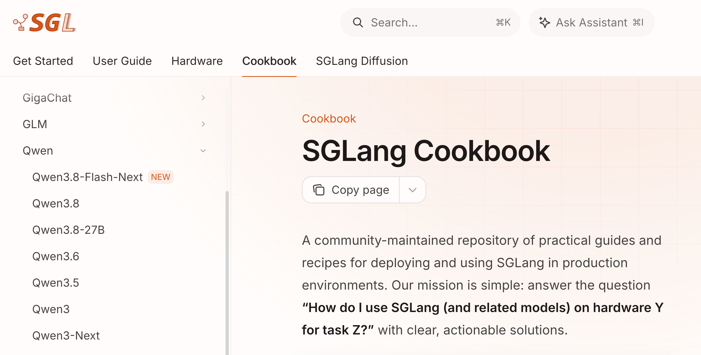
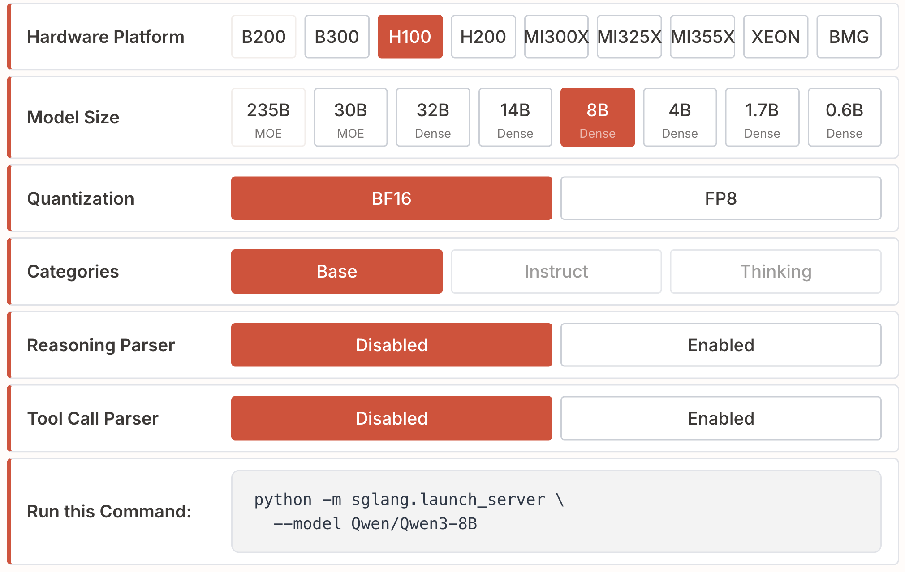

# Chapter 1 Deploying SGLang with the Cookbook

Earlier chapters introduced parallelism, quantization, and prefix caching separately. During deployment, these ideas meet in one launch command: which model, how many GPUs, what precision, and whether to reuse previously computed KV.

This chapter starts from an official Cookbook configuration, connects those choices, and checks the resulting service with a request, logs, and a small benchmark.

## 1 Learning Objectives

After completing this chapter, you should be able to answer these questions:

1. How do you find a Cookbook configuration for your model and hardware?
2. Which earlier concepts do the main launch arguments correspond to?
3. How do you validate the service and measure a configuration change?

## 2 What the Cookbook Provides

The [SGLang Cookbook](https://docs.sglang.io/cookbook/intro) is a community-maintained collection within the official documentation. Each recipe addresses a practical question: how do I run this model on this hardware? Model pages typically cover installation, recommended configurations, API usage, and tuning.

A recipe reduces trial and error, but its assumptions matter. An eight-GPU command will not transfer directly to a single GPU, and a quantization format may not be supported on your device. Before copying a command, check the model variant, GPU type and count, weight precision, and required SGLang version.

<div align="center">
  
  <p><em>Figure 1. Start from a recipe, check the service, and repeat the same measurement after changing a setting.</em></p>
</div>

## 3 Decisions Behind a Launch Command

In the Cookbook sidebar, expand `Autoregressive Models → Qwen` and select `Qwen3` to open the recipe used in this chapter.

<div align="center">
  
  <p><em>Figure 2. Find Qwen3 in the model navigation. Source: <a href="https://docs.sglang.io/cookbook/intro">SGLang Cookbook</a>, captured November 7, 2026. The website changes over time.</em></p>
</div>

Open the [Qwen3 recipe](https://docs.sglang.io/cookbook/autoregressive/Qwen/Qwen3) and select H100, 8B, and BF16, leaving the optional reasoning and tool-call parsers disabled. The command below keeps its single-GPU setup and explicitly states the precision, GPU count, and local listening address.

<div align="center">
  
  <p><em>Figure 3. Run this Command updates when selections change. Source: <a href="https://docs.sglang.io/cookbook/autoregressive/Qwen/Qwen3#3-1-basic-configuration">Qwen3 configuration selector</a>, captured November 7, 2026. The screenshot's <code>--model</code> and the example's <code>--model-path</code> are aliases for the same argument.</em></p>
</div>

This example assumes one available H100 80GB and a compatible installation following [Part 0](../part0/Part0-Deploy-Your-First-SGLang-Server.md) and the [official installation guide](https://docs.sglang.io/docs/get-started/install). Run it on the GPU machine. If the course provides different hardware, select that hardware in the recipe instead.

```bash
python3 -m sglang.launch_server \
  --model-path Qwen/Qwen3-8B \
  --dtype bfloat16 \
  --tp-size 1 \
  --host 127.0.0.1 \
  --port 30000
```

Read the arguments as deployment decisions:

| Decision | Configuration | Connection to earlier chapters |
|---|---|---|
| Which model? | `--model-path` | Selects the weights; the first launch may download them |
| How many GPUs cooperate? | `--tp-size 1` | No sharding here; multi-GPU TP introduces memory and communication tradeoffs |
| What precision? | `--dtype bfloat16` | This example uses BF16; quantization also depends on the checkpoint, hardware, and backend |
| Reuse prefixes? | Keep default prefix caching | Connects to RadixAttention; `--disable-radix-cache` disables prefix reuse across requests |

Disabling prefix reuse does not remove the current request's KV cache during Decode; see [RadixAttention and Prefix Caching](../part2/Chapter8_RadixAttention-and-Prefix-Caching.md). Likewise, `--dtype` does not replace choosing a quantization scheme; see [Quantization and Low-Precision Inference](../part3/Chapter2_Quantization-and-Low-Precision-Inference.md). Consult [Server Arguments](https://docs.sglang.io/docs/advanced_features/server_arguments) for the full definitions.

## 4 Validate the Service

### 4.1 Send a Request

Wait for weight loading and initialization to finish, then open another terminal on the same machine. This request uses Qwen3's non-thinking mode to keep the first response short:

```bash
curl --fail-with-body http://127.0.0.1:30000/v1/chat/completions \
  -H 'Content-Type: application/json' \
  -d '{
    "model": "Qwen/Qwen3-8B",
    "messages": [{"role": "user", "content": "Explain KV cache in one sentence."}],
    "max_tokens": 128,
    "chat_template_kwargs": {"enable_thinking": false}
  }'
```

Check for a sensible response in `choices[0].message.content`. A successful answer confirms that the request reached model inference; it does not establish accuracy or performance under concurrency.

### 4.2 Inspect Logs and GPU Memory

Check that the server loaded the intended model and initialized without errors. Use `nvidia-smi` to inspect the process and GPU memory. SGLang reserves space for KV cache and other data as well as weights, so high memory usage alone does not imply a leak. The first request may include extra initialization work; keep warmup consistent in later comparisons.

Three common failures are worth recognizing. For out-of-memory errors, identify whether loading or serving failed before trying a smaller model, supported quantization, or a different cache budget. For download failures, check connectivity, model access, and disk space. For a busy port, change `--port` and update the client too.

### 4.3 Run a Small Benchmark

Leave the server running and invoke the [official serving benchmark](https://docs.sglang.io/docs/developer_guide/bench_serving) from the same Python environment:

```bash
python3 -m sglang.benchmark.serving \
  --backend sglang \
  --host 127.0.0.1 --port 30000 \
  --model Qwen/Qwen3-8B \
  --dataset-name random \
  --random-input-len 256 --random-output-len 64 \
  --random-range-ratio 1 \
  --num-prompts 80 --max-concurrency 4 \
  --seed 42
```

This is a small connectivity and performance exercise: random input length 256, target output length 64, 80 requests, and at most four concurrent requests. Older versions may use `sglang.bench_serving`; check the documentation and `--help` for your installed version.

First verify that all requests succeeded, then examine TTFT, TPOT, and output throughput, as introduced in [Introduction to Benchmark](../part1/Chapter5_Introduction_to_Benchmark.md). Random-text performance tests do not measure answer quality, which matters especially when changing quantization.

## 5 Summary and Exercises

### 5.1 Summary

The Cookbook provides a tested starting point. Match the model, hardware, and version, then understand the parallelism, precision, and caching choices. Complete the exercise by checking a response, logs and memory, and behavior under a small workload.

### 5.2 Exercises

1. Choose a recipe for the course GPU and complete the launch, request, and benchmark. Record the recipe link, GPU, SGLang version, full commands, successful request count, TTFT, TPOT, and output throughput.
2. Change one setting and repeat with the same inputs, concurrency, and warmup. For example, compare BF16 with the recipe's FP8 checkpoint on supported hardware, or toggle prefix caching. Stop the old server first. For caching, use requests with a shared long prefix and start both configurations from the same cache state. Repeat a few times and describe the difference numerically; finding no clear benefit is also a valid result.

## References

- [SGLang Cookbook](https://docs.sglang.io/cookbook/intro)
- [SGLang: Qwen3 Recipe](https://docs.sglang.io/cookbook/autoregressive/Qwen/Qwen3)
- [SGLang: Installation Guide](https://docs.sglang.io/docs/get-started/install)
- [SGLang: Server Arguments](https://docs.sglang.io/docs/advanced_features/server_arguments)
- [Qwen3: Deployment and API Usage with SGLang](https://github.com/QwenLM/Qwen3/blob/main/docs/source/deployment/sglang.md)
- [SGLang: Bench Serving Guide](https://docs.sglang.io/docs/developer_guide/bench_serving)
