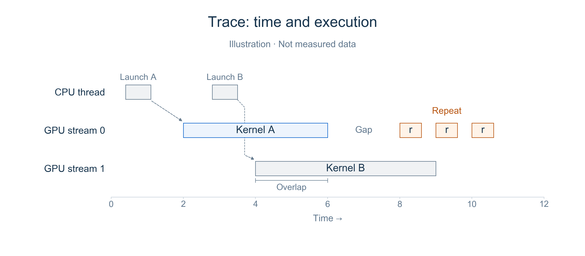
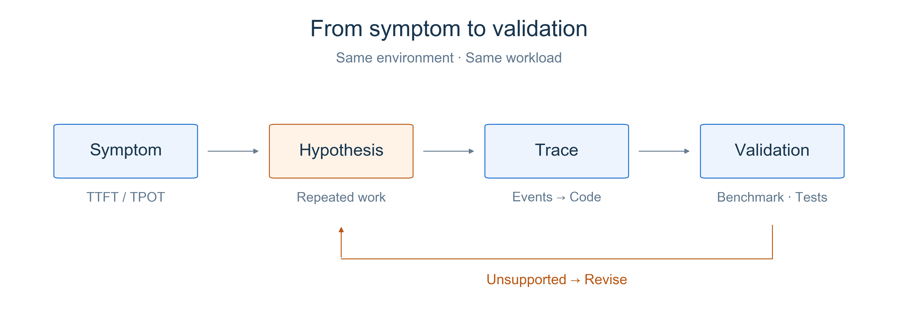
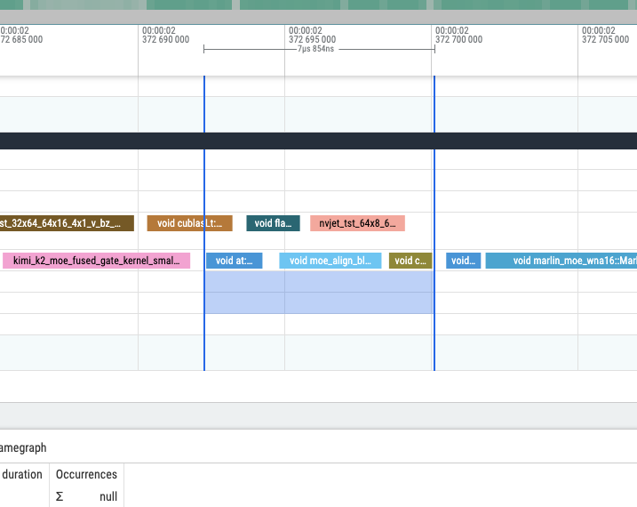
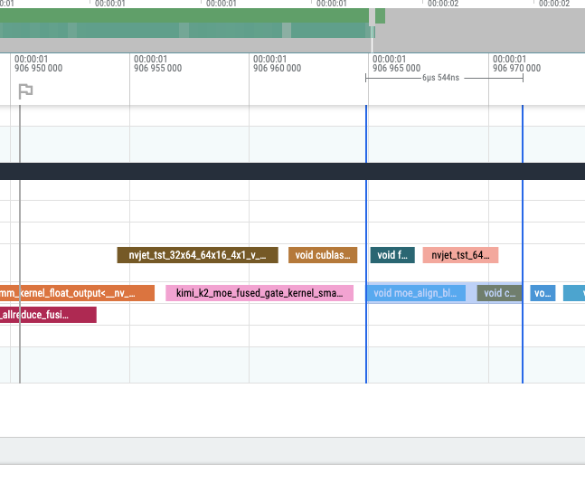

# Chapter 2 Measuring It All: Profiling and Trace Analysis

Previous chapters covered many optimizations, but which ones help in practice depends on the workload. A throughput number alone rarely answers that question.

This chapter first explains how benchmarks, profiling, and traces fit together, then studies merged [PR #13587](https://github.com/sgl-project/sglang/pull/13587), authored by SGLang core maintainer **BBuf**. It lets an existing MoE alignment kernel handle padding, removing a separate GPU kernel. We follow the author's original screenshots, code, and benchmarks to assess the change.

## 1 Learning Objectives

After this chapter, you should be able to answer three questions:

1. What do benchmarks and profiling each tell you, and what should you look for in a trace?
2. How do you turn a symptom into a hypothesis, locate the problem in a real trace, and validate a code change?
3. Why does a roughly 16.7% reduction in local duration produce only about 1% higher end-to-end throughput under some workloads?

## 2 Understand What Profiling Shows

### 2.1 Benchmark Results, Then Investigate the Cause

TTFT, TPOT, and throughput from Part I describe request-level behavior: time to the first token, time per subsequent token, and work completed per unit of time. A benchmark with a fixed workload establishes which metric is slow and whether a change helps. But high TTFT could come from queueing or slow prefill; the metric alone cannot distinguish them.

Profiling records internal execution: which CPU operators run, which GPU kernels execute, and where time is spent. Think of benchmarking as a black-box measurement and profiling as a white-box view of execution. Use them together: establish the symptom with metrics, investigate a hypothesis in the recording, then benchmark the change.

You can use [PyTorch Profiler](https://docs.pytorch.org/tutorials/recipes/recipes/profiler_recipe.html) to capture CPU / GPU events and use Perfetto to open the resulting trace. **The profiler records, the trace contains the recorded data, and the viewer displays it.** Collection adds overhead, so disable profiling for the final performance comparison.

### 2.2 What to Look for in a Trace

A trace is commonly displayed as a timeline: time runs horizontally, tracks represent CPU threads or GPU streams, and each block represents an event whose width shows its duration. CPU operators and GPU kernels describe different levels of execution. GPU work may execute after the CPU submits it, so a CPU block's width is not the GPU computation time.

Start with **long events, frequently repeated events, and gaps between events**. A kernel lasting only a few microseconds can still be worth optimizing if it repeats across many layers and steps. A gap on one stream requires checking other streams, CPU submission, and dependencies before concluding that the entire GPU is idle.

Also check for overlap. Kernels on different streams can overlap in time, so summing every duration does not give request latency. What matters for completion is the execution path that must finish before the result can be returned. Even when a trace shows less work, a benchmark is still needed to confirm an overall improvement.

<div align="center">
  
  <p><em>Figure 1. Teaching illustration, not measured timings. Dashed lines connect CPU submissions to their GPU kernels. Follow one track first, then compare tracks for overlap and gaps.</em></p>
</div>

### 2.3 From Symptom to Hypothesis to Verification

Follow **symptom → hypothesis → trace inspection → change and validation**:

1. **Establish the symptom.** Fix the model, hardware, versions, input/output lengths, and concurrency. Identify whether TTFT, TPOT, or throughput is the concern, and rule out workload changes.
2. **Make a testable hypothesis.** For high TTFT, inspect queueing and prefill. For uneven TPOT, check whether prefill interleaving or other work delays decode. For limited throughput, inspect actual batch sizes, concurrency, and compute / communication waits. Metrics tell you where to start, but do not prove the cause.
3. **Test the hypothesis and the change.** Capture short traces from the same rank and execution phase, then connect suspicious events to code. Focus each change on one problem, verify that the intended overhead decreased, and repeat equivalent benchmarks with profiling disabled. Include correctness checks.

<div align="center">
  
  <p><em>Figure 2. Turn metrics into testable hypotheses, then validate with traces, benchmarks, and correctness checks. Revisit the hypothesis when the evidence does not support it.</em></p>
</div>

BBuf's PR #13587 takes us through this process with a concrete hypothesis: if an existing MoE alignment kernel can also perform padding, can we remove a separate padding kernel?

## 3 Case Study: Removing a Padding Kernel

[PR #13587](https://github.com/sgl-project/sglang/pull/13587) was authored by **BBuf** and merged on 2025-11-21. The official [Kernel maintainer list](https://github.com/sgl-project/sglang/blob/main/.github/MAINTAINER.md#kernel) names him. Part of a Kimi K2 optimization series, the PR changes one shared MoE function and includes additional end-to-end benchmarks on DeepSeek-R1.

After routing tokens to experts, MoE aligns each expert's workload to a multiple of the block size for matrix computation. For example, an expert with three tokens and a block size of four needs one padding slot. That slot contains an invalid-token sentinel that subsequent computation ignores.

Before the change, `moe_align_block_size()` chose between two paths based on buffer size. Small buffers used padding inside the alignment kernel. Buffers larger than 4,096 elements first called `sorted_ids.fill_()`, then ran alignment, adding a separate GPU kernel.

The hypothesis is: **can the existing alignment kernel handle padding on this path too, eliminating the separate fill?** First inspect the author's profiling, then check the code to confirm that necessary padding is preserved.

### 3.1 Read the Author's Original Traces

The PR includes screenshots of main and the PR version and reports a reduction from approximately **7.8μs to 6.5μs** for this local execution segment. Compare the same MoE alignment segment, looking for the separate fill and subsequent alignment rather than comparing the pixel widths of blocks.

In Before, the blue selection starts with an event labeled `void at:...`, followed by `void moe_align_bl...` and another event. In After, the selection starts directly at `void moe_align_bl...`. Names are truncated in the screenshots; the diff below identifies the removed operation as `sorted_ids.fill_()`.

<div align="center">
  
  <p><em>Figure 3a. Before: main. Reproduced directly from <a href="https://github.com/sgl-project/sglang/pull/13587">BBuf's PR #13587</a>, preserving the original pixels and selection. <a href="https://github.com/user-attachments/assets/b9d82fb5-c289-45bc-a6b0-55666b12662b">View original</a>.</em></p>
</div>

<div align="center">
  
  <p><em>Figure 3b. After: PR version. Same source. <a href="https://github.com/user-attachments/assets/589a56b1-e924-4587-ad0e-b1a50f816686">View original</a>.</em></p>
</div>

Think of it this way: **previously, the GPU ran a separate fill before alignment; now the alignment kernel handles the fill as part of its work.** Padding still needs to happen, but it no longer needs its own kernel. Launching and running a kernel has a cost too, so combining this small task with existing work can save time.

In the screenshots, find the row containing `moe_align_bl...`. Before has an extra `void at:...` block ahead of it for the separate fill. That block is gone in After because the alignment kernel now handles the fill internally. Then read the time between the two blue boundaries at the top: 7.854μs Before and 6.544μs After. **The required work still happens, but with one fewer separate execution, this segment takes about 1.3μs less.** That is roughly a 16.7% reduction for this segment. The model performs plenty of other work, so the benchmark below tells us how much faster inference becomes overall.

### 3.2 Read the Code: Let the Existing Kernel Handle Padding

The [merged diff](https://github.com/sgl-project/sglang/commit/bfcf15a129fd4e26ef8d4af140f30cbcf02a6696) is short. This excerpt omits unchanged arguments to focus on path selection:

```python
# Before
fuse_sorted_ids_padding = sorted_ids.shape[0] <= 4096
if not fuse_sorted_ids_padding:
    sorted_ids.fill_(topk_ids.numel())
sgl_moe_align_block_size(..., fuse_sorted_ids_padding)

# After
sgl_moe_align_block_size(..., True)
```

The final argument controls whether the kernel performs padding. Setting it to `True` delegates the separate fill to the existing kernel, removing the Python-side size check and standalone operation.

The buffer is still initialized where needed. The [CUDA implementation at this revision](https://github.com/sgl-project/sglang/blob/bfcf15a129fd4e26ef8d4af140f30cbcf02a6696/sgl-kernel/csrc/moe/moe_align_kernel.cu) fills padding slots with `numel`, the invalid-token sentinel, when `pad_sorted_token_ids` is true. **The separate execution overhead disappears; the required padding remains.**

This connects two pieces of evidence: the trace shows one fewer event, and the code explains where that work went. Without the second check, accidentally skipping necessary work could look like an optimization.

### 3.3 Return to the Benchmark: How Much Does the Service Improve?

In a [benchmark comment](https://github.com/sgl-project/sglang/pull/13587#issuecomment-3558359315), the author tests **DeepSeek-R1 with TP8**, random input and output lengths of 1,000, `random-range-ratio=1`, and five warmup requests per configuration. All reported concurrency levels are retained below. These are the author's results; we did not rerun the GPU experiments.

| Maximum concurrency | Requests | Output throughput: main → PR (token/s) | Change | Mean TPOT: main → PR (ms) |
|---|---:|---:|---:|---:|
| 1 | 5 | 105.806 → 105.542 | −0.25% | 9.067 → 9.164 |
| 4 | 20 | 372.914 → 373.976 | +0.28% | 10.243 → 10.211 |
| 16 | 80 | 1,049.407 → 1,060.126 | +1.02% | 14.590 → 14.482 |
| 32 | 160 | 1,657.395 → 1,675.659 | +1.10% | 18.158 → 18.030 |

**A roughly 16.7% reduction in local duration does not imply 16.7% higher end-to-end throughput.** Alignment is only one part of inference; attention, expert computation, and communication remain. These results show roughly 1% higher throughput at concurrency 16 and 32, with no improvement at concurrency 1. The PR does not report distributions across repeated runs, so these small differences do not establish a stable gain for every workload.

The PR also includes a GSM8K run that actually completed 1,319 questions, reporting accuracy 0.938 and invalid rate 0. This checks model outputs, but without paired main / PR accuracy results it does not establish complete equivalence.

This is a useful example because **the scope is small and the evidence connects to the code**: a separate fill is the target, padding inside an existing kernel is the mechanism, and benchmarks at several concurrency levels define the observed benefit. We can explain what changed, why it may be faster, and what still needs more measurement.

## 4 Summary and Exercises

### 4.1 Summary

Benchmarks establish performance, while profiling helps test the cause. Read traces for durations, repetition, gaps, and execution dependencies.

Start by fixing the environment and workload, establishing the symptom with metrics, and forming a testable hypothesis. Use traces to connect suspicious overhead to code, then focus each change on one problem. After the change, verify both that the target overhead decreased and that the required computation still completes correctly.

Finally, disable profiling, repeat end-to-end benchmarks under the same conditions, and check correctness. A local reduction in duration does not imply a proportional overall speedup. State which workloads benefit, how large the improvement is, and what remains unverified.

### 4.2 Exercises

1. If a benchmark shows higher TTFT, which hypotheses would you form? What trace evidence would help distinguish their causes?
2. Does a gap on one GPU stream mean the entire GPU is idle? Why might a substantial reduction in one kernel's duration fail to produce a proportional end-to-end improvement?
3. How would you design a credible before-and-after comparison? Describe which conditions to hold fixed, when to enable the profiler, and what to check for performance and correctness.

## References

- [BBuf's SGLang PR #13587: original screenshots, code, and test results](https://github.com/sgl-project/sglang/pull/13587)
- [The author's DeepSeek-R1 benchmark](https://github.com/sgl-project/sglang/pull/13587#issuecomment-3558359315)
- [Merge commit: bfcf15a](https://github.com/sgl-project/sglang/commit/bfcf15a129fd4e26ef8d4af140f30cbcf02a6696)
- [SGLang profiling documentation](https://docs.sglang.io/docs/developer_guide/benchmark_and_profiling)
