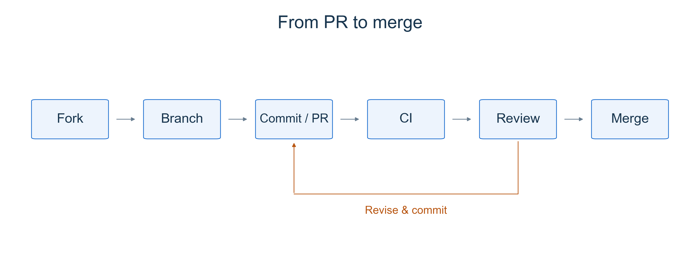

# Chapter 3 SGLang PR Workflow

After working through this course, you may have found an outdated command or a configuration that runs slower than expected. Describing the problem, making a focused change, and validating it can become your first open-source contribution.

This chapter follows a PR from proposal to merge. Beyond Git commands, we will look at why each step exists and how to make a change that maintainers can understand, verify, and maintain.

## 1 Learning Objectives

After completing this chapter, you should be able to answer these questions:

1. What information should you prepare before asking a question or making a change?
2. What problems do forks, branches, CI, and review address?
3. How do you choose a manageable first contribution?

## 2 Working with an Open-Source Community

[Part 0's Coding Ethics and Open-Source Spirit](../part0/Part0-Coding-Ethics-and-Open-Source-Spirit.md) discussed responsibility for code. In everyday collaboration, start with three habits.

**Define a clear problem.** Explain what you want to solve and provide evidence. For performance improvements, profile before and after the change with the same hardware, model, and workload to show the bottleneck and what changed. For a bug, include minimal reproduction steps, relevant logs, the model, GPU, SGLang version or commit, and launch command, along with expected and actual behavior.

**Discuss substantial changes first.** For a feature, interface change, or larger optimization, open an RFC or issue describing the use case, scope, and approach. Discuss the direction with maintainers before implementing it. A typo or clear small fix can usually go straight to a PR without an extra issue.

**Keep the PR's scope limited.** Solve one problem per PR; avoid reformatting an entire file while fixing a scheduler bug. When using AI assistance, the author must still understand the code, validate it, and state what has not been tested. Do not irresponsibly submit agent slop or flood the project with low-quality issues and PRs, creating a DDoS-like burden on maintainers' review time and CI resources.

## 3 The Lifecycle of a PR

Suppose a Cookbook launch command is outdated and you want to fix it. The process looks like this:

  
  
<em>Figure 1. Commits make changes traceable; CI and review check whether they can enter main. Continue revisions on the same branch.</em>

| Step | What you do | What it protects |
|---|---|---|
| Fork | Create a repository copy under your GitHub account | Lets you propose changes without upstream write access |
| Branch | Create a task branch from the latest upstream main | Separates this change from other work |
| Commit and open a PR | Inspect the diff, push your branch, and target upstream `main` | Records what changed, why, and how it was validated |
| CI checks | Run automated checks and read failure logs | Detects errors and regressions that tests can catch |
| Review | Answer questions, supply evidence, and add commits to the same branch | Examines correctness, design choices, and maintenance cost |
| Merge | Obtain required approvals and let maintainers complete the merge | Brings reviewed changes into the shared main branch |

See the [SGLang Contribution Guide](https://docs.sglang.io/docs/developer_guide/contribution_guide) for development setup and checks. Reuse an existing local checkout: inspect the working tree before updating upstream references and creating a branch, so other work remains safe.

### 3.1 Make the PR Understandable

A short description can answer three questions: what was wrong, what changes, and what evidence supports the fix? For the Cookbook example, identify the model and hardware, the failing command, the updated argument, and whether the new command actually launched and returned an answer. If you could not test on a GPU, say so; a documentation build does not validate deployment.

For performance changes, provide before-and-after measurements with the same hardware, model, input and output lengths, and concurrency. Use the previous chapter's profiling methods when needed to explain where time goes. If model outputs can change, include an appropriate accuracy check. Validation should match the change.

Run relevant tests and required formatting checks before opening the PR, then inspect the final diff. Use the current repository templates; the contribution guide describes SGLang's title rules, test locations, and commands.

### 3.2 Iterate Through CI and Review

CI is automated, but not every check runs immediately after a PR opens. SGLang GPU tests have resource and permission constraints; some workflows require the `run-ci` label and an authorized person to trigger them. Follow the contribution guide and ask a maintainer when needed. If a test fails, read the logs and distinguish a code failure from an environment problem before retrying.

When a reviewer comments, explain what changed and what validation you added. If you disagree, use code or measurements to explain the tradeoff. Push revisions to the same branch to update the existing PR. New commits may need fresh tests and review; a green result for an earlier version does not validate the new one.

Passing CI does not guarantee a merge. People still need to assess design and maintenance concerns outside test coverage. Maintainers arrange the merge after the required approvals are in place.

## 4 Choose Your First Contribution

Expand the scope as you become familiar with the project:

| Starting point | A useful contribution |
|---|---|
| Fix documentation | Correct a typo, broken link, or outdated command and check the updated page |
| Improve a Cookbook recipe | Record the model, GPU, version, and configuration you actually ran so others can reproduce it |
| Reproduce and locate a problem | Supply a minimal reproduction and use logs or a profile to narrow the cause, even without a fix |
| Fix a small bug | Explain the cause, make a focused change, and add a regression test that distinguishes the old and new behavior |

Start with [SGLang issues](https://github.com/sgl-project/sglang/issues), the relevant module, and the contribution guide. Documentation contributors can use the [docs contribution instructions](https://github.com/sgl-project/sglang/blob/main/docs/CONTRIBUTING.md); Cookbook recipes also live in the main repository under `docs/cookbook/`. If you are unsure where to begin, describe your reproduction progress in the relevant issue and ask for pointers.

## 5 Summary and Exercises

### 5.1 Summary

A contribution starts with a problem others can understand and reproduce. Make a focused change, provide suitable validation, and use CI and review to bring it into main. A first contribution can be small: preventing the next reader from hitting the same problem is useful work.

### 5.2 Exercises

1. Find a real small issue, search existing discussions, and prepare a PR draft describing the problem, scope, and validation. You can keep it local for self-review; there is no need to submit a meaningless change just to finish the exercise.
2. An optimization is twice as fast after also changing the GPU and shortening the input. Does this prove that the code change helped? How should you proceed if CI has not started?

## References

- [Part 0: Coding Ethics and Open-Source Spirit](../part0/Part0-Coding-Ethics-and-Open-Source-Spirit.md)
- [SGLang: Contribution Guide](https://docs.sglang.io/docs/developer_guide/contribution_guide)
- [SGLang: Documentation Contribution Instructions](https://github.com/sgl-project/sglang/blob/main/docs/CONTRIBUTING.md)
- [SGLang: Documentation and Cookbook Layout](https://github.com/sgl-project/sglang/blob/main/docs/README.md)
- [SGLang: Issues](https://github.com/sgl-project/sglang/issues)
